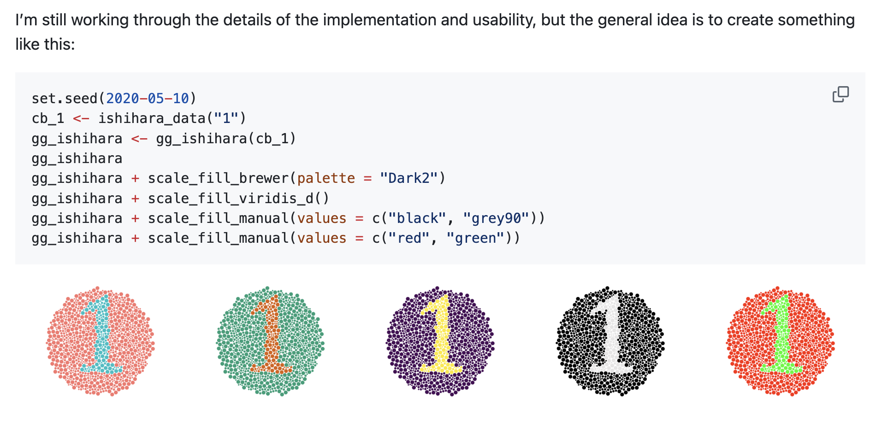
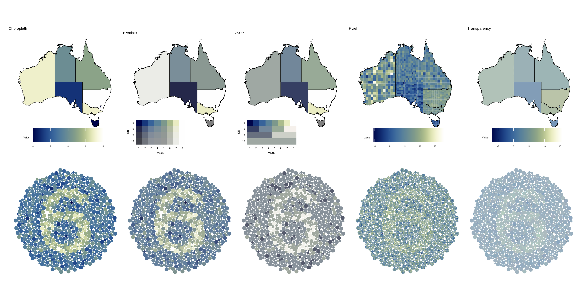

```{r setup}
#| include: false
#| message: false
#| warning: false

library(MASS)
library(tidyverse)
library(ggdibbler)
library(colorspace)
library(sf)
library(ggthemes)
library(distributional)
library(patchwork)
library(kableExtra)
library(ggthemes)
library(ggdist)
library(ggwordcloud)
library(nullabor)
library(shadowtext)
library(flextable)
library(ozmaps)
library(emmeans)
library(broom)
library(lme4)
library(car)
library(janitor)
library(naniar)

# set theme?
# theme_set( theme_gdocs() + 
#              theme(aspect.ratio = 1, 
#                    axis.text.x = element_text(angle = 35, 
#                                               vjust = 1.05, 
#                                               hjust=1),
#                    palette.colour.continuous = gdocs_pal(),
#                    palette.colour.discrete = gdocs_pal(),
#              )
# 3)
gpal <- gdocs_pal()(5)
```


```{r walkremote}
#| eval: false
suburbs <- strayr::read_absmap("suburb2021")
saveRDS(suburbs, file = "data/suburbs.rds")
```

```{r walkdata}
#filtered_walk <- walkathon[which((walkathon$name %in% extra_walk$name)),]
filtered_walk <- walktober

# Read in extra walk and add in suburbs
extra_walk <- read.csv("data/extrawalktober.csv") |>
  mutate(suburb = ifelse(suburb == "Claython north", "Clayton", suburb),
         suburb = ifelse(suburb == "Clayton ", "Clayton", suburb),
         suburb = ifelse(suburb == "Mordi ", "Oakleigh", suburb),
         suburb = ifelse(suburb == "Oakleigh ", "Oakleigh", suburb),
         suburb = ifelse(suburb == "Langwarrin", "Mordialloc", suburb),
         suburb = ifelse(suburb == "Croydon", "Mordialloc", suburb))
#required_subs <- unique(c(extra_walk$suburb))
suburbs <- readRDS("data/suburbs.rds")

my_suburbs <- suburbs |> 
  filter(state_name_2021 == "Victoria") |>
  mutate(suburb_name_2021 = str_remove(suburb_name_2021, " \\(Vic.\\)")) |>
  filter(between(cent_long, 144.8, 145.2),
         between(cent_lat, -38, -37.8)) |>
  #filter(suburb_name_2021 %in% required_subs) |>
  #select(c(suburb_name_2021, geometry)) |>
  rename("suburb" = "suburb_name_2021")

extra_walk <- extra_walk |>
  left_join(my_suburbs, by = "suburb")
# add team colours
extra_walk$team_colour <- c(sequential_hcl(4, palette = "Peach"),
  sequential_hcl(5, palette = "Blues")[1:4],
  sequential_hcl(6, palette = "Reds 3")[2:5],
  sequential_hcl(5, palette = "Greens")[1:4],
  sequential_hcl(4, palette = "Purp"),
  sequential_hcl(8, palette = "Heat")[3:6])

# clean data to just local suburbs
clean_walk <- filtered_walk |>
  left_join(extra_walk, by="name") |>
  mutate(steps_dist = dist_truncated(steps + 0.1*steps*dist_normal(bias_mu, bias_se), 0),
         date = as.Date(date, "%d/%m/%y")) |>
  group_by(name) |>
  mutate(cum_steps = cumsum(steps)) |>
  ungroup() |>
  filter(date <= as.Date("23/10/25", "%d/%m/%y")) |>
  na.omit()
# remove emojis
clean_walk$team <- gsub("\\p{So}", "", clean_walk$team, perl = TRUE)
suburb_walk <- clean_walk |>
  as.tibble() |>
  group_by(suburb) |>
  summarise(mean_steps = mean(steps + 0.1*bias_mu),
            se_steps = mean((steps*0.1)^2*bias_se),
            steps_dist = dist_normal(mean_steps, se_steps)) |> 
  left_join(my_suburbs, by = "suburb") |>
  select(c(suburb, steps_dist, mean_steps, geometry))


```


```{r, setup-part4}

source("code/gen_functions.R") # in render

# load raw theoretical data
load("data/bigpvalues.rda")
load("data/study_data.RData")

h0_true <- study_data |>
  filter(correct_number == "No number visible") |>
  group_by(plot_type) |>
  summarise(alpha = 1- mean(correct),
            n_correct = sum(correct),
            n_reject = sum(!correct))

# make into a compatible format
theory_data_plot <- bigpvalues |>
 mutate(reject = pvalue <= mean(h0_true$alpha)) |>
 filter(drawID<=10) |>
 select(D, V, reject) |>
 mutate(plot_type = "Theoretical")  |>
 rename("correct_original" = reject)
```

# Walktober


## What is walktober? {.smaller}

My department had a walkathon in October where we all competed to see how many steps we could walk each day

{fig-align="center"}

## Data quality angel

::::: columns
::: {.column width="60%"}
{fig-align="center"}
:::

::: {.column width="40%"}
Before the competition started, I searched up the most accurate and cost effective pedometer
:::
:::::

## Pedometer = bad {.smaller}

-   It turns out, pedometers are wildly inaccurate 
{fig-align="center"}


## Data quality demons {.smaller}

::::: columns
:::: {.column width="60%"}
{fig-align="center"}
::::

:::: {.column width="40%"}
::: {.incremental}
-   We conducted a survey after walktober, to see if we could quantify the pedometer error
-   It turns out I was the ONLY person concerned about data quality
-   Turns out the measurement error was the least of my worries
:::
::::
:::::

## Survey response

{fig-align="center"}

## The visualisation challenge {.smaller}
Our department decides to do a visualisation challenge of the walktober data

```{r}
#| fig-height: 4
#| fig-align: center

# Just include map because that is the context of this
ggplot(my_suburbs) +
  geom_sf(data = suburb_walk, aes(geometry= geometry, fill = mean_steps)) +
  geom_sf(aes(geometry= geometry), fill=NA) +
  theme_map() +
  ggtitle("Average steps per day by Melbourne Suburb") + 
  labs(fill = "Average steps per day") +
  scale_fill_continuous_sequential(palette = "Magenta", rev = TRUE)

```

## We frequently have this kind of data! {.smaller}
::: {.incremental}
Distribuion inputs includes cases where we have...

- Unavailable 
  - anonymised data, measurement error, etc.
- Non-deterministic 
  - bounded data, estimated values, etc.
- Theoretical 
  - latent variables, calculations from theory, etc.
- Abstract 
  - based on expert opinion or credibility
  
Also, the world is crawling with people like...
  
:::

## Make this data using distributional {.smaller}

::: {.incremental}
- Include pedometer uncertainty with `distributional`
  - Thank you Mitch, Matt, Alex, and Rob
  - This is not a talk on `distributional`
  
```{r}
clean_walk|> 
  as_tibble() |>
  select(steps_dist, team, name) |>
  head(4) 
```

- Our walktober examples are truncated normal distributions
  - The "prior inference" comes from measurement error (i.e. what is my *true* step count, not the *recorded* step count)
- Now that we know what uncertainty *is* how do we visualise it?
  
:::

## ...Should I just ignore the uncertainty?

::: {.incremental}
- This seems like it is going to be a lot of work
  - But I did all that reading about pedometers!!! 
- Is that the only reason?

::: 

*(image = angel and devil on shoulder)*

## There are people who are too trusting

::: {.incremental}
- So uncertainty should...
  - Communicate confidence [@Correll2018; @Boukhelifa2017]
  - Guide, qualify or soften judgements [@Leland2005]
  
::: 

*(image = me text)*

## There are also people who are not trusting at all

::: {.incremental}

- So uncertainty should...
  - Conveys the legitimacy (or illegitimacy) of conclusions [@Kale2018; @Griethe2006]
  - Communicate validity [@Hullman2020a; @Griethe2006]
  
::: 

*(image = mum text)*


## There are also people who are interested in probabilites

::: {.incremental}

::: 

*(image = alatair text)*


## The "decision making" melting pot
We currently throw these motivations together, but are they the same?
*(image = melting pot)*


## Signal vs noise
::: {.incremental}
- The decision making framework obfuscates two disparate roles uncertainty can take on in our analysis
- Uncertainty as signal: we are interested in uncertainty as a statistic in it's own right
  - e.g. extracting variance or probabilities
- Uncertainty as noise: we are interested in how uncertainty affects our primary estimate
  - e.g. ensuring the signals are valid, preventing false conclusions
  
::: 


## This creates conflict in the literature
::: {.incremental}
- Evaluating uncertainty as signal (when it is supposed to be noise) creates bizzare results in the literature
  - e.g. studies that suggest you shouldn't visualise uncertainty as all
  - e.g. studies that suggest including uncertainty reduces trust or confidence

::: 

*(image = question mark)*

## Existing research is a bit disproportionate...
- This problem is then exacerbated by the fact that most research evaluates uncertainty as signal...
*(image = crushed by rocks)*


## How has this happened?
- There are two ways to evaluate a plot [@Vanderplas2020]

  - Explicit: "What is the spatial correlation in this plot?"
  - Implicit: "Which is the odd one out" (of a lineup protocol)

- If possible, you should do implicit testing

## Problems with explicit tests

1. They evaluate uncertainty as signal
2. They violate the Ratatouille rule

## Problems with explicit tests

1. **They evaluate uncertainty as signal**
2. They violate the Ratatouille rule

## Exploring vs Inference 
- How you instruct someone to look at a plot can literally change what they see
- People are worse at seeing dinosaurs if you give them an explicit task
- Giving a question fundamentally changes the way you interact with the plot
  - Something similar happens with uncertainty

*(image = dinosaur)*


## Evaluating uncertainty as signal
- The signal is not an inherrent feature to the plot
  - Signal is whatever we are drawing inference 
  - It is determined by the question you ask 
- For example, asking "What is the variance of the plot" means you are drawing inference on $\sigma^2$, so $\sigma^2$  is your signal.
  - If $\sigma^2$ was included to create noise, it is now *being evaluated as noise*
- Asking direct questions about variance, turns it into signal


## Measuring signal modulation
- Measuring uncertainty as noise reauires us to measure signal modulation
  - **Signal modulation**: statistical validity translates to perceptual ease
- The higher the variance on an estimate, the harder that estimate is to extract from the plot

{fig-align="center"}


## What do we do?
- Uncertainty is a bit like an optical illusion that you cant see the second you look directly at it
- We need to figure out how to *measure* uncertainty without asking about it *directly*

*(image = find some optical illustion)*

## Can we use, the lineup protocol?
- Usually, yes
- In this case, no
- If a lineup protocol is a hypothesis test, the uncertainty visualisation is a confidence interval
- They are different forms of inference and cannot be used to validate each other


## We only found this out halfway into the study...
{fig-align="center"}


## Problems with explicit tests

1. They evaluate uncertainty as signal
2. **They violate the Ratatouille rule**

## The Ratatouille rule{.smaller}

::::: columns
::: {.column width="65%"}

- "Not everyone can become a great artist, but a great artist can come from anywhere." - Anton Ego (Ratatouille (2007))
- "Not *everyone* need to be able to understand your plot, but a good plot can be understood by *anyone*. - Me (right here, right now)
  - Spatial autocorrelation = what you can understand 
  - Colour blindness = what you can literally see 
- Any child should be able to see the pattern in your plot, even if they can't understand it

:::

::: {.column width="35%"}

{fig-align="center"}

:::
:::::


## We need an explicit evaluation method that...
- Can measure a uncertainty as a latent variable (can't ask about it directly) and
- Could be understood by a child 

## ... Wait 
  
::::: columns
::: {.column width="60%"}

- Um, isn't that just an Ishihara colour blind test?
- Usually the latent variable is colour vision deficiency
- This would work!


:::

::: {.column width="40%"}

{fig-align="center"}

:::
:::::


## A visual hypothesis test
With uncertainty as a latent variable, our Ishihara test should behave like a hypothesis test

{fig-align="center"}

## How would this work exactly?
*Stimuli explain image 1*

## How would this work exactly?
*Stimuli explain image 2*


## The stimuli

- Making Ishihara plates of the choropleth maps is super easy
- Nick Tierney has a package called `ishihara` 

{fig-align="center"}

## The stimuli
Which we use to make Ishihara uncertainty maps




## Borrow power curve analysis {.smaller}

::::: columns
::: {.column width="40%"}
- Power curves can be used to compare hypothesis tests
  - The lineup protocol is often assessed using power curve analysis
- We can do the same thing for our uncertainty visualisations.

:::

::: {.column width="60%"}

{fig-align="center"}

:::
:::::


## Data 
Grid of distance and variance of estimates

::::: columns
::: {.column width="50%"}

```{r}

set.seed(731)
# generate data
D = c(0,1,2,3,4)
V = c(1,2,3,4,5)
Dlab = D
Vlab = V

# make data for plotting
parent_dists <- expand_grid(D, V) |>
  mutate(Background = dist_normal(-0.5*D, 1),
         Number = dist_normal(0.5*D, 1)) |>
    pivot_longer(cols = Background:Number,
               names_to = "group",
               values_to = "dist") 

estimate_dists <- gen_data(D, V, parentV = 1, noiseV = 0, number = 2) |>
  mutate(group = ifelse(group=="out", "Background", "Number")) |>
  group_by(D, V, group) |>
  slice_sample(n = 20) |>
  ungroup() |>
  rename("dist" = "estimate_dist") 

# set colours
pal <- colour("high contrast")(3)[c(2,1)]

# plot distributions
parent_dists |>
  ggplot(aes(xdist = dist, colour = group)) +
  
  # Visualise parent distribution
  stat_slab(scale = 0.3, fill=NA, 
            linewidth=1, alpha=0.5,
            aes(y=-0.35)) +
  geom_hline(yintercept = -0.35, colour = "black") +
  
  # Visualise Estimate Distribution
  stat_slab(data = estimate_dists, normalize = "panels",
             fill=NA, linewidth=0.2, alpha=0.3) + 
  labs(y = "Standard Deviation (V)", x = "Distance (D)") +
  geom_hline(yintercept = 0, colour = "black") +
  
  # Other visual changes
  scale_colour_manual(name = "Group", values = pal) +
  facet_grid(rows = vars(V), cols = vars(D), as.table = FALSE,
             scales = "free", switch = "both") +
  theme_minimal() +
  theme(aspect.ratio = 1, 
        text = element_text(size = 15),
        panel.grid = element_blank(),
        axis.text = element_blank(),
        legend.position = "bottom")

```

:::

::: {.column width="50%"}

```{r}
# make into plot
theory_data_plot |>
 select(D, V, correct_original, plot_type) |>
 ggplot(aes(x=D, y=V))+
 geom_jitter(height=0.3, width=0.3, alpha=0.5, size=0.3,
             aes(colour = correct_original)) +
 theme_bw() +
 theme(legend.position = "bottom",
       legend.direction = "horizontal",
       aspect.ratio=1) +
 labs(x = "Distance (D)",
      y = "Standard Deviation (V)",
      colour = "Correct number selected")

```

:::
:::::


## Our hypothesis?
- i.e. stuff I have been saying with no evidence
  - 1. Choropleth maps and Bivariate value/variance maps are identical 
  - 2. VSUP will do some signal suppression, but not in a way that is mathematically consistent with hypothesis test results
  - 3. Pixel maps and Transparency maps should perform the same


## Significance levels
```{r}
load("data/combined.rda")

studydata_av <- study_data |>
  filter(correct_number == "No number visible") |>
  group_by(plot_type) |>
  summarise(alpha = length(correct[!correct])/length(correct))
p1 <- combined |>
  ggplot() +
  geom_vline(xintercept = 0.05, colour="black", linetype = 2) +
  geom_quasirandom(aes(x = alpha, y = plot_type, colour = plot_type), 
                   alpha=0.01) +
  geom_point(data=studydata_av, aes(x = alpha, 
                                    y = plot_type, 
                                    colour = plot_type), 
             size=4) +
  theme_classic() +
  theme(aspect.ratio = 1,
        legend.position = "none") +
  labs(x = "Significance level",
       y = "") 

p1
```

## Choropleth - data
::::: columns
::: {.column width="50%"}

{fig-align="center"}

:::

::: {.column width="50%"}

```{r}
# make into plot
study_data |>
filter(plot_type == "Choropleth") |>
 select(D, V, correct_original, plot_type) |>
 ggplot(aes(x=D, y=V))+
 geom_jitter(height=0.3, width=0.3, alpha=0.5, size=0.7,
             aes(colour = correct_original)) +
 theme_bw() +
 theme(legend.position = "bottom",
       legend.direction = "horizontal",
       aspect.ratio=1) +
 labs(x = "Distance (D)",
      y = "Standard Deviation (V)",
      colour = "Correct number selected") +
  guides(color = guide_legend(override.aes = list(size = 2, alpha = 1))) 

```

:::
:::::


## Choropleth - power curves

```{r}
#| out-width: 100%
# load simulated models
load("data/glmer_models.rda")
load("data/theoretical_models.rda")
# load("data/average_fit.rda")

name_distance <- function(string) {
  paste0("Distance: \n", string)
}

LINES <- c("T-test" = "longdash", "Moran's I" = "dotdash")

map_type = "Choropleth"
pcol = gpal[1]

glmer_models |>
  filter(!D==0,
         plot_type %in% map_type) |>
  mutate(line_id = interaction(plot_type, id)) |>
  ggplot(aes(x=V,  group = line_id)) +
  geom_line(aes(y = power_random), colour = pcol,
            linewidth=0.3, alpha=0.3) +
  geom_line(data = theoretical_models |>
              filter(!D==0, plot_type %in% map_type) |>
              mutate(line_id = interaction(test, plot_type, correct_number)),
            aes(y=power_random, linetype = test),
            linewidth=0.3, colour = "black") +
  theme(legend.position="top", 
        legend.direction ="horizontal",
        text=element_text(size=10), 
        strip.text.x=element_text(size=8),
        strip.text.y=element_text(size=8),
        legend.text = element_text(size=8)) +
  guides(colour = "none") + 
  facet_wrap(~D, nrow = 1,
             labeller = labeller(D = name_distance)) +
  labs(x = "Standard Deviation", y = "Power",
       linetype = "Classical Test") +
  scale_linetype_manual(values = LINES) 

```


## Bivariate - data
::::: columns
::: {.column width="50%"}

{fig-align="center"}

:::

::: {.column width="50%"}

```{r}
# make into plot
study_data |>
filter(plot_type == "Bivariate") |>
 select(D, V, correct_original, plot_type) |>
 ggplot(aes(x=D, y=V))+
 geom_jitter(height=0.3, width=0.3, alpha=0.5, size=0.7,
             aes(colour = correct_original)) +
 theme_bw() +
 theme(legend.position = "bottom",
       legend.direction = "horizontal",
       aspect.ratio=1) +
 labs(x = "Distance (D)",
      y = "Standard Deviation (V)",
      colour = "Correct number selected") +
  guides(color = guide_legend(override.aes = list(size = 2, alpha = 1))) 

```

:::
:::::

## Bivariate - power curves

```{r}
#| out-width: 100%
map_type = "Bivariate"
pcol = gpal[2]

glmer_models |>
  filter(!D==0,
         plot_type %in% map_type) |>
  mutate(line_id = interaction(plot_type, id)) |>
  ggplot(aes(x=V,  group = line_id)) +
  geom_line(aes(y = power_random), colour = pcol,
            linewidth=0.3, alpha=0.3) +
  geom_line(data = theoretical_models |>
              filter(!D==0, plot_type %in% map_type) |>
              mutate(line_id = interaction(test, plot_type, correct_number)),
            aes(y=power_random, linetype = test),
            linewidth=0.3, colour = "black") +
  theme(legend.position="top", 
        legend.direction ="horizontal",
        text=element_text(size=10), 
        strip.text.x=element_text(size=8),
        strip.text.y=element_text(size=8),
        legend.text = element_text(size=8)) +
  guides(colour = "none") + 
  facet_wrap(~D, nrow = 1,
             labeller = labeller(D = name_distance)) +
  labs(x = "Standard Deviation", y = "Power",
       linetype = "Classical Test") +
  scale_linetype_manual(values = LINES) 

```


## VSUP - data

::::: columns
::: {.column width="50%"}

{fig-align="center"}

:::

::: {.column width="50%"}

```{r}
# make into plot
study_data |>
filter(plot_type == "VSUP") |>
 select(D, V, correct_original, plot_type) |>
 ggplot(aes(x=D, y=V))+
 geom_jitter(height=0.3, width=0.3, alpha=0.5, size=0.7,
             aes(colour = correct_original)) +
 theme_bw() +
 theme(legend.position = "bottom",
       legend.direction = "horizontal",
       aspect.ratio=1) +
 labs(x = "Distance (D)",
      y = "Standard Deviation (V)",
      colour = "Correct number selected") +
  guides(color = guide_legend(override.aes = list(size = 2, alpha = 1))) 

```

:::
:::::


## VSUP - power curves

```{r}
#| out-width: 100%
map_type = "VSUP"
pcol = gpal[3]

glmer_models |>
  filter(!D==0,
         plot_type %in% map_type) |>
  mutate(line_id = interaction(plot_type, id)) |>
  ggplot(aes(x=V,  group = line_id)) +
  geom_line(aes(y = power_random), colour = pcol,
            linewidth=0.3, alpha=0.3) +
  geom_line(data = theoretical_models |>
              filter(!D==0, plot_type %in% map_type) |>
              mutate(line_id = interaction(test, plot_type, correct_number)),
            aes(y=power_random, linetype = test),
            linewidth=0.3, colour = "black") +
  theme(legend.position="top", 
        legend.direction ="horizontal",
        text=element_text(size=10), 
        strip.text.x=element_text(size=8),
        strip.text.y=element_text(size=8),
        legend.text = element_text(size=8)) +
  guides(colour = "none") + 
  facet_wrap(~D, nrow = 1,
             labeller = labeller(D = name_distance)) +
  labs(x = "Standard Deviation", y = "Power",
       linetype = "Classical Test") +
  scale_linetype_manual(values = LINES) 

```

## Pixel - data

::::: columns
::: {.column width="50%"}

{fig-align="center"}

:::

::: {.column width="50%"}

```{r}
# make into plot
study_data |>
filter(plot_type == "Pixel") |>
 select(D, V, correct_original, plot_type) |>
 ggplot(aes(x=D, y=V))+
 geom_jitter(height=0.3, width=0.3, alpha=0.5, size=0.7,
             aes(colour = correct_original)) +
 theme_bw() +
 theme(legend.position = "bottom",
       legend.direction = "horizontal",
       aspect.ratio=1) +
 labs(x = "Distance (D)",
      y = "Standard Deviation (V)",
      colour = "Correct number selected") +
  guides(color = guide_legend(override.aes = list(size = 2, alpha = 1))) 

```

:::
:::::

## Pixel - power curves

```{r}
#| out-width: 100%
map_type = "Pixel"
pcol = gpal[4]

glmer_models |>
  filter(!D==0,
         plot_type %in% map_type) |>
  mutate(line_id = interaction(plot_type, id)) |>
  ggplot(aes(x=V,  group = line_id)) +
  geom_line(aes(y = power_random), colour = pcol,
            linewidth=0.3, alpha=0.3) +
  geom_line(data = theoretical_models |>
              filter(!D==0, plot_type %in% map_type) |>
              mutate(line_id = interaction(test, plot_type, correct_number)),
            aes(y=power_random, linetype = test),
            linewidth=0.3, colour = "black") +
  theme(legend.position="top", 
        legend.direction ="horizontal",
        text=element_text(size=10), 
        strip.text.x=element_text(size=8),
        strip.text.y=element_text(size=8),
        legend.text = element_text(size=8)) +
  guides(colour = "none") + 
  facet_wrap(~D, nrow = 1,
             labeller = labeller(D = name_distance)) +
  labs(x = "Standard Deviation", y = "Power",
       linetype = "Classical Test") +
  scale_linetype_manual(values = LINES) 

```

## Transparency - data


::::: columns
::: {.column width="50%"}

{fig-align="center"}

:::

::: {.column width="50%"}

```{r}
# make into plot
study_data |>
filter(plot_type == "Transparency") |>
 select(D, V, correct_original, plot_type) |>
 ggplot(aes(x=D, y=V))+
 geom_jitter(height=0.3, width=0.3, alpha=0.5, size=0.7,
             aes(colour = correct_original)) +
 theme_bw() +
 theme(legend.position = "bottom",
       legend.direction = "horizontal",
       aspect.ratio=1) +
 labs(x = "Distance (D)",
      y = "Standard Deviation (V)",
      colour = "Correct number selected") +
  guides(color = guide_legend(override.aes = list(size = 2, alpha = 1))) 

```

:::
:::::

## Transparency - power curves
```{r}
#| out-width: 100%
map_type = "Transparency"
pcol = gpal[4]

glmer_models |>
  filter(!D==0,
         plot_type %in% map_type) |>
  mutate(line_id = interaction(plot_type, id)) |>
  ggplot(aes(x=V,  group = line_id)) +
  geom_line(aes(y = power_random), colour = pcol,
            linewidth=0.3, alpha=0.3) +
  geom_line(data = theoretical_models |>
              filter(!D==0, plot_type %in% map_type) |>
              mutate(line_id = interaction(test, plot_type, correct_number)),
            aes(y=power_random, linetype = test),
            linewidth=0.3, colour = "black") +
  theme(legend.position="top", 
        legend.direction ="horizontal",
        text=element_text(size=10), 
        strip.text.x=element_text(size=8),
        strip.text.y=element_text(size=8),
        legend.text = element_text(size=8)) +
  guides(colour = "none") + 
  facet_wrap(~D, nrow = 1,
             labeller = labeller(D = name_distance)) +
  labs(x = "Standard Deviation", y = "Power",
       linetype = "Classical Test") +
  scale_linetype_manual(values = LINES) 

```


## To sum up?
- I was right, never verify your claims, they will just prove what you already thought based on vibes


# Conclusion


## Acknowledgements
-   My supervisors: Di Cook, Susan Vanderplas, and Sarah Goodwin
-   Good ideas: Mitch O'Hara-Wild, Cynthia Huang, Emily Robbinson
-   AEMO Zema Energy Scholarship
-   Australian RTP Stipend
-   Numbat Hackathon (for the walktober data)

## References
