```{r setup}
#| include: false
#| message: false
#| warning: false

library(MASS)
library(tidyverse)
library(ggdibbler)
library(colorspace)
library(sf)
library(ggthemes)
library(distributional)
library(patchwork)
library(kableExtra)
library(ggthemes)
library(ggdist)
library(ggwordcloud)
library(nullabor)
library(shadowtext)
library(flextable)
library(ozmaps)
library(emmeans)
library(broom)
library(lme4)
library(car)
library(janitor)
library(naniar)
library(datasauRus)
library(tidygraph)
library(ggraph)

# set theme?
# theme_set( theme_gdocs() + 
#              theme(aspect.ratio = 1, 
#                    axis.text.x = element_text(angle = 35, 
#                                               vjust = 1.05, 
#                                               hjust=1),
#                    palette.colour.continuous = gdocs_pal(),
#                    palette.colour.discrete = gdocs_pal(),
#              )
# 3)
gpal <- gdocs_pal()(5)
```


```{r walkremote}
#| eval: false
suburbs <- strayr::read_absmap("suburb2021")
saveRDS(suburbs, file = "data/suburbs.rds")
```

```{r walkdata}
#filtered_walk <- walkathon[which((walkathon$name %in% extra_walk$name)),]
filtered_walk <- walktober

# Read in extra walk and add in suburbs
extra_walk <- read.csv("data/extrawalktober.csv") |>
  mutate(suburb = ifelse(suburb == "Claython north", "Clayton", suburb),
         suburb = ifelse(suburb == "Clayton ", "Clayton", suburb),
         suburb = ifelse(suburb == "Mordi ", "Oakleigh", suburb),
         suburb = ifelse(suburb == "Oakleigh ", "Oakleigh", suburb),
         suburb = ifelse(suburb == "Langwarrin", "Mordialloc", suburb),
         suburb = ifelse(suburb == "Croydon", "Mordialloc", suburb))
#required_subs <- unique(c(extra_walk$suburb))
suburbs <- readRDS("data/suburbs.rds")

my_suburbs <- suburbs |> 
  filter(state_name_2021 == "Victoria") |>
  mutate(suburb_name_2021 = str_remove(suburb_name_2021, " \\(Vic.\\)")) |>
  filter(between(cent_long, 144.8, 145.2),
         between(cent_lat, -38, -37.8)) |>
  #filter(suburb_name_2021 %in% required_subs) |>
  #select(c(suburb_name_2021, geometry)) |>
  rename("suburb" = "suburb_name_2021")

extra_walk <- extra_walk |>
  left_join(my_suburbs, by = "suburb")
# add team colours
extra_walk$team_colour <- c(sequential_hcl(4, palette = "Peach"),
  sequential_hcl(5, palette = "Blues")[1:4],
  sequential_hcl(6, palette = "Reds 3")[2:5],
  sequential_hcl(5, palette = "Greens")[1:4],
  sequential_hcl(4, palette = "Purp"),
  sequential_hcl(8, palette = "Heat")[3:6])

# clean data to just local suburbs
clean_walk <- filtered_walk |>
  left_join(extra_walk, by="name") |>
  mutate(steps_dist = dist_truncated(steps + 0.1*steps*dist_normal(bias_mu, bias_se), 0),
         date = as.Date(date, "%d/%m/%y")) |>
  group_by(name) |>
  mutate(cum_steps = cumsum(steps)) |>
  ungroup() |>
  filter(date <= as.Date("23/10/25", "%d/%m/%y")) |>
  na.omit()
# remove emojis
clean_walk$team <- gsub("\\p{So}", "", clean_walk$team, perl = TRUE)
suburb_walk <- clean_walk |>
  as.tibble() |>
  group_by(suburb) |>
  summarise(mean_steps = mean(steps + 0.1*bias_mu),
            se_steps = mean((steps*0.1)^2*bias_se),
            steps_dist = dist_normal(mean_steps, se_steps)) |> 
  left_join(my_suburbs, by = "suburb") |>
  select(c(suburb, steps_dist, mean_steps, geometry))


```


```{r, setup-part4}

source("code/gen_functions.R") # in render

# load raw theoretical data
load("data/bigpvalues.rda")
load("data/study_data.RData")

h0_true <- study_data |>
  filter(correct_number == "No number visible") |>
  group_by(plot_type) |>
  summarise(alpha = 1- mean(correct),
            n_correct = sum(correct),
            n_reject = sum(!correct))

# make into a compatible format
theory_data_plot <- bigpvalues |>
 mutate(reject = pvalue <= mean(h0_true$alpha)) |>
 filter(drawID<=10) |>
 select(D, V, reject) |>
 mutate(plot_type = "Theoretical")  |>
 rename("correct_original" = reject)
```

# Walktober


## What is walktober? {.smaller}

My department had a walkathon in October where we all competed to see how many steps we could walk each day

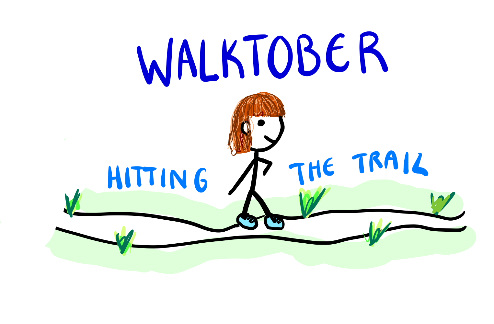{fig-align="center"}

## Data quality angel

::::: columns
::: {.column width="60%"}
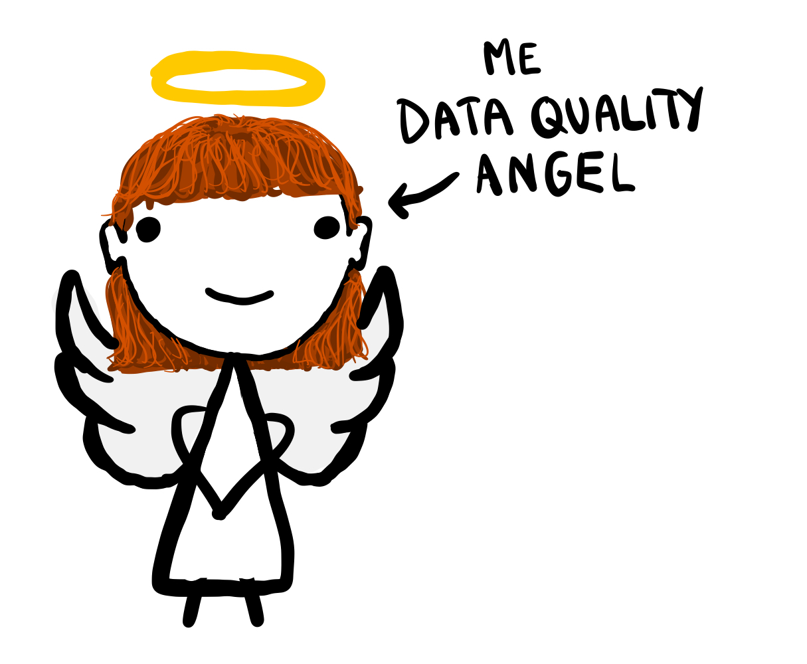{fig-align="center"}
:::

::: {.column width="40%"}
Before the competition started, I searched up the most accurate and cost effective pedometer
:::
:::::

## Pedometer = bad {.smaller}

-   It turns out, pedometers are wildly inaccurate 
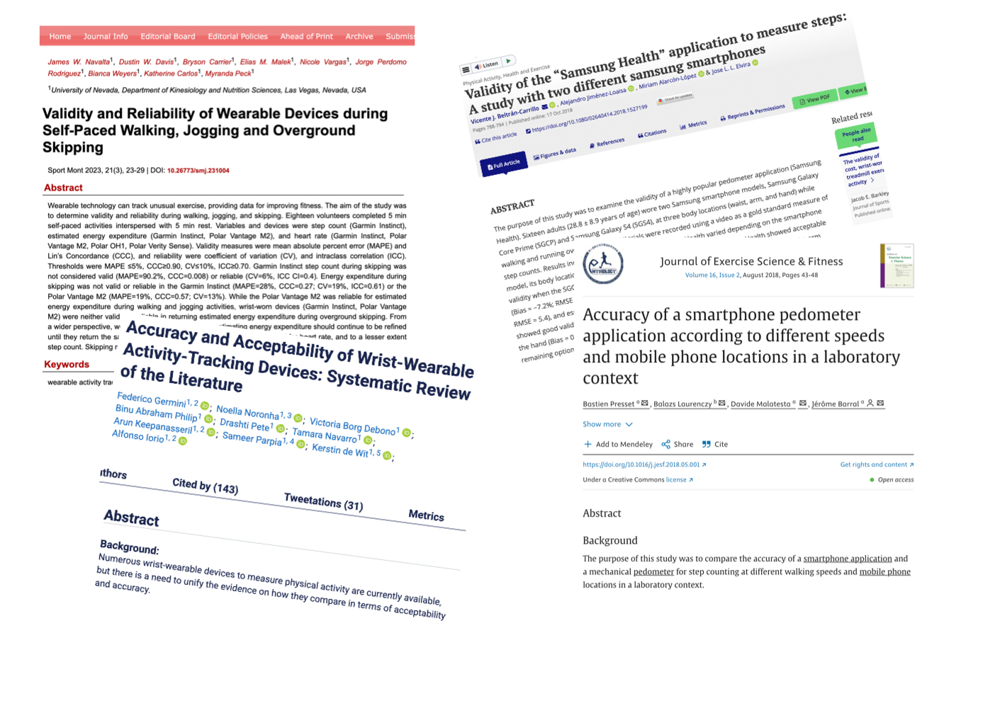{fig-align="center"}


## Data quality demons {.smaller}

::::: columns
:::: {.column width="60%"}
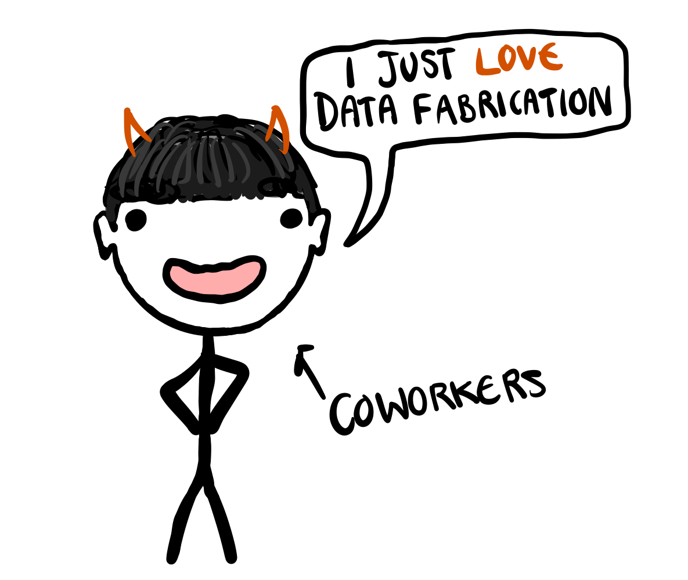{fig-align="center"}
::::

:::: {.column width="40%"}
::: {.incremental}
-   We conducted a survey after walktober, to see if we could quantify the pedometer error
-   It turns out I was the ONLY person concerned about data quality
-   Turns out the measurement error was the least of my worries
:::
::::
:::::

## Survey response

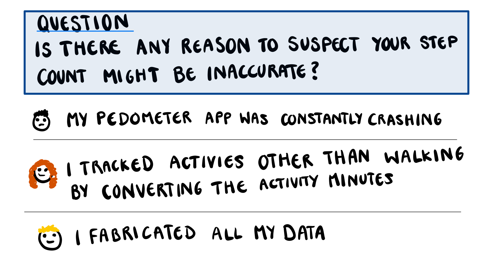{fig-align="center"}

## The visualisation challenge {.smaller}
Our department decides to do a visualisation challenge of the walktober data

```{r}
#| fig-height: 4
#| fig-align: center

# Just include map because that is the context of this
ggplot(my_suburbs) +
  geom_sf(data = suburb_walk, aes(geometry= geometry, fill = mean_steps)) +
  geom_sf(aes(geometry= geometry), fill=NA) +
  theme_map() +
  ggtitle("Average steps per day by Melbourne Suburb") + 
  labs(fill = "Average steps per day") +
  scale_fill_continuous_sequential(palette = "Magenta", rev = TRUE)

```

## We frequently have this kind of data! {.smaller}
::: {.incremental}
Distribuion inputs includes cases where we have...

- Unavailable 
  - anonymised data, measurement error, etc.
- Non-deterministic 
  - bounded data, estimated values, etc.
- Theoretical 
  - latent variables, calculations from theory, etc.
- Abstract 
  - based on expert opinion or credibility
  
Also, the world is crawling with people like...
  
:::

## Make this data using distributional {.smaller}

::: {.incremental}
- Include pedometer uncertainty with `distributional`
  - Thank you Mitch, Matt, Alex, and Rob
  - This is not a talk on `distributional`
  
```{r}
clean_walk|> 
  as_tibble() |>
  select(steps_dist, team, name) |>
  head(4) 
```

- Our walktober examples are truncated normal distributions
  - The "prior inference" comes from measurement error (i.e. what is my *true* step count, not the *recorded* step count)
- Now that we know what uncertainty *is* how do we visualise it?
  
:::

## ...Should I just ignore the uncertainty?

::::: columns
::: {.column width="65%"}

:::: {.incremental}
- Including the uncertainty seems like it might be annoying
- But which uncertainty visualisation is best?
- And what are the benefits to including uncertainty?

:::: 

:::

::: {.column width="35%"}

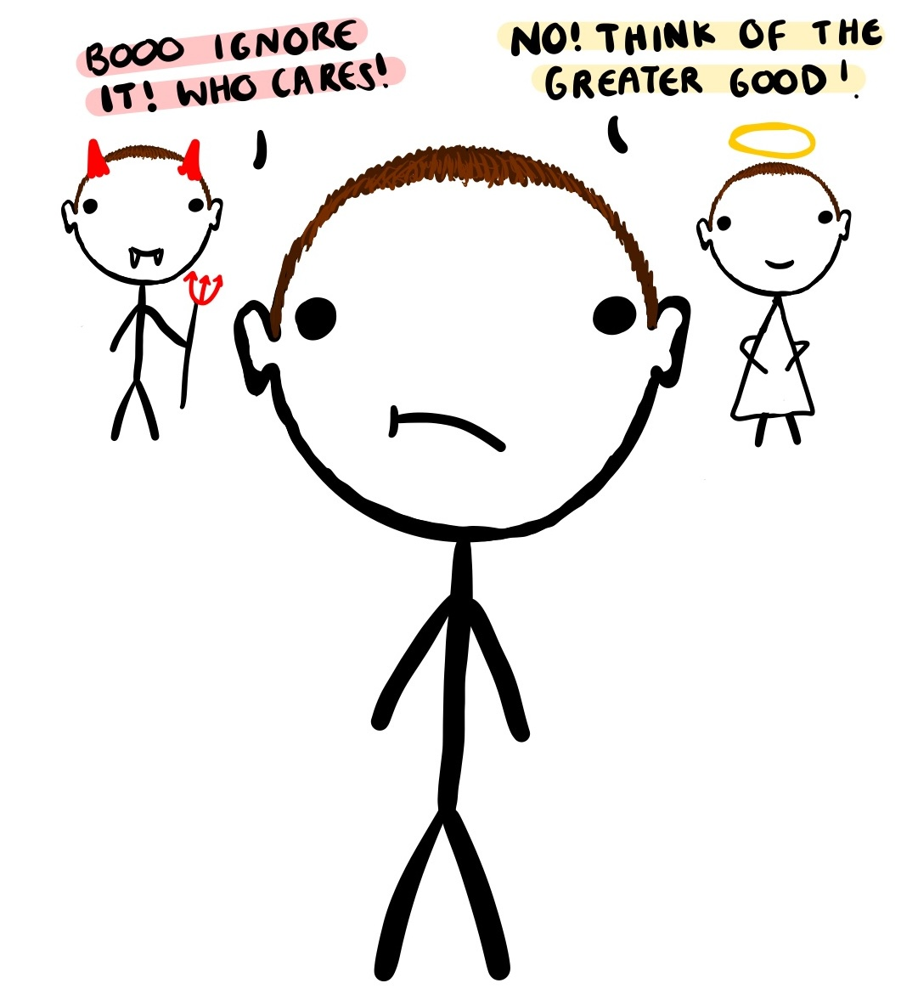{fig-align="center"}

:::
:::::


## There are people who are too trusting

::::: columns
::: {.column width="35%"}

{fig-align="center"}

:::

::: {.column width="65%"}

:::: {.incremental}
- So uncertainty can...
  - Communicate confidence [@Correll2018; @Boukhelifa2017]
  - Guide, qualify or soften judgements [@Leland2005]
  
:::: 

:::
:::::


*(image = me text)*

## There are also people who are not trusting at all

::::: columns
::: {.column width="35%"}

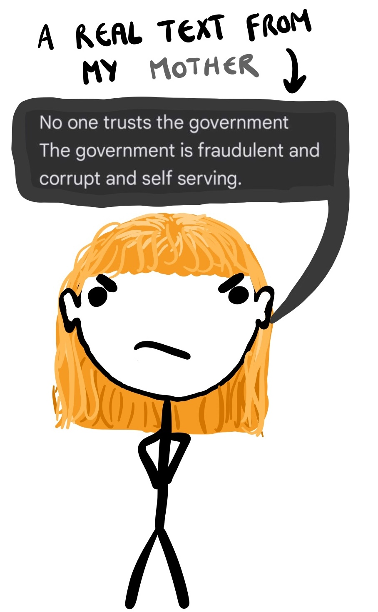{fig-align="center"}

:::

::: {.column width="65%"}

:::: {.incremental}

- So uncertainty can...
  - Convey the legitimacy (or illegitimacy) of conclusions [@Kale2018; @Griethe2006]
  - Communicate validity [@Hullman2020a; @Griethe2006]
  
:::: 

:::
:::::


## There are also people who are interested in probabilities

::::: columns
::: {.column width="35%"}

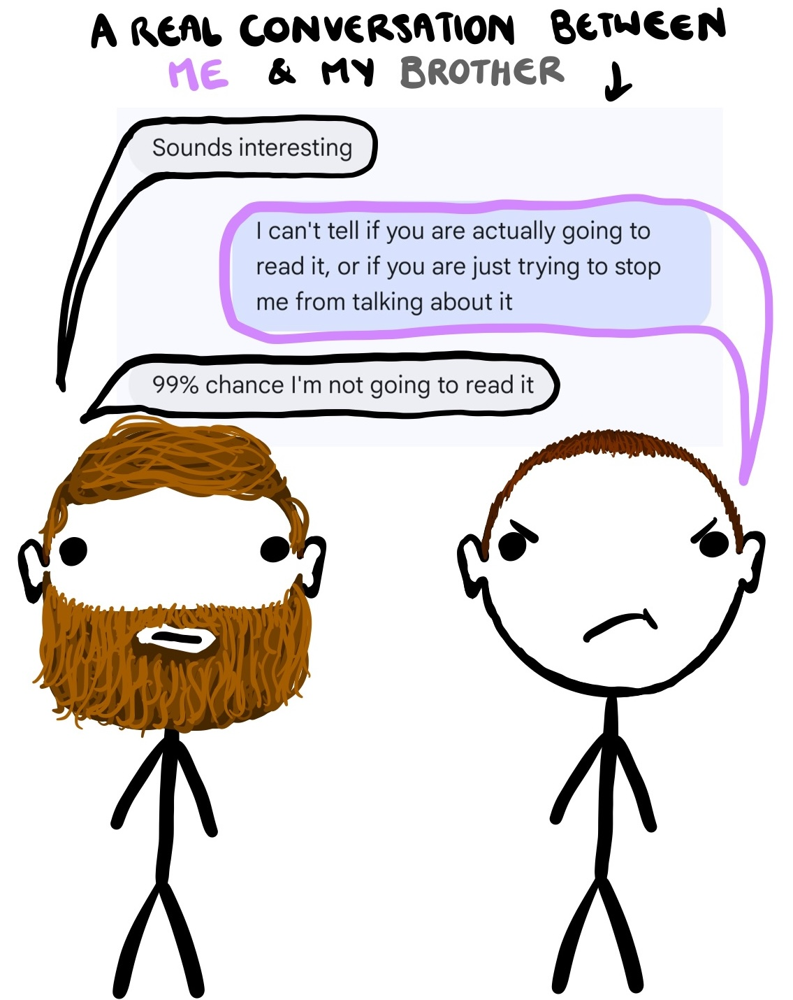{fig-align="center"}

:::

::: {.column width="65%"}

:::: {.incremental}
- So uncertainty can...
  - also be a variable of interest, in and of itself [@Blenkinsop2000; @geointerviews]

:::: 

:::
:::::


## Into the melting pot
Our current "decision making" framework throws these motivations together, but are they all the same?

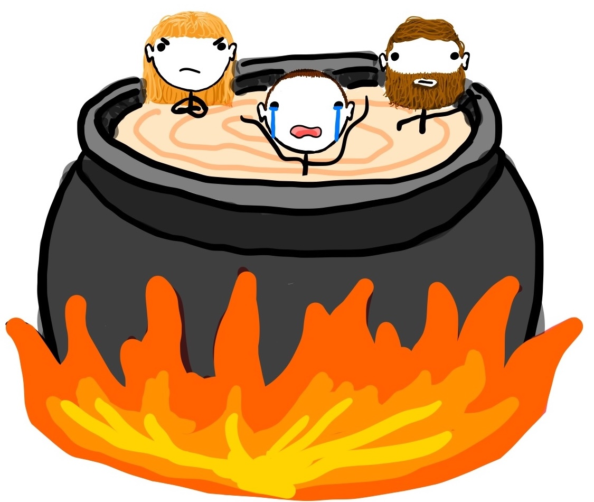{fig-align="center"}


## Signal vs noise
::: {.incremental}
- The decision making framework obfuscates two disparate roles uncertainty can take on in our analysis
- Uncertainty as signal: we are interested in uncertainty as a statistic in it's own right
  - e.g. extracting variance or probabilities
- Uncertainty as noise: we are interested in how uncertainty affects our primary estimate
  - e.g. ensuring the signals are valid, preventing false conclusions
  
::: 


## This creates conflict in the literature
::::: columns
::: {.column width="35%"}

{fig-align="center"}

:::

::: {.column width="65%"}

:::: {.incremental}
- Evaluating uncertainty as signal (when it is supposed to be noise) creates bizzare results in the literature
  - e.g. reviews that **questions if you should visualise uncertainty as all** [@MacEachren2005]
  - e.g. studies that suggest **ignoring uncertainty** in high variance scenarios **improves trust** [@Zhao2023]
  
:::: 

:::
:::::

## Existing research is a bit disproportionate...
Most research evaluates uncertainty as signal which discourages effective signal modulation approaches [@Mason2026]

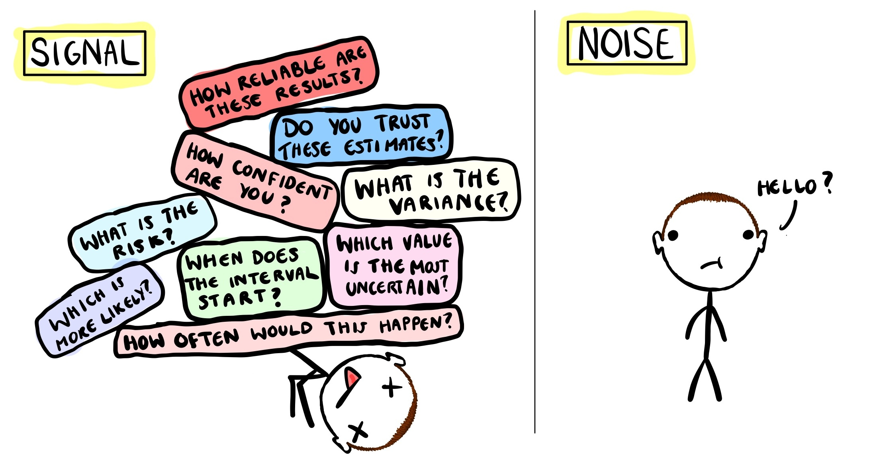{fig-align="center"}


## My problem is noise

::::: columns
::: {.column width="35%"}

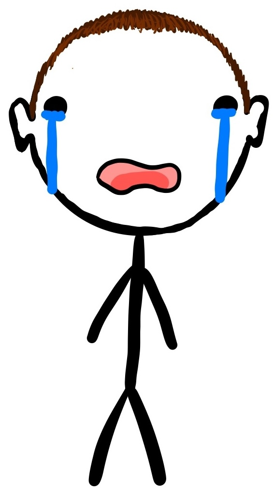{fig-align="center"}

:::

::: {.column width="65%"}

:::: {.incremental}
- I am mostly concerned about being scammed
- I want to visualise uncertainty as noise but I have no idea which approach works best
- I will need to work out 
  1. Why don't we evaluate uncertainty as noise?
  2. Can I design an experiment that will evaluate uncertainty as noise?
  
:::: 

:::
:::::

# How to evaluate uncertainty as noise?


## Why is it all signal?

::::: columns
::: {.column width="50%"}

:::: {.incremental}

- Existing research uses explicit testing methods
- There are two ways to evaluate a plot [@Vanderplas2020]
  - Explicit: User is directed to the purpose of the plot with a question
    - e.g. "What is the spatial correlation in this plot?"
  - Implicit: User must identify the purpose of the plot
    - "Identify the odd one out" (e.g. a lineup protocol [@Buja2009])
  
:::: 


:::

::: {.column width="50%"}

```{r}
#| fig-height: 5
#| fig-width: 5
#| fig-align: center


# Generate true data from lineup protocol
data(wasps)

wasp.lda <- lda(Group~., data=wasps[,-1])
wasp.ld <- predict(wasp.lda, dimen=2)$x
true <- data.frame(wasp.ld, Group=wasps$Group)

# Generate lineup protocol plot
wasp.sim <- data.frame(LD1=NULL, LD2=NULL, Group=NULL, .n=NULL)
for (i in 1:19) {
  x <- wasps
  x$Group <- sample(x$Group)
  x.lda <- lda(Group~., data=x[,-1])
  x.ld <- predict(x.lda, dimen=2)$x
  sim <- data.frame(x.ld, Group=x$Group, .n=i)
  wasp.sim <- rbind(wasp.sim, sim)
}

pos <- sample(1:20, 1)
d <- lineup(true=true, samples=wasp.sim, pos=pos)

ggplot(d, aes(x=LD1, y=LD2, colour=Group)) + 
  facet_wrap(~.sample, ncol=5) +
  geom_point() + 
  theme_minimal() +
  theme(aspect.ratio=1,
        legend.position = "bottom") +
  scale_color_gdocs()
```

:::
:::::

## Explicit tests create problems for us

1. They evaluate uncertainty as signal
2. They violate the Ratatouille rule

## Explicit tests create problems for us

1. **They evaluate uncertainty as signal**
2. They violate the Ratatouille rule

## Exploring versus Inference 
::::: columns
::: {.column width="50%"}

:::: {.incremental}

- The reason someone is engaging with a plot can change what they see
  - e.g. people are worse at seeing dinosaurs if you give them an explicit task [@Boger2021]
- A similar problem occurs in uncertainty visualisation
  
:::: 


:::

::: {.column width="50%"}

```{r}
#| fig-height: 5
#| fig-width: 5
#| fig-align: center

ggplot(datasaurus_dozen_wide, aes(x = dino_x, y = dino_y))+
  geom_point(colour = "steelblue") +
  labs(x = "X", y = "Y") +
  theme_classic() +
  theme(aspect.ratio=1)
```

:::
:::::


## Evaluating uncertainty as signal
:::: {.incremental}

- The signal is not an inherent feature of the plot
- Signal is whatever we are drawing inference on
  - It is determined by the question you ask 
- Asking direct questions about variance, probability, or trust turn the uncertainty into signal
  - For example, asking "What is the variance of the plot" means you are drawing inference on $\sigma^2$, so $\sigma^2$  is your signal.
  - *Irrespective of your intentions* in including $\sigma^2$ in the plot, it is now being *evaluated as signal*

  
:::: 


## Can we use, the lineup protocol?

::::: columns
::: {.column width="55%"}

:::: {.incremental}

- Usually, yes. For uncertainty visualisation? No
- Think of it like this
  - a lineup protocol is a visual hypothesis test
  - an uncertainty visualisation is a generalised visual confidence interval
- They are different forms of inference and cannot be used to validate each other
  - *The details as to why are prickly, so we leave them for the paper*
  
:::: 

:::

::: {.column width="45%"}

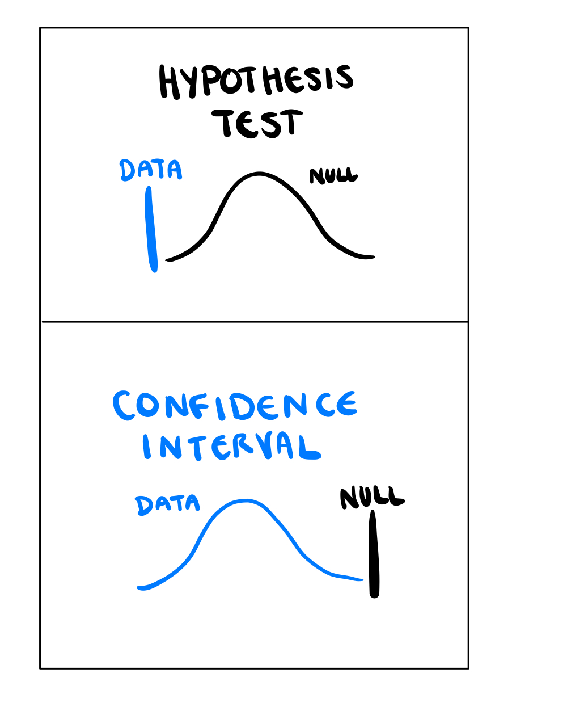{fig-align="center"}

:::
:::::


## We only realised this out halfway into the study...
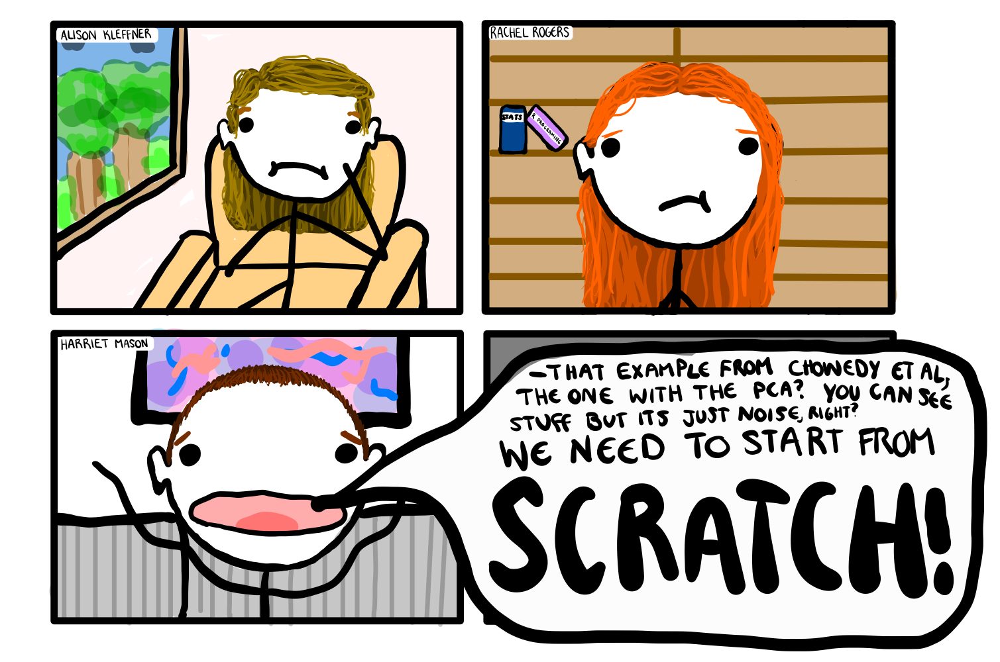{fig-align="center"}

## So what does evaluating uncertainty as noise look like?
::::: columns
::: {.column width="55%"}

:::: {.incremental}
- Confidence intervals do not have the null built in, they require a question or null to be provided
  - This explains why all existing studies use explicit methods
- To avoid evaluating uncertainty as signal, our question can *ONLY* be about the estimate
- Evaluate plots on how well they perform **signal modulation**
  - Signal modulation: statistical validity translates to perceptual ease
  - The higher the variance on an estimate, the harder that estimate is to extract from the plot
- Measuring signal modulation is how we will measure uncertainty as a latent variable 
  - i.e. without asking about it *directly* 

:::: 

:::

::: {.column width="45%"}

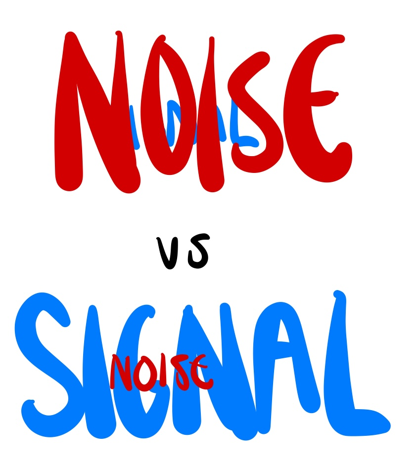{fig-align="center"}

:::
:::::


## Problems with explicit tests

1. They evaluate uncertainty as signal
2. **They violate the Ratatouille rule**

## The Ratatouille rule{.smaller}

::::: columns
::: {.column width="65%"}

:::: {.incremental}

- "Not everyone can become a great artist, but a great artist can come from anywhere." - Anton Ego (Ratatouille (2007))
- "Not *everyone* need to be able to understand your plot, but a good plot can be understood by *anyone*. - Me (right here, right now)
  - Spatial autocorrelation = what you can understand 
  - Colour blindness = what you can literally see 
- This is the main benefit of the lineup protocol
  - It avoids conflating  *understanding* with *seeing*

:::: 


:::

::: {.column width="35%"}

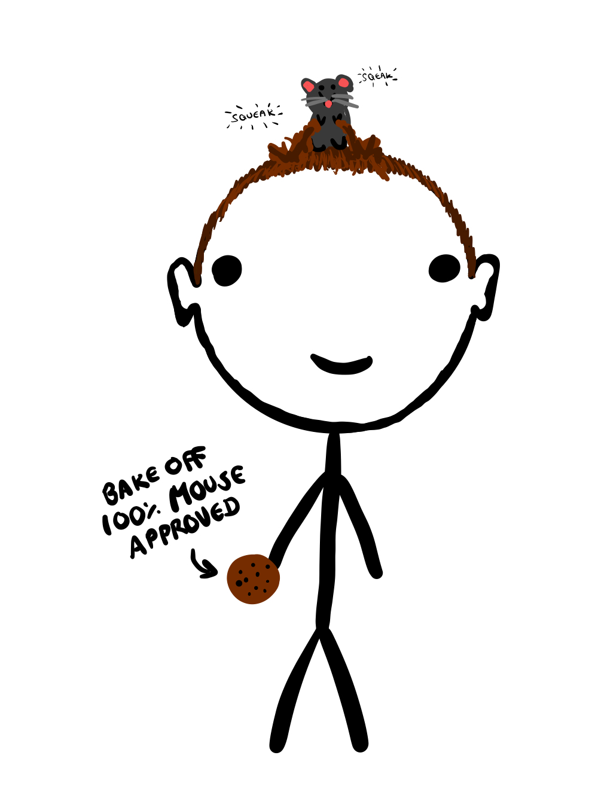{fig-align="center"}

:::
:::::


## Therefore we want an evaluation method that can...
:::: {.incremental}

- Works for choropleth maps 
  - (my walktober plot)
- Measures uncertainty as a latent variable 
  - (by using signal modulation)
- Is simple enough that it could be understood by a child 
  - (so we evaluate seeing, not understanding)

:::: 


## ... Wait 
  
::::: columns
::: {.column width="60%"}
:::: {.incremental}
- Um, isn't that just an Ishihara colour blind test?
- Usually the latent variable is colour vision deficiency

::::

:::

::: {.column width="40%"}

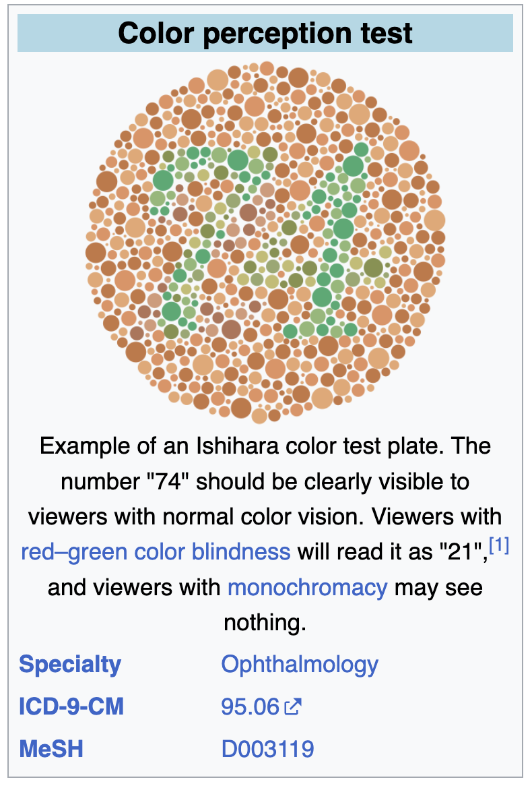{fig-align="center"}

:::
:::::


## A visual hypothesis test
With uncertainty as a latent variable, our Ishihara test should behave like a hypothesis test

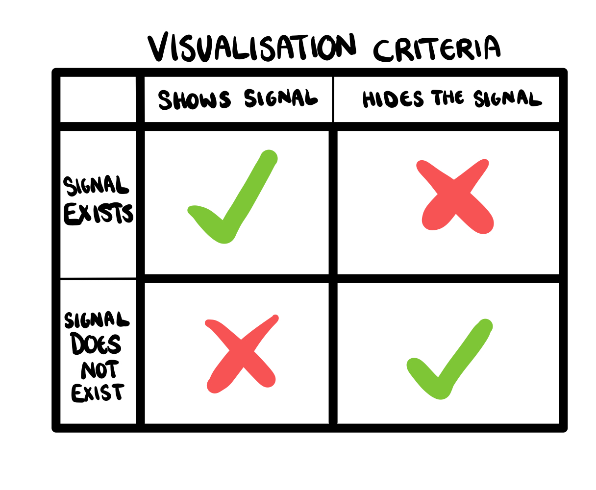{fig-align="center"}

## Borrow power curve analysis {.smaller}

::::: columns
::: {.column width="40%"}
- Power curves can be used to compare hypothesis tests
  - The lineup protocol is often assessed using power curve analysis
- We can do the same thing for our uncertainty visualisations.
- As the variance increases, we would expect the number to be harder to see

:::

::: {.column width="60%"}

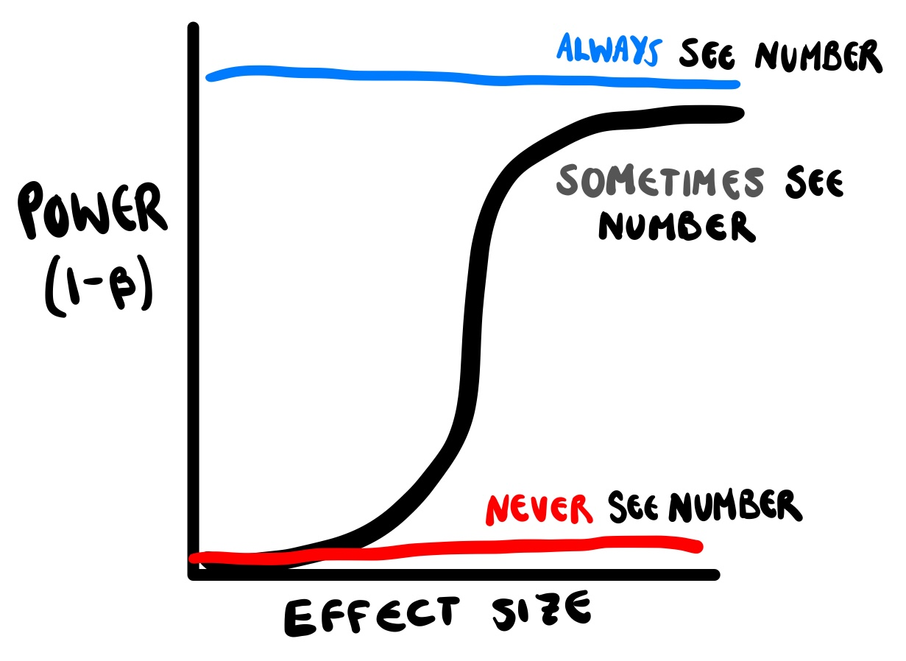{fig-align="center"}

:::
:::::


## How would this work exactly?

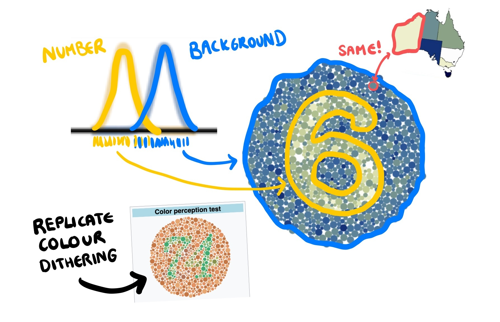{fig-align="center"}

## How would this work exactly?
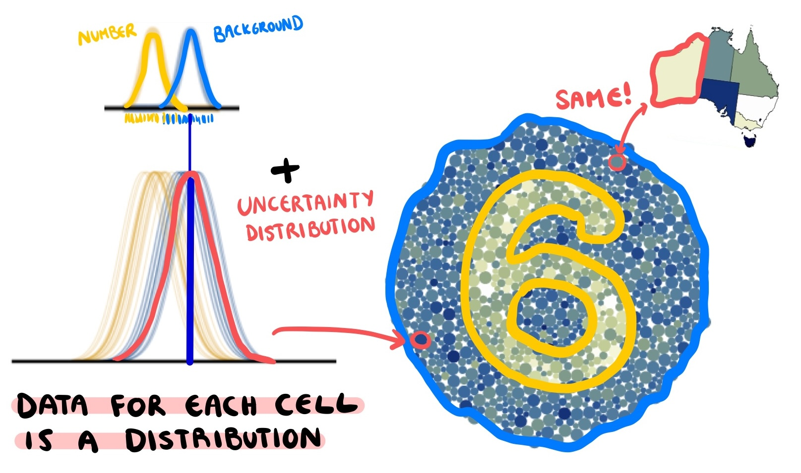{fig-align="center"}


## Assess this grid of distributions
Grid of distance and variance of estimates

::::: columns
::: {.column width="50%"}

```{r}

set.seed(731)
# generate data
D = c(0,1,2,3,4)
V = c(1,2,3,4,5)
Dlab = D
Vlab = V

# make data for plotting
parent_dists <- expand_grid(D, V) |>
  mutate(Background = dist_normal(-0.5*D, 1),
         Number = dist_normal(0.5*D, 1)) |>
    pivot_longer(cols = Background:Number,
               names_to = "group",
               values_to = "dist") 

estimate_dists <- gen_data(D, V, parentV = 1, noiseV = 0, number = 2) |>
  mutate(group = ifelse(group=="out", "Background", "Number")) |>
  group_by(D, V, group) |>
  slice_sample(n = 20) |>
  ungroup() |>
  rename("dist" = "estimate_dist") 

# set colours
pal <- colour("high contrast")(3)[c(2,1)]

# plot distributions
parent_dists |>
  ggplot(aes(xdist = dist, colour = group)) +
  
  # Visualise parent distribution
  stat_slab(scale = 0.3, fill=NA, 
            linewidth=1, alpha=0.5,
            aes(y=-0.35)) +
  geom_hline(yintercept = -0.35, colour = "black") +
  
  # Visualise Estimate Distribution
  stat_slab(data = estimate_dists, normalize = "panels",
             fill=NA, linewidth=0.2, alpha=0.3) + 
  labs(y = "Standard Deviation (V)", x = "Distance (D)") +
  geom_hline(yintercept = 0, colour = "black") +
  
  # Other visual changes
  scale_colour_manual(name = "Group", values = pal) +
  facet_grid(rows = vars(V), cols = vars(D), as.table = FALSE,
             scales = "free", switch = "both") +
  theme_minimal() +
  theme(aspect.ratio = 1, 
        text = element_text(size = 15),
        panel.grid = element_blank(),
        axis.text = element_blank(),
        legend.position = "bottom")

```

:::

::: {.column width="50%"}

```{r}
# make into plot
theory_data_plot |>
 select(D, V, correct_original, plot_type) |>
 ggplot(aes(x=D, y=V))+
 geom_jitter(height=0.3, width=0.3, alpha=0.5, size=0.3,
             aes(colour = correct_original)) +
 theme_bw() +
 theme(legend.position = "bottom",
       legend.direction = "horizontal",
       aspect.ratio=1) +
 scale_colour_discrete(palette = "dark2") +
 labs(x = "Distance (D)",
      y = "Standard Deviation (V)",
      colour = "Correct number selected")

```

:::
:::::

## Theoretical power curves
```{r}
#| out-width: 100%
# load simulated models
load("data/glmer_models.rda")
load("data/theoretical_models.rda")
# load("data/average_fit.rda")

name_distance <- function(string) {
  paste0("Distance: \n", string)
}

LINES <- c("T-test" = "longdash", "Moran's I" = "dotdash")


theoretical_models |>
  filter(!D==0, plot_type %in% map_type) |>
  mutate(line_id = interaction(test, plot_type, correct_number)) |>
  ggplot(aes(x=V, y=power_random, group = line_id, linetype = test)) +
  geom_line(linewidth=0.3, colour = "black") +
  theme_minimal()+
  theme(legend.position="top", 
        legend.direction ="horizontal",
        text=element_text(size=10), 
        strip.text.x=element_text(size=8),
        strip.text.y=element_text(size=8),
        legend.text = element_text(size=8)) +
  guides(colour = "none") + 
  facet_wrap(~D, nrow = 1,
             labeller = labeller(D = name_distance)) +
  labs(x = "Standard Deviation", y = "Power",
       linetype = "Classical Test") +
  scale_linetype_manual(values = LINES) 

```


# Which plots?

## The choropleth map
::::: columns
::: {.column width="50%"}


:::

::: {.column width="50%"}
 
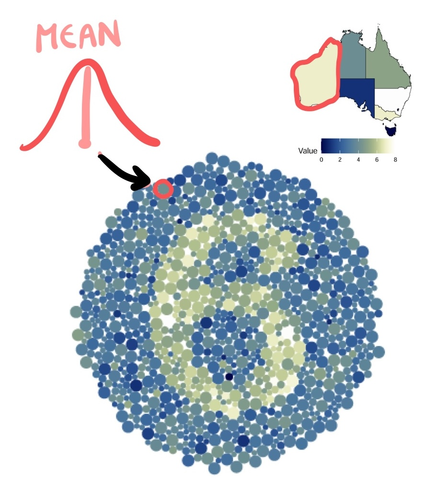

:::
:::::


## The bivariate palette map
::::: columns
::: {.column width="50%"}


:::

::: {.column width="50%"}
 
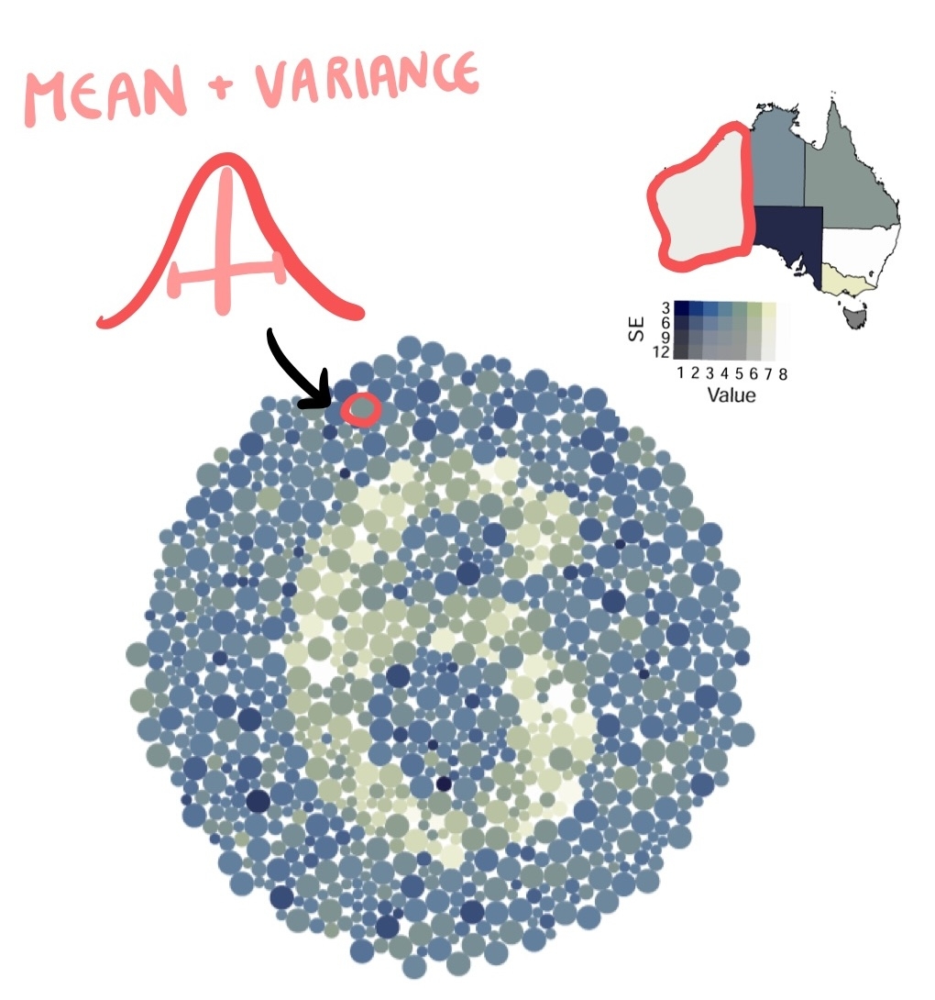

:::
:::::

## The VSUP map
::::: columns
::: {.column width="50%"}


:::

::: {.column width="50%"}
 
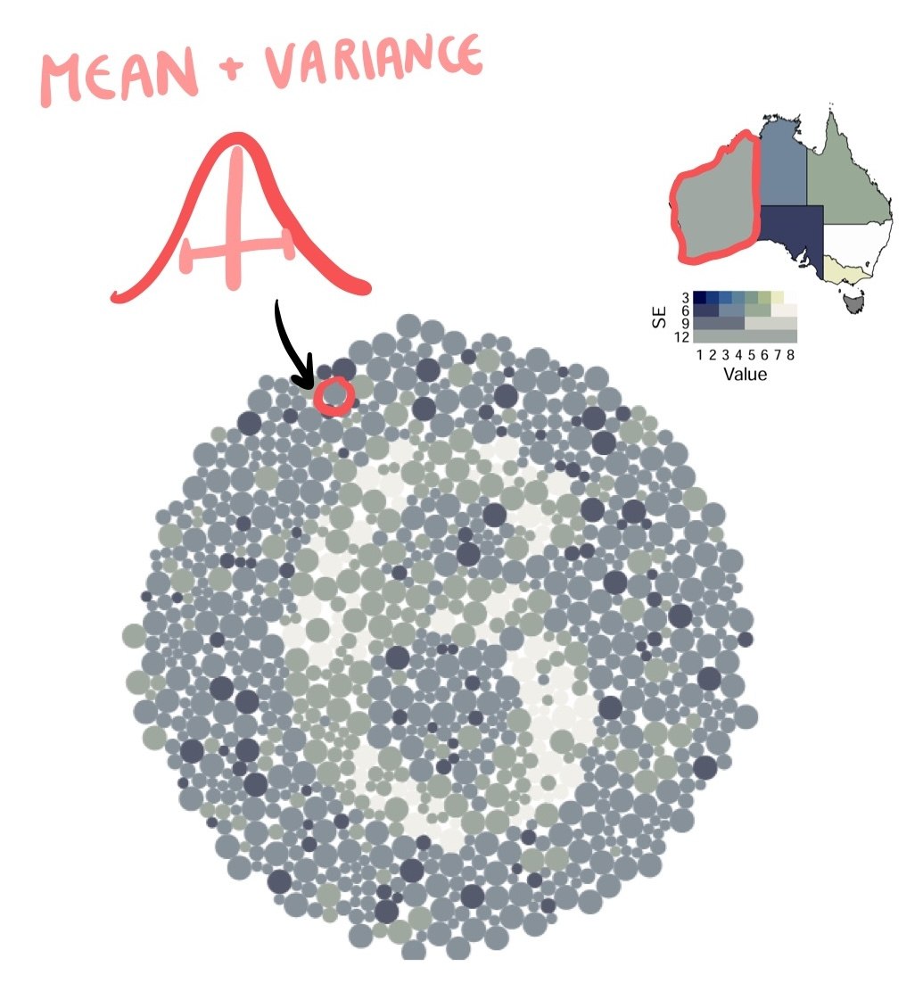

:::
:::::


## The pixel map
::::: columns
::: {.column width="50%"}


:::

::: {.column width="50%"}
 
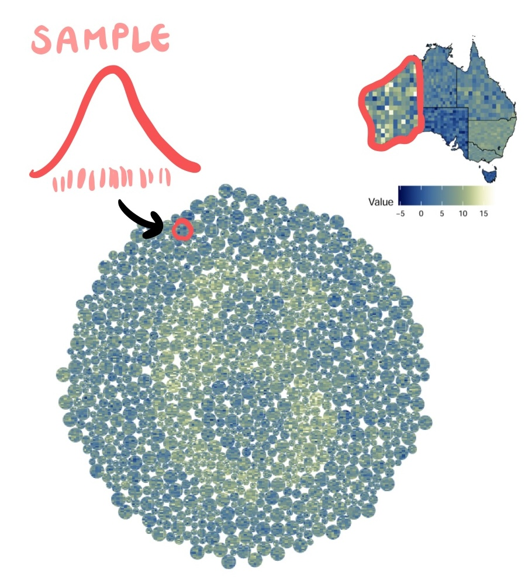

:::
:::::


## The transparency map
::::: columns
::: {.column width="50%"}


:::

::: {.column width="50%"}
 
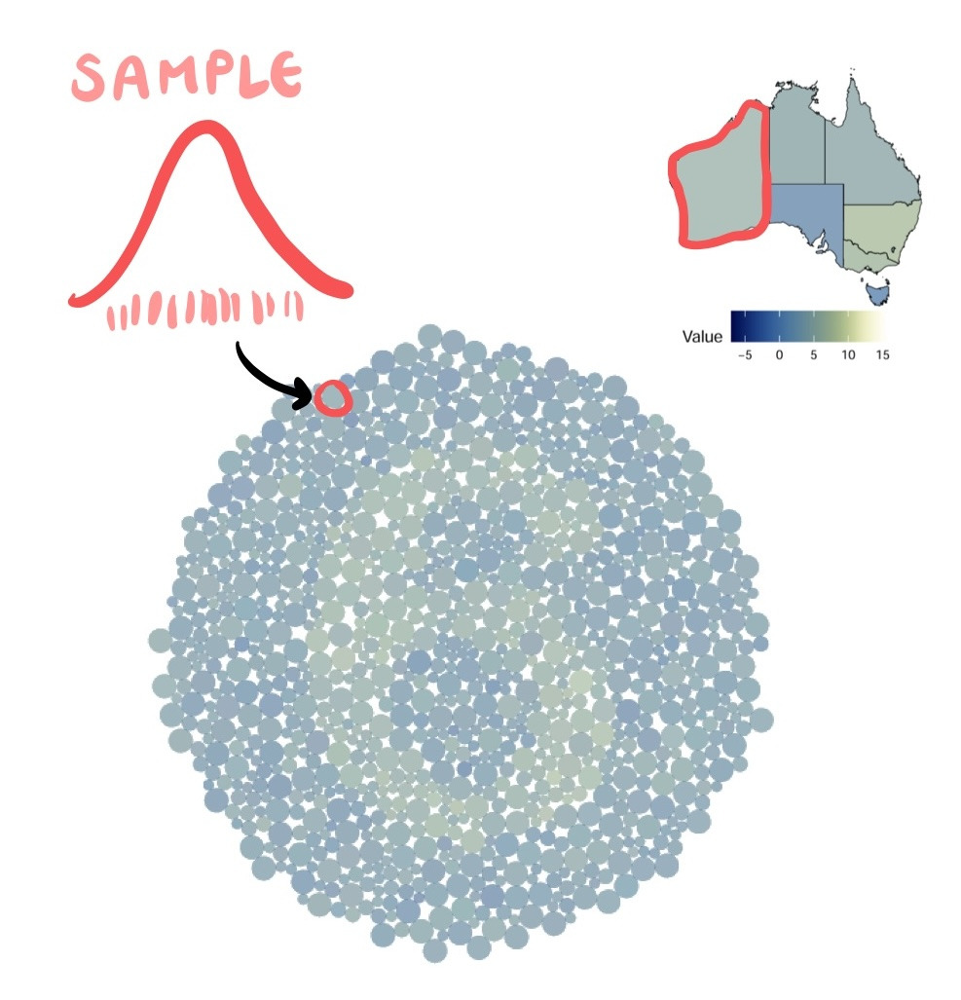

:::
:::::

## Aside on `ggdibbler`
A generalised uncertainty visualisation framework

```{r}
#| label: fig-illustration
#| fig-align: center
#| fig-height: 8
#| fig-width: 15
#| out-width: 90%
#| fig-pos: "t"
#| dev: "png"

set.seed(10)
# any data edits
# GRAPH DF
uncertain_edges <- tibble::tibble(from = sample(5, 20, TRUE),
                                  to = sample(5, 20, TRUE),
                                  weight = runif(20)) |>
  dplyr::group_by(from, to) |>
  dplyr::mutate(to = distributional::dist_sample(list(sample(seq(from=max(1,to-1), 
                                                                 to = min(to+1, 5)), 
                                                             replace = TRUE)))) |>
  ungroup()
graph_sample <- uncertain_edges |>
  sample_expand(times=50) |>
  as_tbl_graph()
jitter = position_jitter(width=0.03, height=0.03)

# geom_sf data
Aust_map <- ozmap_data(data = "states", quiet = TRUE) |>
  group_by(NAME) |>
  mutate(value = dist_normal(mu = rnorm(1, 30, 10), rexp(1, 0.3))) |>
  ungroup()


ppie <- ggplot(uncertain_mpg, aes(x="")) +
  geom_bar_sample(aes(fill = class), times = 50, alpha=1.2/50,
                  position = "stack_identity",
                  width = 1)+
  theme_void() +
  scale_fill_gdocs() +
  coord_polar(theta = "y") +
  theme(legend.position="none",
        aspect.ratio=1) +
  ggtitle("b. pie chart")

psf <- ggplot(data = Aust_map, aes(geometry = geometry, fill = value)) + 
  geom_sf_sample(times = 300, linewidth = 0) +
  #theme_void() +
  theme_map() +
  theme(legend.position="none") +
  geom_sf(fill = NA, linewidth = 0.5, colour = "black") +
  scale_fill_acton() + 
  scale_x_continuous_distribution(limits = c(111,155)) +
  ggtitle("d. choropleth map")

pgraph <- ggraph(graph_sample, weights = weight) + 
  geom_edge_link(aes(group=drawID), position=jitter, alpha=0.01, 
                 colour = "#cc3311") + 
  theme_void() +
  theme(aspect.ratio = 1) +
  geom_node_point(size=3) +
  theme(aspect.ratio = 1, legend.position="none") +
  ggtitle("f. network diagram")

pcount <- ggplot(uncertain_mpg, aes(cty, hwy)) +
  geom_count_sample(alpha=0.05, times=30, colour = "#FD9A44") +
  theme_few() +
  theme(aspect.ratio = 1, legend.position="none") +
  ggtitle("e. bubble chart")

phist <- ggplot(smaller_uncertain_diamonds, aes(carat, fill = cut)) +
  geom_histogram_sample(position="stack_dodge", alpha=1, times=30) +
  theme_few() +
  scale_fill_discreterainbow() +
  theme(aspect.ratio = 1, legend.position="none") +
  ggtitle("c. histogram")

pline <- ggplot(mtcars, aes(wt, mpg)) + 
  geom_abline_sample(intercept = dist_normal(37, 1.8), colour = "#9970AB",
                     slope = dist_normal(-5, 0.56), 
                     times=30, alpha=0.5) +
  geom_point(colour = "black") + 
  theme_few() +
  theme(aspect.ratio=1, legend.position = "none") +
  ggtitle("a. line plot")

pline +  ppie + phist + psf  + pcount + pgraph 
```

## Mathematical findings of `ggdibbler`
According to the formalisation, the information in the pixel and transparency map should be the same

```{r}

p1 <- ggplot(uncertain_mpg, aes(class)) + 
  geom_bar_sample(aes(fill = drv),
                  position = "stack_dodge")+
  theme_void() +
  theme(legend.position="none", aspect.ratio=1)+
  scale_fill_discrete_sequential(palette = "viridis") +
  ggtitle("Pixelation")

p2 <- ggplot(uncertain_mpg, aes(class)) + 
  geom_bar_sample(aes(fill = drv), alpha=0.15,
                  position = "stack_identity")+
  theme_void() +
  theme(legend.position="none", aspect.ratio=1)+
  scale_fill_discrete_sequential(palette = "viridis") +
  ggtitle("Transparency")


p1 | p2

```

## The transparency map
::::: columns
::: {.column width="50%"}


:::

::: {.column width="50%"}
 


:::
:::::

## Hypothesis
:::: {.incremental}

This stimuli design leads to three hypothesis

1. The Choropleth and Bivariate maps will have *no signal modulation*
2. The VSUP map *will have signal modulation*, but not in a way that is statistically sensible 
2. The pixel and transparency maps will be the same in how well they perform *signal modulation* and should *align with standard hypothesis tests*

::::

# Results


## Choropleth - data
::::: columns
::: {.column width="50%"}

{fig-align="center"}

:::

::: {.column width="50%"}

```{r}
# make into plot
study_data |>
filter(plot_type == "Choropleth") |>
 select(D, V, correct_original, plot_type) |>
 ggplot(aes(x=D, y=V))+
 geom_jitter(height=0.3, width=0.3, alpha=0.5, size=0.7,
             aes(colour = correct_original)) +
 theme_bw() +
 theme(legend.position = "bottom",
       legend.direction = "horizontal",
       aspect.ratio=1) +
 scale_colour_discrete(palette = "dark2") +
 labs(x = "Distance (D)",
      y = "Standard Deviation (V)",
      colour = "Correct number selected") +
  guides(color = guide_legend(override.aes = list(size = 2, alpha = 1))) 

```

:::
:::::


## Choropleth - power curves

```{r}
#| out-width: 100%

map_type = "Choropleth"
pcol = gpal[1]

glmer_models |>
  filter(!D==0,
         plot_type %in% map_type) |>
  mutate(line_id = interaction(plot_type, id)) |>
  ggplot(aes(x=V,  group = line_id)) +
  geom_line(aes(y = power_random), colour = pcol,
            linewidth=0.3, alpha=0.3) +
  geom_line(data = theoretical_models |>
              filter(!D==0, plot_type %in% map_type) |>
              mutate(line_id = interaction(test, plot_type, correct_number)),
            aes(y=power_random, linetype = test),
            linewidth=0.3, colour = "black") +
  theme_minimal()+
  theme(legend.position="top", 
        legend.direction ="horizontal",
        text=element_text(size=10), 
        strip.text.x=element_text(size=8),
        strip.text.y=element_text(size=8),
        legend.text = element_text(size=8)) +
  guides(colour = "none") + 
  facet_wrap(~D, nrow = 1,
             labeller = labeller(D = name_distance)) +
  labs(x = "Standard Deviation", y = "Power",
       linetype = "Classical Test") +
  scale_linetype_manual(values = LINES) 

```


## Bivariate - data
::::: columns
::: {.column width="50%"}

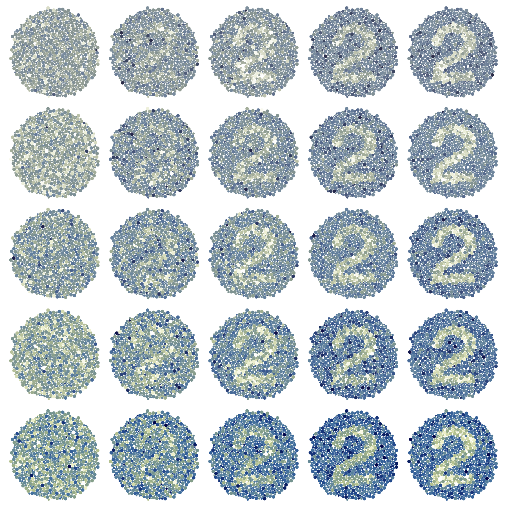{fig-align="center"}

:::

::: {.column width="50%"}

```{r}
# make into plot
study_data |>
filter(plot_type == "Bivariate") |>
 select(D, V, correct_original, plot_type) |>
 ggplot(aes(x=D, y=V))+
 geom_jitter(height=0.3, width=0.3, alpha=0.5, size=0.7,
             aes(colour = correct_original)) +
 theme_bw() +
  scale_colour_discrete(palette = "dark2") +
 theme(legend.position = "bottom",
       legend.direction = "horizontal",
       aspect.ratio=1) +
 labs(x = "Distance (D)",
      y = "Standard Deviation (V)",
      colour = "Correct number selected") +
  guides(color = guide_legend(override.aes = list(size = 2, alpha = 1))) 

```

:::
:::::

## Bivariate - power curves

```{r}
#| out-width: 100%
map_type = "Bivariate"
pcol = gpal[2]

glmer_models |>
  filter(!D==0,
         plot_type %in% map_type) |>
  mutate(line_id = interaction(plot_type, id)) |>
  ggplot(aes(x=V,  group = line_id)) +
  geom_line(aes(y = power_random), colour = pcol,
            linewidth=0.3, alpha=0.3) +
  geom_line(data = theoretical_models |>
              filter(!D==0, plot_type %in% map_type) |>
              mutate(line_id = interaction(test, plot_type, correct_number)),
            aes(y=power_random, linetype = test),
            linewidth=0.3, colour = "black") +
  theme_minimal()+
  theme(legend.position="top", 
        legend.direction ="horizontal",
        text=element_text(size=10), 
        strip.text.x=element_text(size=8),
        strip.text.y=element_text(size=8),
        legend.text = element_text(size=8)) +
  guides(colour = "none") + 
  facet_wrap(~D, nrow = 1,
             labeller = labeller(D = name_distance)) +
  labs(x = "Standard Deviation", y = "Power",
       linetype = "Classical Test") +
  scale_linetype_manual(values = LINES) 

```


## VSUP - data

::::: columns
::: {.column width="50%"}

{fig-align="center"}

:::

::: {.column width="50%"}

```{r}
# make into plot
study_data |>
filter(plot_type == "VSUP") |>
 select(D, V, correct_original, plot_type) |>
 ggplot(aes(x=D, y=V))+
 geom_jitter(height=0.3, width=0.3, alpha=0.5, size=0.7,
             aes(colour = correct_original)) +
 theme_bw() +
  scale_colour_discrete(palette = "dark2") +
 theme(legend.position = "bottom",
       legend.direction = "horizontal",
       aspect.ratio=1) +
 labs(x = "Distance (D)",
      y = "Standard Deviation (V)",
      colour = "Correct number selected") +
  guides(color = guide_legend(override.aes = list(size = 2, alpha = 1))) 

```

:::
:::::


## VSUP - power curves

```{r}
#| out-width: 100%
map_type = "VSUP"
pcol = gpal[3]

glmer_models |>
  filter(!D==0,
         plot_type %in% map_type) |>
  mutate(line_id = interaction(plot_type, id)) |>
  ggplot(aes(x=V,  group = line_id)) +
  geom_line(aes(y = power_random), colour = pcol,
            linewidth=0.3, alpha=0.3) +
  geom_line(data = theoretical_models |>
              filter(!D==0, plot_type %in% map_type) |>
              mutate(line_id = interaction(test, plot_type, correct_number)),
            aes(y=power_random, linetype = test),
            linewidth=0.3, colour = "black") +
  theme_minimal()+
  theme(legend.position="top", 
        legend.direction ="horizontal",
        text=element_text(size=10), 
        strip.text.x=element_text(size=8),
        strip.text.y=element_text(size=8),
        legend.text = element_text(size=8)) +
  guides(colour = "none") + 
  facet_wrap(~D, nrow = 1,
             labeller = labeller(D = name_distance)) +
  labs(x = "Standard Deviation", y = "Power",
       linetype = "Classical Test") +
  scale_linetype_manual(values = LINES) 

```

## Pixel - data

::::: columns
::: {.column width="50%"}

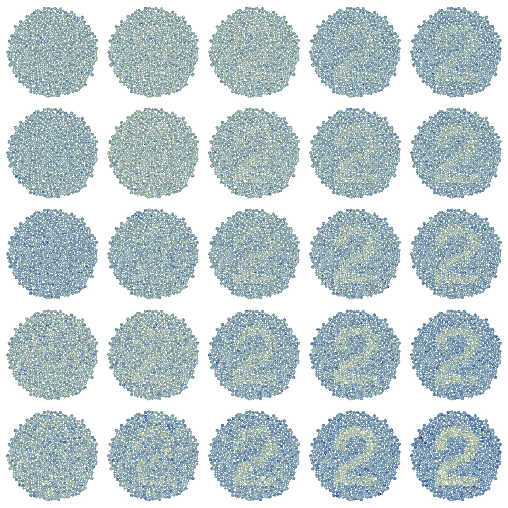{fig-align="center"}

:::

::: {.column width="50%"}

```{r}
# make into plot
study_data |>
filter(plot_type == "Pixel") |>
 select(D, V, correct_original, plot_type) |>
 ggplot(aes(x=D, y=V))+
 geom_jitter(height=0.3, width=0.3, alpha=0.5, size=0.7,
             aes(colour = correct_original)) +
 theme_bw() +
  scale_colour_discrete(palette = "dark2") +
 theme(legend.position = "bottom",
       legend.direction = "horizontal",
       aspect.ratio=1) +
 labs(x = "Distance (D)",
      y = "Standard Deviation (V)",
      colour = "Correct number selected") +
  guides(color = guide_legend(override.aes = list(size = 2, alpha = 1))) 

```

:::
:::::

## Pixel - power curves

```{r}
#| out-width: 100%
map_type = "Pixel"
pcol = gpal[4]

glmer_models |>
  filter(!D==0,
         plot_type %in% map_type) |>
  mutate(line_id = interaction(plot_type, id)) |>
  ggplot(aes(x=V,  group = line_id)) +
  geom_line(aes(y = power_random), colour = pcol,
            linewidth=0.3, alpha=0.3) +
  geom_line(data = theoretical_models |>
              filter(!D==0, plot_type %in% map_type) |>
              mutate(line_id = interaction(test, plot_type, correct_number)),
            aes(y=power_random, linetype = test),
            linewidth=0.3, colour = "black") +
  theme_minimal()+
  theme(legend.position="top", 
        legend.direction ="horizontal",
        text=element_text(size=10), 
        strip.text.x=element_text(size=8),
        strip.text.y=element_text(size=8),
        legend.text = element_text(size=8)) +
  guides(colour = "none") + 
  facet_wrap(~D, nrow = 1,
             labeller = labeller(D = name_distance)) +
  labs(x = "Standard Deviation", y = "Power",
       linetype = "Classical Test") +
  scale_linetype_manual(values = LINES) 

```

## Transparency - data


::::: columns
::: {.column width="50%"}

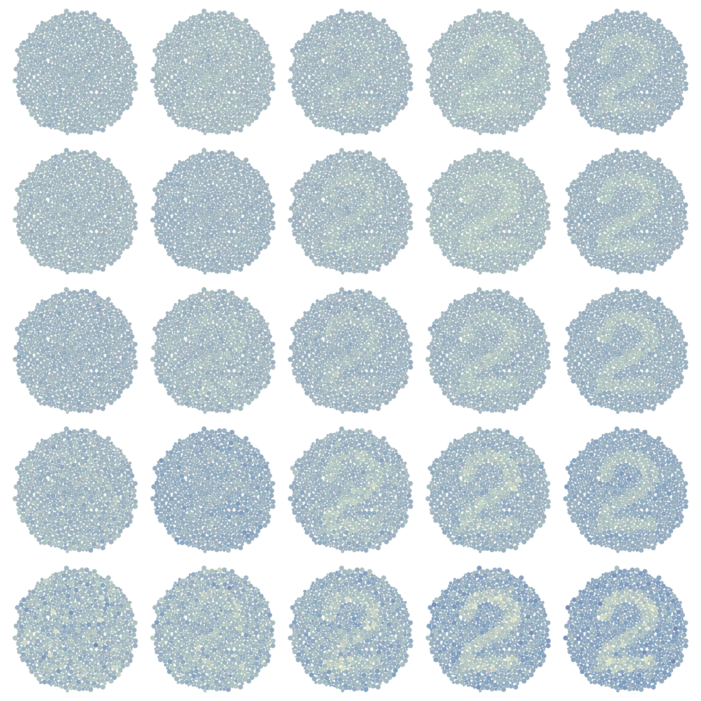{fig-align="center"}

:::

::: {.column width="50%"}

```{r}
# make into plot
study_data |>
filter(plot_type == "Transparency") |>
 select(D, V, correct_original, plot_type) |>
 ggplot(aes(x=D, y=V))+
 geom_jitter(height=0.3, width=0.3, alpha=0.5, size=0.7,
             aes(colour = correct_original)) +
 theme_bw() +
  scale_colour_discrete(palette = "dark2") +
 theme(legend.position = "bottom",
       legend.direction = "horizontal",
       aspect.ratio=1) +
 labs(x = "Distance (D)",
      y = "Standard Deviation (V)",
      colour = "Correct number selected") +
  guides(color = guide_legend(override.aes = list(size = 2, alpha = 1))) 

```

:::
:::::

## Transparency - power curves
```{r}
#| out-width: 100%
map_type = "Transparency"
pcol = gpal[5]

glmer_models |>
  filter(!D==0,
         plot_type %in% map_type) |>
  mutate(line_id = interaction(plot_type, id)) |>
  ggplot(aes(x=V,  group = line_id)) +
  geom_line(aes(y = power_random), colour = pcol,
            linewidth=0.3, alpha=0.3) +
  geom_line(data = theoretical_models |>
              filter(!D==0, plot_type %in% map_type) |>
              mutate(line_id = interaction(test, plot_type, correct_number)),
            aes(y=power_random, linetype = test),
            linewidth=0.3, colour = "black") +
  theme_minimal()+
  theme(legend.position="top", 
        legend.direction ="horizontal",
        text=element_text(size=10), 
        strip.text.x=element_text(size=8),
        strip.text.y=element_text(size=8),
        legend.text = element_text(size=8)) +
  guides(colour = "none") + 
  facet_wrap(~D, nrow = 1,
             labeller = labeller(D = name_distance)) +
  labs(x = "Standard Deviation", y = "Power",
       linetype = "Classical Test") +
  scale_linetype_manual(values = LINES) 

```


##  Returning to our hypothesis
:::: {.incremental}

1. The Choropleth and Bivariate maps will have no signal modulation: **Confirmed**
2. The VSUP map will have signal modulation, but not in a way that is statistically sensible: **Confirmed**  
2. The pixel and transparency maps will be the same in how well they perform signal modulation and should align with standard hypothesis tests: **Confirmed**

::::


# Conclusion

## What did we learn?
:::: {.incremental}

- It is important to know if you are evaluating uncertainty as signal or noise
- Power curve analysis is required to assess uncertainty as signal
- Visualising distributions as samples is the only approach that leads to sensible signal modulation

::::


## Want more? Read our paper here!
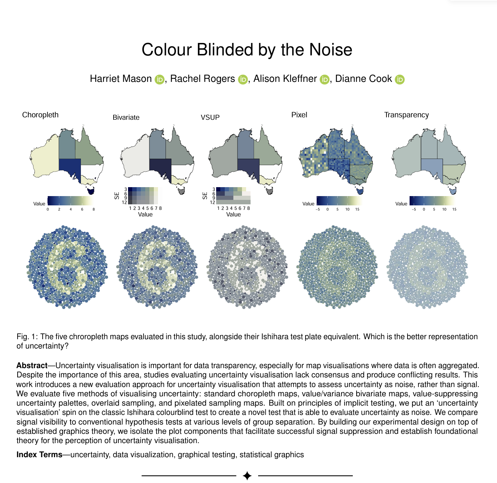{fig-align="center"}

## If want more work on signal modulation...
This paper was the third chapter of my PhD, and the third part of a trillogy on this approach to uncertainty visualisation!

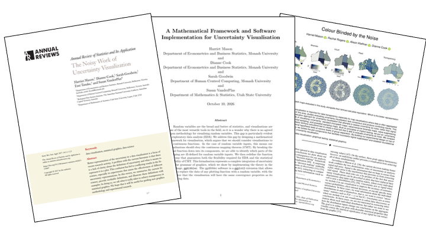{fig-align="center"}


## References
