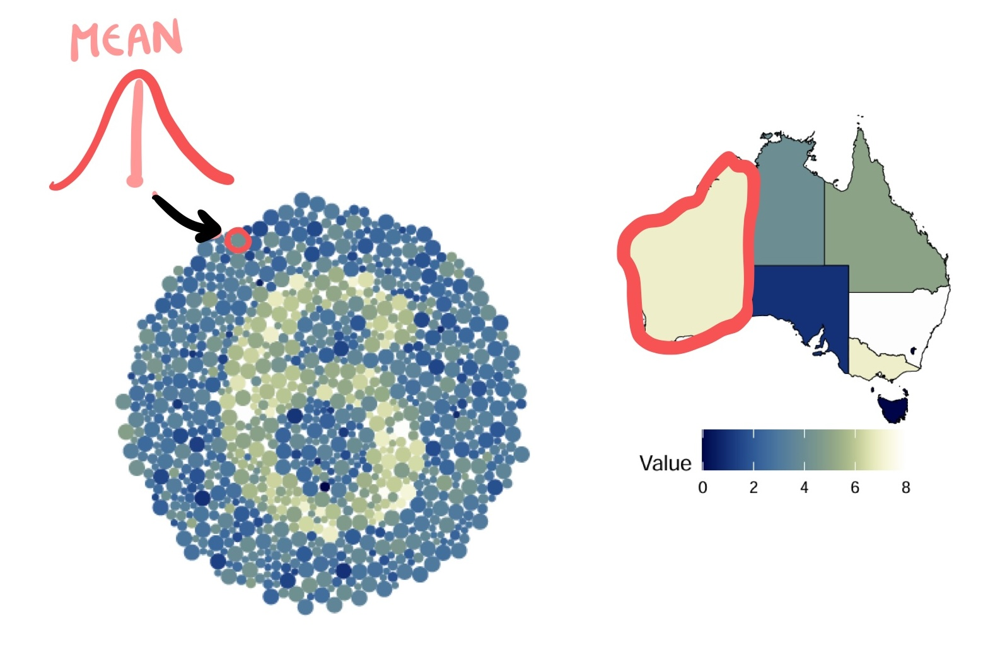
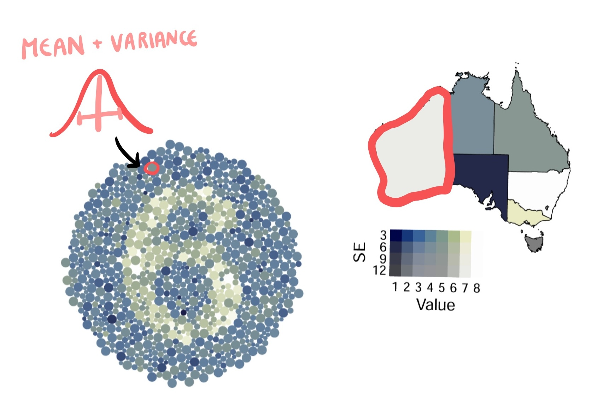
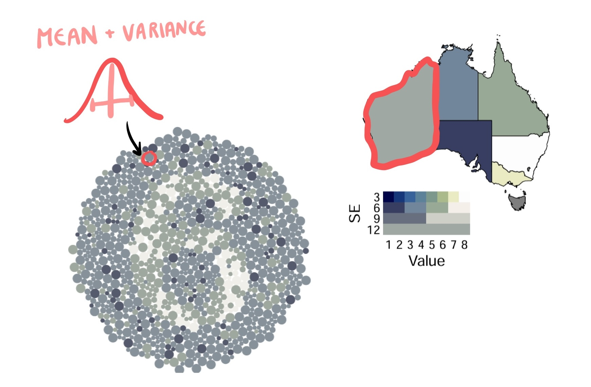
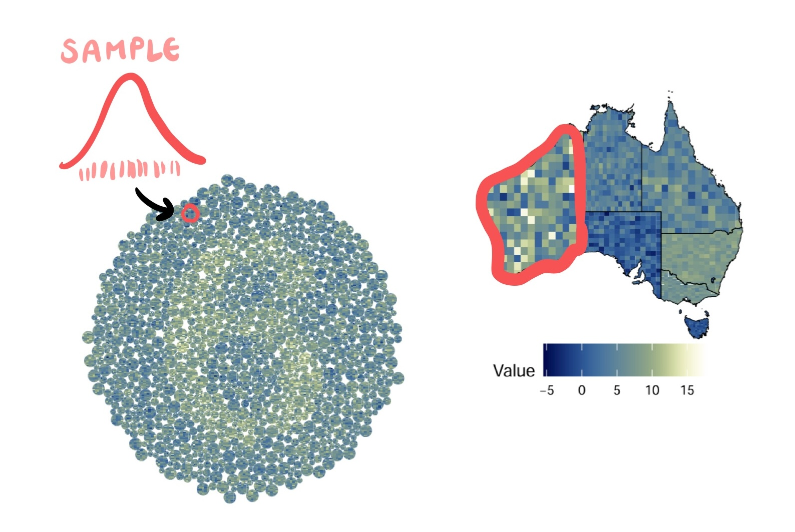
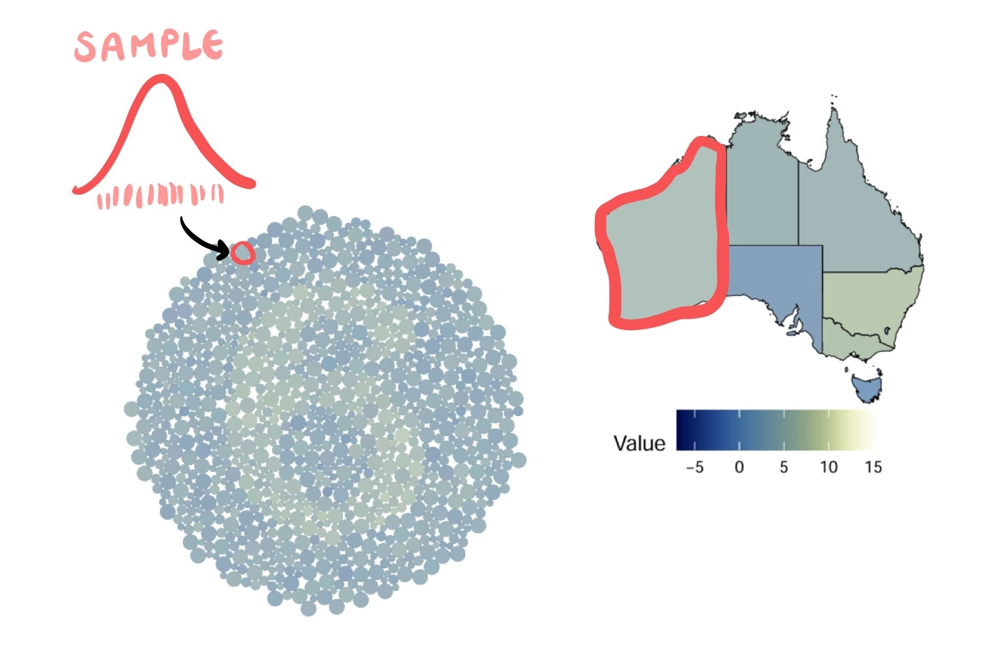
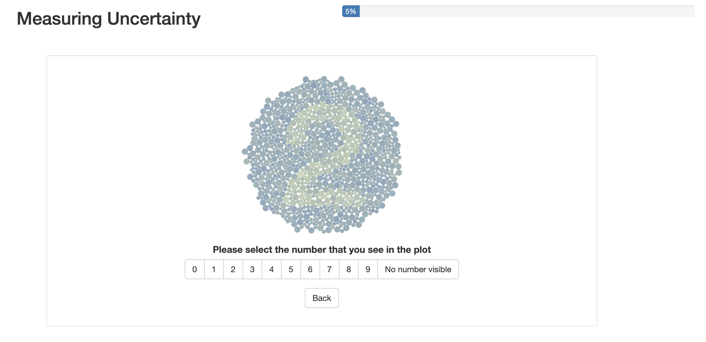

```{r setup}
#| include: false
#| message: false
#| warning: false

library(MASS)
library(tidyverse)
library(ggdibbler)
library(colorspace)
library(sf)
library(ggthemes)
library(distributional)
library(patchwork)
library(kableExtra)
library(ggthemes)
library(ggdist)
library(ggwordcloud)
library(nullabor)
library(shadowtext)
library(flextable)
library(ozmaps)
library(emmeans)
library(broom)
library(lme4)
library(car)
library(janitor)
library(naniar)
library(datasauRus)
library(tidygraph)
library(ggraph)

# set theme?
# theme_set( theme_gdocs() + 
#              theme(aspect.ratio = 1, 
#                    axis.text.x = element_text(angle = 35, 
#                                               vjust = 1.05, 
#                                               hjust=1),
#                    palette.colour.continuous = gdocs_pal(),
#                    palette.colour.discrete = gdocs_pal(),
#              )
# 3)
gpal <- gdocs_pal()(5)
```


```{r walkremote}
#| eval: false
suburbs <- strayr::read_absmap("suburb2021")
saveRDS(suburbs, file = "data/suburbs.rds")
```

```{r walkdata}
#filtered_walk <- walkathon[which((walkathon$name %in% extra_walk$name)),]
filtered_walk <- walktober

# Read in extra walk and add in suburbs
extra_walk <- read.csv("data/extrawalktober.csv") |>
  mutate(suburb = ifelse(suburb == "Claython north", "Clayton", suburb),
         suburb = ifelse(suburb == "Clayton ", "Clayton", suburb),
         suburb = ifelse(suburb == "Mordi ", "Oakleigh", suburb),
         suburb = ifelse(suburb == "Oakleigh ", "Oakleigh", suburb),
         suburb = ifelse(suburb == "Langwarrin", "Mordialloc", suburb),
         suburb = ifelse(suburb == "Croydon", "Mordialloc", suburb))
#required_subs <- unique(c(extra_walk$suburb))
suburbs <- readRDS("data/suburbs.rds")

my_suburbs <- suburbs |> 
  filter(state_name_2021 == "Victoria") |>
  mutate(suburb_name_2021 = str_remove(suburb_name_2021, " \\(Vic.\\)")) |>
  filter(between(cent_long, 144.8, 145.2),
         between(cent_lat, -38, -37.8)) |>
  #filter(suburb_name_2021 %in% required_subs) |>
  #select(c(suburb_name_2021, geometry)) |>
  rename("suburb" = "suburb_name_2021")

extra_walk <- extra_walk |>
  left_join(my_suburbs, by = "suburb")
# add team colours
extra_walk$team_colour <- c(sequential_hcl(4, palette = "Peach"),
  sequential_hcl(5, palette = "Blues")[1:4],
  sequential_hcl(6, palette = "Reds 3")[2:5],
  sequential_hcl(5, palette = "Greens")[1:4],
  sequential_hcl(4, palette = "Purp"),
  sequential_hcl(8, palette = "Heat")[3:6])

# clean data to just local suburbs
clean_walk <- filtered_walk |>
  left_join(extra_walk, by="name") |>
  mutate(steps_dist = dist_normal(steps, 0.1*steps),
         date = as.Date(date, "%d/%m/%y")) |>
  group_by(name) |>
  mutate(cum_steps = cumsum(steps)) |>
  ungroup() |>
  filter(date <= as.Date("23/10/25", "%d/%m/%y")) |>
  na.omit()
# remove emojis
clean_walk$team <- gsub("\\p{So}", "", clean_walk$team, perl = TRUE)
suburb_walk <- clean_walk |>
  as.tibble() |>
  group_by(suburb) |>
  summarise(mean_steps = mean(steps),
            steps_dist = dist_truncated(dist_normal(mean(steps), 0.1*mean(steps)), 0)) |> 
  left_join(my_suburbs, by = "suburb") |>
  select(c(suburb, steps_dist, mean_steps, geometry))


```


```{r, setup-part4}

source("code/gen_functions.R") # in render

# load raw theoretical data
load("data/bigpvalues.rda")
load("data/study_data.RData")

h0_true <- study_data |>
  filter(correct_number == "No number visible") |>
  group_by(plot_type) |>
  summarise(alpha = 1- mean(correct),
            n_correct = sum(correct),
            n_reject = sum(!correct))

# make into a compatible format
theory_data_plot <- bigpvalues |>
 mutate(reject = pvalue <= mean(h0_true$alpha)) |>
 filter(drawID<=10) |>
 select(D, V, reject) |>
 mutate(plot_type = "Theoretical")  |>
 rename("correct_original" = reject)
```


# Walktober

## Walktober {.smaller}

Last October my department had a step challenge 

{fig-align="center"}

## Data quality angel

::::: columns
::: {.column width="60%"}
{fig-align="center"}
:::

::: {.column width="40%"}
Before the competition started, I searched up the most accurate and cost effective pedometer
:::
:::::

## Pedometer = bad {.smaller}

It turns out, pedometers are wildly inaccurate 

{fig-align="center"}

## Data quality demons {.smaller}

::::: columns
:::: {.column width="60%"}
{fig-align="center"}
::::

:::: {.column width="40%"}
::: {.incremental}
-   It turns out I was the ONLY person concerned about data quality
-   We conducted a survey after walktober, to see if we could quantify the pedometer error
-   Measurement error was the least of my worries
:::
::::
:::::

## Survey response

{fig-align="center"}


## The visualisation challenge {.smaller}

::: {.incremental}
- I made a choropleth map to check step count against suburb walkability
- But I did all that pedometer research? How should I include the measurement error in my visualisation?
:::


```{r}
#| fig-height: 4
#| fig-align: center

# Just include map because that is the context of this
ggplot(my_suburbs) +
  geom_sf(data = suburb_walk, aes(geometry= geometry, fill = mean_steps)) +
  geom_sf(aes(geometry= geometry), fill=NA) +
  theme_map() +
  ggtitle("Average steps per day by Melbourne Suburb") + 
  labs(fill = "Average steps per day") +
  scale_fill_continuous_sequential(palette = "Magenta", rev = TRUE)

```

# Well this depends

# Who is the visualisation for?

## There are people who are too trusting

::::: columns
::: {.column width="35%"}

{fig-align="center"}

:::

::: {.column width="55%"}

:::: {.incremental}
- For these people we expect uncertainty to...
  - Communicate confidence [@Correll2018; @Boukhelifa2017]
  - Guide, qualify or soften judgements [@Leland2005]
  
:::: 

:::
:::::


## ...and people who are not trusting at all

::::: columns
::: {.column width="40%"}

{fig-align="center"}

:::

::: {.column width="60%"}

:::: {.incremental}

- For these people we expect uncertainty to...
  - Convey the legitimacy (or illegitimacy) of conclusions [@Kale2018; @Griethe2006]
  - Communicate validity [@Hullman2020a; @Griethe2006]
  
:::: 

:::
:::::


## ... and people who just want probabilities

::::: columns
::: {.column width="50%"}

{fig-align="center"}

:::

::: {.column width="50%"}

:::: {.incremental}
- For these people  uncertainty is...
  - A variable of interest, in and of itself [@Blenkinsop2000; @geointerviews]
  - Or required for some utility calculation [@wu2023rational; @Fernandes2018]

:::: 

:::
:::::


## Into the melting pot
Our current decision making framework does not differentiate between these approaches.

{fig-align="center"}


## Signal vs noise
::: {.incremental}
- Doing this obfuscates the two disparate roles uncertainty can take on in our analysis
- **Uncertainty as signal**: we are interested in uncertainty as a statistic in it's own right
  - e.g. extracting variance or probabilities
- **Uncertainty as noise**: we are interested in how uncertainty affects our primary estimate
  - e.g. ensuring the signals are valid, preventing false conclusions
  
::: 


## Conflict in the literature
::::: columns
::: {.column width="35%"}

{fig-align="center"}

:::

::: {.column width="65%"}

:::: {.incremental}
- Ignoring uncertainty's role as noise or signal creates conflict in the literature
- Evaluating uncertainty as signal (when it is supposed to be noise) can flip conclusions on their head [@Mason2026]
- For example, we might suggest that we **ignore uncertainty** in high variance scenarios to **improve trust** [@Zhao2023]

:::: 

:::
:::::

## I am mostly concerned about being scammed

::::: columns
::: {.column width="35%"}

{fig-align="center"}

:::

::: {.column width="65%"}

- I want to visualise uncertainty as noise
- I would like to know which approach works best 
  
:::: 

:::
:::::

# How do we evaluate uncertainty?


## How do we evaluate it as signal? {.smaller}


:::: {.incremental}

- Signal vs noise is not an inherent feature of the plot
- It is whatever we are drawing inference on
  - That is, it is determined by the question you ask 
- Therefore asking direct questions about variance or probability will turn the uncertainty into signal
  - This will occur regardless of the reason the plot was made
  
:::: 

## Most research evaluates uncertainty as signal{.smaller}

{fig-align="center"}


## How do we evaluate it as noise?
::::: columns
::: {.column width="55%"}

:::: {.incremental}
- To evaluate uncertainty as noise, we will see how well they perform **signal modulation**
  - The higher the variance on an estimate, the harder that estimate is to extract from the plot
- This is a perceptual property of our plot

:::: 

:::

::: {.column width="45%"}

{fig-align="center"}

:::
:::::


## My Ratatouille rule{.smaller}

::::: columns
::: {.column width="65%"}

:::: {.incremental}
- Signal modulation is about seeing
  - It is important to avoid conflating  *understanding* with *seeing*
- "Not everyone can become a great artist, but a great artist can come from anywhere." - Anton Ego (Ratatouille (2007))
- "Not *everyone* need to be able to understand your plot, but a good plot can be understood by *anyone*. - Me (right here, right now)
  - Should not be limited by inherent ability (e.g. colour blindness)
  - Can be limited by actual skill/knowledge (e.g. what does spatial autocorrelation look like?) 

:::: 


:::

::: {.column width="35%"}

{fig-align="center"}

:::
:::::


## Therefore we want an evaluation method that can...

:::: {.incremental}

1. Work for choropleth maps 
2. Measures the effect of a latent variable
3. Is simple enough that it could be understood by a child 

:::: 


## ... Wait 
  
::::: columns
::: {.column width="60%"}

:::: {.incremental}
- Isn't that just an Ishihara colour blind test?
  - Choropleth map
  - Measures latent variable (colour vision deficiency)
  - Is understood by children

::::

:::

::: {.column width="40%"}

{fig-align="center"}

:::
:::::

## How would this work exactly?

{fig-align="center"}


## Then we add uncertainty
{fig-align="center"}

## The choropleth map

{fig-align="center"}

## Hypothesis 

**1. The choropleth map will not perform signal modulation.**


## The bivariate map

{fig-align="center"}

## Hypothesis 
1. The choropleth map will not perform signal modulation

**2. ...and neither will the bivariate map.**


## The VSUP map
Value suppressing uncertainty palette (VSUP) [@Correll2018]
 
{fig-align="center"}

## Hypothesis 
1. The choropleth map will not perform signal modulation
2. ...and neither will the bivariate map.

**3. The VSUP map will perform signal modulation, but not in a way that is statistically sensible**


## The pixel map
 
{fig-align="center"}

## Hypothesis 
1. The choropleth map will not perform signal modulation
2. ...and neither will the bivariate map.
3. The VSUP map will perform signal modulation, but not in a way that is statistically sensible

**4. The pixel map will perform sensible signal modulation**

## How to represent using one colour?
A flexible uncertainty visualisation framework `ggdibbler`

```{r}
#| fig-align: center
#| fig-height: 8
#| fig-width: 15
#| out-width: 90%
#| fig-pos: "t"
#| dev: "png"

set.seed(10)
# any data edits
# GRAPH DF
uncertain_edges <- tibble::tibble(from = sample(5, 20, TRUE),
                                  to = sample(5, 20, TRUE),
                                  weight = runif(20)) |>
  dplyr::group_by(from, to) |>
  dplyr::mutate(to = distributional::dist_sample(list(sample(seq(from=max(1,to-1), 
                                                                 to = min(to+1, 5)), 
                                                             replace = TRUE)))) |>
  ungroup()
graph_sample <- uncertain_edges |>
  sample_expand(times=50) |>
  as_tbl_graph()
jitter = position_jitter(width=0.03, height=0.03)

# geom_sf data
Aust_map <- ozmap_data(data = "states", quiet = TRUE) |>
  group_by(NAME) |>
  mutate(value = dist_normal(mu = rnorm(1, 30, 10), rexp(1, 0.3))) |>
  ungroup()


ppie <- ggplot(uncertain_mpg, aes(x="")) +
  geom_bar_sample(aes(fill = class), times = 50, alpha=1.2/50,
                  position = "stack_identity",
                  width = 1)+
  theme_void() +
  scale_fill_gdocs() +
  coord_polar(theta = "y") +
  theme(legend.position="none",
        aspect.ratio=1) +
  ggtitle("b. pie chart")

psf <- ggplot(data = Aust_map, aes(geometry = geometry, fill = value)) + 
  geom_sf_sample(times = 300, linewidth = 0) +
  #theme_void() +
  theme_map() +
  theme(legend.position="none") +
  geom_sf(fill = NA, linewidth = 0.5, colour = "black") +
  scale_fill_acton() + 
  scale_x_continuous_distribution(limits = c(111,155)) +
  ggtitle("d. choropleth map")

pgraph <- ggraph(graph_sample, weights = weight) + 
  geom_edge_link(aes(group=drawID), position=jitter, alpha=0.01, 
                 colour = "#cc3311") + 
  theme_void() +
  theme(aspect.ratio = 1) +
  geom_node_point(size=3) +
  theme(aspect.ratio = 1, legend.position="none") +
  ggtitle("f. network diagram")

pcount <- ggplot(uncertain_mpg, aes(cty, hwy)) +
  geom_count_sample(alpha=0.05, times=30, colour = "#FD9A44") +
  theme_few() +
  theme(aspect.ratio = 1, legend.position="none") +
  ggtitle("e. bubble chart")

phist <- ggplot(smaller_uncertain_diamonds, aes(carat, fill = cut)) +
  geom_histogram_sample(position="stack_dodge", alpha=1, times=30) +
  theme_few() +
  scale_fill_discreterainbow() +
  theme(aspect.ratio = 1, legend.position="none") +
  ggtitle("c. histogram")

pline <- ggplot(mtcars, aes(wt, mpg)) + 
  geom_abline_sample(intercept = dist_normal(37, 1.8), colour = "#9970AB",
                     slope = dist_normal(-5, 0.56), 
                     times=30, alpha=0.5) +
  geom_point(colour = "black") + 
  theme_few() +
  theme(aspect.ratio=1, legend.position = "none") +
  ggtitle("a. line plot")

pline +  ppie + phist + psf  + pcount + pgraph 
```

## In `ggdibbler`
Mathematical information in a pixel and transparency map should be the same

```{r}

p1 <- ggplot(uncertain_mpg, aes(class)) + 
  geom_bar_sample(aes(fill = drv),
                  position = "stack_dodge")+
  theme_void() +
  theme(legend.position="none", aspect.ratio=1)+
  scale_fill_discrete_sequential(palette = "viridis") +
  ggtitle("Pixelation")

p2 <- ggplot(uncertain_mpg, aes(class)) + 
  geom_bar_sample(aes(fill = drv), alpha=0.15,
                  position = "stack_identity")+
  theme_void() +
  theme(legend.position="none", aspect.ratio=1)+
  scale_fill_discrete_sequential(palette = "viridis") +
  ggtitle("Transparency")


p1 | p2

```

## The transparency map
 
{fig-align="center"}

## Hypothesis 
1. The choropleth map will not perform signal modulation
2. ...and neither will the bivariate map.
3. The VSUP map will perform signal modulation, but not in a way that is statistically sensible
4. The pixel map will perform sensible signal modulation

**5. ...and so will the transparency map**

## The underlying data

```{r}

set.seed(731)
# generate data
D = c(0,1,2,3,4)
V = c(1,2,3,4,5)
Dlab = D
Vlab = V

# make data for plotting
parent_dists <- expand_grid(D, V) |>
  mutate(Background = dist_normal(-0.5*D, 1),
         Number = dist_normal(0.5*D, 1)) |>
    pivot_longer(cols = Background:Number,
               names_to = "group",
               values_to = "dist") 

estimate_dists <- gen_data(D, V, parentV = 1, noiseV = 0, number = 2) |>
  mutate(group = ifelse(group=="out", "Background", "Number")) |>
  group_by(D, V, group) |>
  slice_sample(n = 20) |>
  ungroup() |>
  rename("dist" = "estimate_dist") 

# set colours
pal <- colour("high contrast")(3)[c(2,1)]

# plot distributions
parent_dists |>
  ggplot(aes(xdist = dist, colour = group)) +
  
  # Visualise parent distribution
  stat_slab(scale = 0.3, fill=NA, 
            linewidth=1, alpha=0.5,
            aes(y=-0.35)) +
  geom_hline(yintercept = -0.35, colour = "black") +
  
  # Visualise Estimate Distribution
  stat_slab(data = estimate_dists, normalize = "panels",
             fill=NA, linewidth=0.2, alpha=0.3) + 
  labs(y = "Standard Deviation (V)", x = "Distance (D)") +
  geom_hline(yintercept = 0, colour = "black") +
  
  # Other visual changes
  scale_colour_manual(name = "Group", values = pal) +
  facet_grid(rows = vars(V), cols = vars(D), as.table = FALSE,
             scales = "free", switch = "both") +
  theme_minimal() +
  theme(aspect.ratio = 1, 
        text = element_text(size = 15),
        panel.grid = element_blank(),
        axis.text = element_blank())

```


## A visual hypothesis test
Want to minimise type I and II error

{fig-align="center"}

## Power curves

::::: columns
::: {.column width="40%"}

:::: {.incremental}
- Hypothesis tests evaluated using power curves
- As the variance increases, we would expect the number to be harder to see

::::

:::

::: {.column width="60%"}

{fig-align="center"}

:::
:::::


## Theoretical power curves
```{r}
#| out-width: 100%
# load simulated models
load("data/glmer_models.rda")
load("data/theoretical_models.rda")
# load("data/average_fit.rda")

name_distance <- function(string) {
  paste0("Distance: \n", string)
}

LINES <- c("T-test" = "longdash", "Moran's I" = "dotdash")


theoretical_models |>
  filter(!D==0) |>
  mutate(line_id = interaction(test, plot_type, correct_number)) |>
  ggplot(aes(x=V, y=power_random, group = line_id, linetype = test)) +
  geom_line(linewidth=0.3, colour = "black") +
  theme_minimal()+
  theme(legend.position="top", 
        legend.direction ="horizontal",
        text=element_text(size=10), 
        strip.text.x=element_text(size=8),
        strip.text.y=element_text(size=8),
        legend.text = element_text(size=8),
        aspect.ratio = 1) +
  guides(colour = "none") + 
  facet_wrap(~D, nrow = 1,
             labeller = labeller(D = name_distance)) +
  labs(x = "Standard Deviation", y = "Power",
       linetype = "Classical Test") +
  scale_linetype_manual(values = LINES) 

```


# The analysis

## Study details
:::: {.incremental}
- 137 Prolific users completed the study
- Took a median time of ~8 minutes to do all 125 plots
::::

{fig-align="center"}


## Choropleth - stimuli

{fig-align="center"}


## Choropleth - power curves

```{r}
#| out-width: 100%

map_type = "Choropleth"
pcol = gpal[1]

glmer_models |>
  filter(!D==0,
         plot_type %in% map_type) |>
  mutate(line_id = interaction(plot_type, id)) |>
  ggplot(aes(x=V,  group = line_id)) +
  geom_line(aes(y = power_random), colour = pcol,
            linewidth=0.3, alpha=0.3) +
  geom_line(data = theoretical_models |>
              filter(!D==0, plot_type %in% map_type) |>
              mutate(line_id = interaction(test, plot_type, correct_number)),
            aes(y=power_random, linetype = test),
            linewidth=0.3, colour = "black") +
  theme_minimal()+
  theme(legend.position="top", 
        legend.direction ="horizontal",
        text=element_text(size=10), 
        strip.text.x=element_text(size=8),
        strip.text.y=element_text(size=8),
        legend.text = element_text(size=8),
        aspect.ratio = 1) +
  guides(colour = "none") + 
  facet_wrap(~D, nrow = 1,
             labeller = labeller(D = name_distance)) +
  labs(x = "Standard Deviation", y = "Power",
       linetype = "Classical Test") +
  scale_linetype_manual(values = LINES) 

```


## Hypothesis check
1. The choropleth map will not perform signal modulation **(Confirmed)**


## Bivariate - stimuli

{fig-align="center"}


## Bivariate - power curves

```{r}
#| out-width: 100%
map_type = "Bivariate"
pcol = gpal[2]

glmer_models |>
  filter(!D==0,
         plot_type %in% map_type) |>
  mutate(line_id = interaction(plot_type, id)) |>
  ggplot(aes(x=V,  group = line_id)) +
  geom_line(aes(y = power_random), colour = pcol,
            linewidth=0.3, alpha=0.3) +
  geom_line(data = theoretical_models |>
              filter(!D==0, plot_type %in% map_type) |>
              mutate(line_id = interaction(test, plot_type, correct_number)),
            aes(y=power_random, linetype = test),
            linewidth=0.3, colour = "black") +
  theme_minimal()+
  theme(legend.position="top", 
        legend.direction ="horizontal",
        text=element_text(size=10), 
        strip.text.x=element_text(size=8),
        strip.text.y=element_text(size=8),
        legend.text = element_text(size=8),
        aspect.ratio = 1) +
  guides(colour = "none") + 
  facet_wrap(~D, nrow = 1,
             labeller = labeller(D = name_distance)) +
  labs(x = "Standard Deviation", y = "Power",
       linetype = "Classical Test") +
  scale_linetype_manual(values = LINES) 

```

## Hypothesis check
1. The choropleth map will not perform signal modulation **(Confirmed)**
2. ... and neither will the bivariate map. **(Confirmed)**


## VSUP - stimuli


{fig-align="center"}


## VSUP - power curves

```{r}
#| out-width: 100%
map_type = "VSUP"
pcol = gpal[3]

glmer_models |>
  filter(!D==0,
         plot_type %in% map_type) |>
  mutate(line_id = interaction(plot_type, id)) |>
  ggplot(aes(x=V,  group = line_id)) +
  geom_line(aes(y = power_random), colour = pcol,
            linewidth=0.3, alpha=0.3) +
  geom_line(data = theoretical_models |>
              filter(!D==0, plot_type %in% map_type) |>
              mutate(line_id = interaction(test, plot_type, correct_number)),
            aes(y=power_random, linetype = test),
            linewidth=0.3, colour = "black") +
  theme_minimal()+
  theme(legend.position="top", 
        legend.direction ="horizontal",
        text=element_text(size=10), 
        strip.text.x=element_text(size=8),
        strip.text.y=element_text(size=8),
        legend.text = element_text(size=8),
        aspect.ratio = 1) +
  guides(colour = "none") + 
  facet_wrap(~D, nrow = 1,
             labeller = labeller(D = name_distance)) +
  labs(x = "Standard Deviation", y = "Power",
       linetype = "Classical Test") +
  scale_linetype_manual(values = LINES) 

```

## Hypothesis check
1. The choropleth map will not perform signal modulation **(Confirmed)**
2. ... and neither will the bivariate map. **(Confirmed)**
3. The VSUP map will perform signal modulation, but not in a way that is statistically sensible **(Confirmed)**


## Pixel - stimuli

{fig-align="center"}


## Pixel - power curves

```{r}
#| out-width: 100%
map_type = "Pixel"
pcol = gpal[4]

glmer_models |>
  filter(!D==0,
         plot_type %in% map_type) |>
  mutate(line_id = interaction(plot_type, id)) |>
  ggplot(aes(x=V,  group = line_id)) +
  geom_line(aes(y = power_random), colour = pcol,
            linewidth=0.3, alpha=0.3) +
  geom_line(data = theoretical_models |>
              filter(!D==0, plot_type %in% map_type) |>
              mutate(line_id = interaction(test, plot_type, correct_number)),
            aes(y=power_random, linetype = test),
            linewidth=0.3, colour = "black") +
  theme_minimal()+
  theme(legend.position="top", 
        legend.direction ="horizontal",
        text=element_text(size=10), 
        strip.text.x=element_text(size=8),
        strip.text.y=element_text(size=8),
        legend.text = element_text(size=8),
        aspect.ratio = 1) +
  guides(colour = "none") + 
  facet_wrap(~D, nrow = 1,
             labeller = labeller(D = name_distance)) +
  labs(x = "Standard Deviation", y = "Power",
       linetype = "Classical Test") +
  scale_linetype_manual(values = LINES) 

```

## Hypothesis check
1. The choropleth map will not perform signal modulation **(Confirmed)**
2. ... and neither will the bivariate map. **(Confirmed)**
3. The VSUP map will perform signal modulation, but not in a way that is statistically sensible **(Confirmed)**
4. The pixel map will perform sensible signal modulation **(Confirmed)**


## Transparency - stimuli

{fig-align="center"}


## Transparency - power curves
```{r}
#| out-width: 100%
map_type = "Transparency"
pcol = gpal[5]

glmer_models |>
  filter(!D==0,
         plot_type %in% map_type) |>
  mutate(line_id = interaction(plot_type, id)) |>
  ggplot(aes(x=V,  group = line_id)) +
  geom_line(aes(y = power_random), colour = pcol,
            linewidth=0.3, alpha=0.3) +
  geom_line(data = theoretical_models |>
              filter(!D==0, plot_type %in% map_type) |>
              mutate(line_id = interaction(test, plot_type, correct_number)),
            aes(y=power_random, linetype = test),
            linewidth=0.3, colour = "black") +
  theme_minimal()+
  theme(legend.position="top", 
        legend.direction ="horizontal",
        text=element_text(size=10), 
        strip.text.x=element_text(size=8),
        strip.text.y=element_text(size=8),
        legend.text = element_text(size=8),
        aspect.ratio = 1) +
  guides(colour = "none") + 
  facet_wrap(~D, nrow = 1,
             labeller = labeller(D = name_distance)) +
  labs(x = "Standard Deviation", y = "Power",
       linetype = "Classical Test") +
  scale_linetype_manual(values = LINES) 

```


## Hypothesis check
1. The choropleth map will not perform signal modulation **(Confirmed)**
2. ... and neither will the bivariate map. **(Confirmed)**
3. The VSUP map will perform signal modulation, but not in a way that is statistically sensible **(Confirmed)**
4. The pixel map will perform sensible signal modulation **(Confirmed)**
5. ... and so will the transparency map **(Confirmed)**


## Back to walktober!

```{r}
# Plot0B
options(scipen = 999)
ggplot(my_suburbs) +
  geom_sf_sample(data = suburb_walk, linewidth=0, times=100,
                 aes(geometry= geometry, fill = steps_dist)) +
  geom_sf(aes(geometry= geometry), fill=NA) +
  theme_map()  +
  ggtitle("Average steps per day by Melbourne Suburb") + 
  labs(fill = "Average steps per day") +
  scale_fill_continuous_sequential(palette = "Magenta", rev = TRUE)

```


# Conclusion

## What did we learn?
:::: {.incremental}

- It is important to know if you are evaluating uncertainty as signal or noise
- Power curve analysis is required to assess uncertainty as noise
- A sample of outcomes (such as pixel or transparency maps) do lead to sensible signal modulation

::::


## Want more? 
Read our paper!

{fig-align="center"}

## Want more? 
Or read the full signal modulation trilogy (my PhD thesis)...

{fig-align="center"}

# Thank you for listening!


## References
