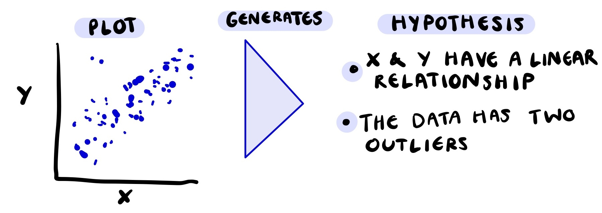
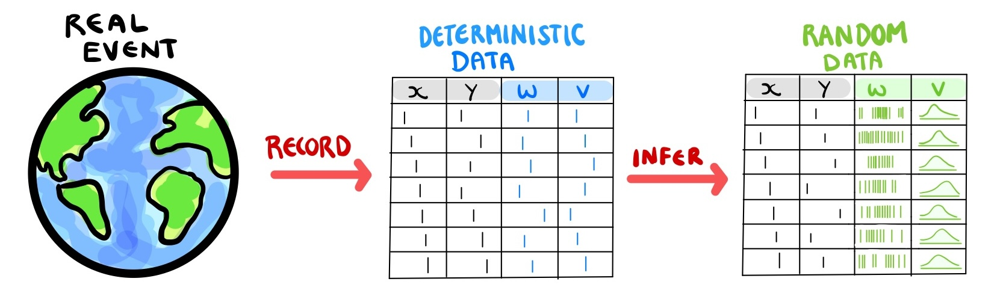
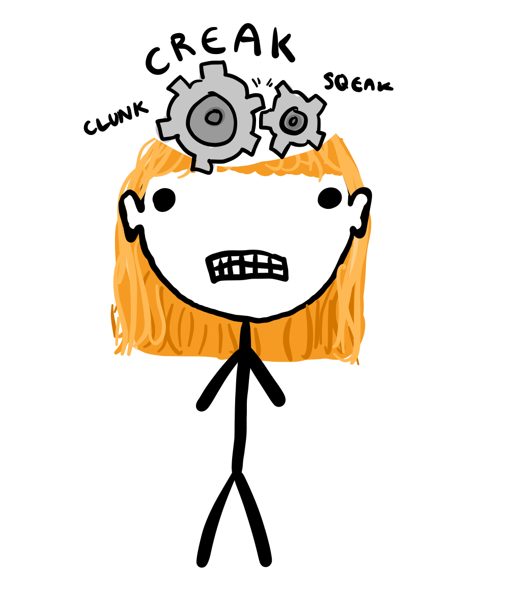
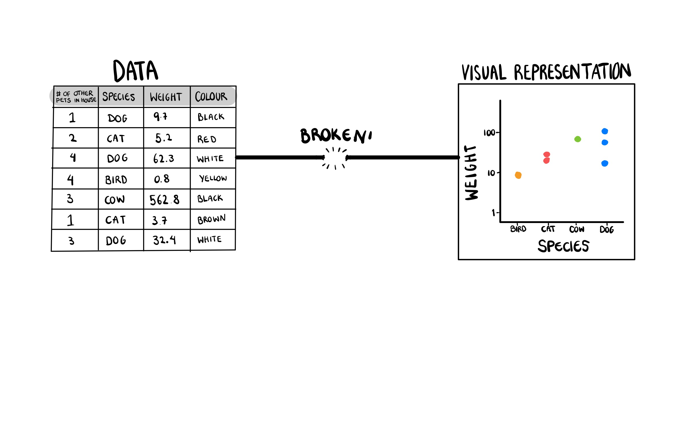
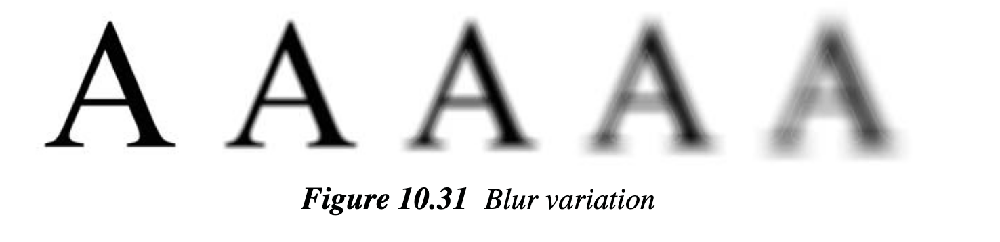

```{r setup}
#| include: false
#| message: false
#| warning: false

library(MASS)
library(tidyverse)
library(ggdibbler)
library(colorspace)
library(sf)
library(ggthemes)
library(distributional)
library(patchwork)
library(kableExtra)
library(ggthemes)
library(ggdist)
library(ggwordcloud)
library(nullabor)
library(shadowtext)
library(flextable)
library(ozmaps)
library(emmeans)
library(broom)
library(lme4)
library(car)
library(janitor)
library(naniar)

# set theme?
# theme_set( theme_gdocs() + 
#              theme(aspect.ratio = 1, 
#                    axis.text.x = element_text(angle = 35, 
#                                               vjust = 1.05, 
#                                               hjust=1),
#                    palette.colour.continuous = gdocs_pal(),
#                    palette.colour.discrete = gdocs_pal(),
#              )
# 3)
gpal <- gdocs_pal()(5)
```


# Walktober

```{r walkremote}
#| eval: false
suburbs <- strayr::read_absmap("suburb2021")
saveRDS(suburbs, file = "data/suburbs.rds")
```

```{r walkdata}
#filtered_walk <- walkathon[which((walkathon$name %in% extra_walk$name)),]
filtered_walk <- walktober

# Read in extra walk and add in suburbs
extra_walk <- read.csv("data/extrawalktober.csv") |>
  mutate(suburb = ifelse(suburb == "Claython north", "Clayton", suburb),
         suburb = ifelse(suburb == "Clayton ", "Clayton", suburb),
         suburb = ifelse(suburb == "Mordi ", "Oakleigh", suburb),
         suburb = ifelse(suburb == "Oakleigh ", "Oakleigh", suburb),
         suburb = ifelse(suburb == "Langwarrin", "Mordialloc", suburb),
         suburb = ifelse(suburb == "Croydon", "Mordialloc", suburb))
#required_subs <- unique(c(extra_walk$suburb))
suburbs <- readRDS("data/suburbs.rds")

my_suburbs <- suburbs |> 
  filter(state_name_2021 == "Victoria") |>
  mutate(suburb_name_2021 = str_remove(suburb_name_2021, " \\(Vic.\\)")) |>
  filter(between(cent_long, 144.8, 145.2),
         between(cent_lat, -38, -37.8)) |>
  #filter(suburb_name_2021 %in% required_subs) |>
  #select(c(suburb_name_2021, geometry)) |>
  rename("suburb" = "suburb_name_2021")

extra_walk <- extra_walk |>
  left_join(my_suburbs, by = "suburb")
# add team colours
extra_walk$team_colour <- c(sequential_hcl(4, palette = "Peach"),
  sequential_hcl(5, palette = "Blues")[1:4],
  sequential_hcl(6, palette = "Reds 3")[2:5],
  sequential_hcl(5, palette = "Greens")[1:4],
  sequential_hcl(4, palette = "Purp"),
  sequential_hcl(8, palette = "Heat")[3:6])

# clean data to just local suburbs
clean_walk <- filtered_walk |>
  left_join(extra_walk, by="name") |>
  mutate(steps_dist = dist_truncated(steps + 0.1*steps*dist_normal(bias_mu, bias_se), 0),
         date = as.Date(date, "%d/%m/%y")) |>
  group_by(name) |>
  mutate(cum_steps = cumsum(steps)) |>
  ungroup() |>
  filter(date <= as.Date("23/10/25", "%d/%m/%y")) |>
  na.omit()
# remove emojis
clean_walk$team <- gsub("\\p{So}", "", clean_walk$team, perl = TRUE)
suburb_walk <- clean_walk |>
  as.tibble() |>
  group_by(suburb) |>
  summarise(mean_steps = mean(steps + 0.1*bias_mu),
            se_steps = mean((steps*0.1)^2*bias_se),
            steps_dist = dist_normal(mean_steps, se_steps)) |> 
  left_join(my_suburbs, by = "suburb") |>
  select(c(suburb, steps_dist, mean_steps, geometry))


```


## What is walktober? {.smaller}

My department had a walkathon in October where we all competed to see how many steps we could walk each day

{fig-align="center"}

## Data quality angel

::::: columns
::: {.column width="60%"}
{fig-align="center"}
:::

::: {.column width="40%"}
Before the competition started, I searched up the most accurate and cost effective pedometer
:::
:::::

## Pedometer = bad {.smaller}

-   It turns out, pedometers are wildly inaccurate 
{fig-align="center"}


## Data quality demons {.smaller}

::::: columns
:::: {.column width="60%"}
{fig-align="center"}
::::

:::: {.column width="40%"}
::: {.incremental}
-   We conducted a survey after walktober, to see if we could quantify the pedometer error
-   It turns out I was the ONLY person concerned about data quality
-   Turns out the measurement error was the least of my worries
:::
::::
:::::

## Survey response

{fig-align="center"}

## The visualisation challenge {.smaller}
Our department decides to do a visualisation challenge of the walktober data

```{r}
#| fig-height: 4
#| fig-align: center

# Plot0A
p1 <- ggplot(my_suburbs) +
  geom_sf(data = suburb_walk, aes(geometry= geometry, fill = mean_steps)) +
  geom_sf(aes(geometry= geometry), fill=NA) +
  theme_map() +
  ggtitle("Average steps per day by Melbourne Suburb") + 
  labs(fill = "Average steps per day") +
  scale_fill_continuous_sequential(palette = "Magenta", rev = TRUE)

# plot 3A
p2 <- ggplot(clean_walk, aes(x=team, y = steps, fill = team_colour)) +
  geom_col() +
  scale_fill_identity() +
  ggtitle("Total steps per team, per person") +
  theme_few() +
  coord_flip()

p1 + p2 + 
  plot_annotation() & 
  theme(plot.background = element_blank())
```

## ...Should I just ignore the uncertainty? {.smaller}

::: {.incremental}
- This seems like it is going to be a lot of work
  - But I did all that reading about pedometers!!! 
- Other sentiments around uncertainty:
  - Failing to include it is akin to fraud! [@Hullman2020a; @Manski2020]
  - Conveys the legitimacy (or illegitimacy) of conclusions [@Kale2018; @Griethe2006]
  - Communicate confidence [@Correll2018; @Boukhelifa2017]
  - Communicate validity [@Hullman2020a; @Griethe2006]
  - It should guide, qualify or soften judgements [@Leland2005]
- **Increase transparency**
  
::: 

## Signal Modulation
- **Signal modulation**: statistical validity translates to perceptual ease
  - The higher the variance on an estimate, the harder that estimate is to extract from the plot

{fig-align="center"}


## In statistics jargon?

::::: columns
::: {.column width="40%"}
:::: {.incremental}

Statistical properties are what differentiate us from the animals

::::

:::

::: {.column width="60%"}
{fig-align="center"}
:::
:::::


## A visual hypothesis test
Our visualisation should have behaviour similar to
  - a hypothesis test [@Correll2018; @MacEachren1992] or 
  - a Bayesian posterior probability [@Kim2019]

{fig-align="center"}


## OK, Fine! {.smaller}
I won't ignore it, we will make an uncertain version of these plots.

```{r}
#| fig-height:  4
#| fig-align: center

p1 + p2 + 
  plot_annotation() & 
  theme(plot.background = element_blank())
```

  
## Overview
This is going to be the focus of todays talk. We are going to go over:

- Part 1: What is uncertainty? [@phd_chap1]
- Part 2: What is a visualisation? [@phd_chap2]
- Part 3: How to (safely) make uncertainty visualisations in `ggdibbler` [@phd_chap2]
- Part 4: Do these plots work? [@phd_chap3]

# Part 1: What is uncertainty?

## The word association Olympics {.smaller}

:::: {.incremental}

- No definition, just a word salad 
- Can nobody tell me what uncertainty *IS*?
- How can you visualise something you can't even define? 

::::

```{r}
#| fig-height: 2
#| fig-width: 3
#| fig-align: center
#| column: screen-inset

# Set seed for appearance of plot
set.seed(3)

# make data
terms <- c("Epistemic", 
           "Precision", 
           "Accuracy", 
           "Missing values", 
           "Error", 
           "Bounds",
           "Variance",
           "Density",
           "Probability",
           "Risk",
           "Expertise",
           "Assumptions"
           )       

word_size <- round(abs(unlist(generate(dist_normal(30,10), length(terms)))))
word_angle <- 45 * sample(-2:2, length(terms), replace = TRUE, prob = c(1, 1, 4, 1, 1))
word_colour <- factor(sample.int(length(terms), length(terms), replace = FALSE))

# make into df
df_words <- tibble(
  words = terms,
  size = word_size,
  angle = word_angle,
  colour = word_colour
  ) |>
    arrange(desc(size)) 
    

ggplot(df_words, 
       aes(label = words, size = size,
           color = colour,
           angle = angle)) +
  geom_text_wordcloud(area_corr = TRUE) +
  scale_radius(range = c(0, 20), limits = c(0, NA)) +
  theme_minimal()
```


## If you are me...
You decide the entire field is fake and not worth working on 


{fig-align="center"}


## But...
Your PhD is externally funded with a set topic

{fig-align="center"}

## So you take another approach
::: {.incremental}
- Instead of defining what uncertainty **IS**...
- Maybe we can look at where uncertainty **ISN'T?**
- To do that, we need to take a look back into the past... 

::: 


## Statistics philosophy? {.smaller}
::::: columns
::: {.column width="50%"}

{fig-align="center"}
  
:::

::: {.column width="50%"}

::: {.incremental}
- In nineteenth-century England, positivism was all the rage
  - Posivitists do not believe in referencing the "unknown", as it is *bad science* [@Otsuka2023]
  - Therefore they only do descriptive statistics
  - Descriptive statistics summarise, they report things as they are without looking beyond the data
  
::: 

:::
:::::


## Statistics philosophy? {.smaller}
::::: columns
::: {.column width="50%"}

:::: {.incremental}
- What's the alternative?  **Inference**
  - discussions about future values
  - population parameters
  - new observations
- Requires a key assumption: *The uniformity of nature* [@Otsuka2023]
  - Assume the observations we have are similar to the ones we do not have
  - Violating this assumption creates uncertainty

:::: 

:::

::: {.column width="50%"}

{fig-align="center"}

:::
:::::

## Yes. And?
:::: {.incremental}
- This means that uncertainty is a product of inference
  - Without inference we have no uncertainty 
    - (*We need something to be uncertain about*)
  - We cannot have inference without uncertainty 
    - (*If we look beyond our data, we can never know for sure*)

:::: 

## Sure. But?
:::: {.incremental}

- What about something like *missing values*? 
  - They are not, in and of themselves "uncertain" 
  - They *create* uncertainty when we perform inference 
- Missing values without inference are "unquantified uncertainty"

:::: 

## Example: missing values {.smaller}
::::: columns
::: {.column width="50%"}

:::: {.incremental}
- Unquantified uncertainty = assumption checks
  - e.g. Normality? Use a `qqplot`
  - e.g. Missing values? use `naniar`[@Tierney2023]
- What is the point of the missing values?
  - There is nothing uncertain here
  - The data is *missing not at random (MNAR)*, so what?
  - It doesn't create uncertainty until I do inference 

:::: 

:::

::: {.column width="50%"}

```{r}
#| fig-width: 4
#| fig-align: center


set.seed(4)
n = 100
myseq <- seq(from = -1, to = 1, length.out = n)
noise_m = 0
noise_sd = 0.1
# generate data
miss_data <- tibble(id = myseq,
                    x = myseq + rnorm(n, mean = noise_m, sd = noise_sd)) |>
  mutate(y = -myseq^2 + 0.8*myseq  + rnorm(n, mean = noise_m, sd = (1+x)*noise_sd)) |>
  # add missings
  mutate(missed = unlist(generate(dist_binomial(1, 1/(1 + exp(-id))),1))) |>
  mutate(z = ifelse(missed == 1, NA, y))


# using  geom_miss_point()
p1 <- ggplot(miss_data,
       aes(x = x, y = z)) +
 geom_miss_point() +
  theme_minimal() +
  scale_color_manual(
    values = c("grey", "firebrick2"),
    labels = c("Missing", "Present")
  ) +
  theme(aspect.ratio = 1,
        legend.position = "bottom") + 
  labs(title = "Do your conclusions change?",
       subtitle = "naniar geom_miss_point()") 

p1

```

:::
:::::

## Example: missing values {.smaller}
::::: columns
::: {.column width="50%"}
 
:::: {.incremental}
- "Well, how do I know if the pattern I see if real" - You, right now probably
  - What pattern? 
  - Do you mean the smoothed line you were probably drawing in your head?
  - Visualising missing values won't magically change the confidence intervals
  - It can make you aware of a problem, it won't fix it
- Adjusting your conclusions requires uncertainty to be visualised as noise
- Visualising uncertainty as *noise* requires it to be quantified
    
::::
    
:::

::: {.column width="50%"}

```{r}
#| fig-width: 4
#| fig-align: center

p1 + geom_smooth(colour = "orchid", fill = "orchid1", alpha=0.2)

```

:::
:::::

## Where is the uncertainty coming from? {.smaller}
::: {.incremental}
- Visualisation is used for exploratory data analysis (EDA)
- Only two points where inference can occur
  1. The data itself (i.e. we are visualising estimates) 
  2. The conclusions we draw from the plot (i.e. visual inference)
- **Qncertainty can only come from the data**

::: 

{fig-align="center"}

## To summarise {.smaller}

::: {.incremental}
- At some point in our analysis we perform *inference* and created *estimates*
- We *quantify* the uncertainty in these estimates by representing them as *probability distributions*
  - "Anything worth doing is worth doing poorly" - G. K. Chesterton
- A table of probability distributions is a *random matrix*

::: 

{fig-align="center"}

## We frequently have this kind of data {.smaller}
::: {.incremental}
We see this when our data is...

- Unavailable 
  - anonymised data, measurement error, etc.
- Non-deterministic 
  - bounded data, estimated values, etc.
- Theoretical 
  - latent variables, calculations from theory, etc.
- Abstract 
  - based on expert opinion or credibility
  
:::


## Make this data using distributional {.smaller}

::: {.incremental}
- Include pedometer uncertainty with `distributional`
  - Thank you Mitch, Matt, Alex, and Rob
  - This is not a talk on `distributional`
  
```{r}
clean_walk|> 
  as_tibble() |>
  select(steps_dist, team, name) |>
  head(4) 
```

- Our walktober examples are truncated normal distributions
  - The "prior inference" comes from measurement error (i.e. what is my *true* step count, not the *recorded* step count)
- Now that we know what uncertainty *is* how do we visualise it?
  
:::


# Part 2: What is a visualisation?

## Uhh I know what a visualisation is...
It's a picture

{fig-align="center"}

## It's not that simple

::::: columns
::: {.column width="50%"}
:::: {.incremental}
- What is the essence a visualisation? What is it trying to do?
- The `plotscaper` paper made this point really well [@Bartonicek2025]
:::: 

:::

::: {.column width="50%"}

{fig-align="center"}

:::
:::::

## A graphic is a map between data and visual representation

```{r}
#| include: false
#| eval: false
library(tidyverse)
df <- tibble(Species = c("Dog", "Cat", "Dog", "Bird", "Cow", "Cat", "Dog"),
             Weight = c(9.7, 5.2, 62.3, 0.8, 562.8, 3.7, 32.4))
ggplot(df) +
  geom_point(aes(x = Species, y = Weight, colour = Species)) +
  scale_y_log10() +
  theme(aspect.ratio = 1)
```

{fig-align="center"}


## The Treachery of Images
These are not data visualisations, there is no data

- These are drawings

{fig-align="center"}


## Take it one step further {.smaller}

:::: {.incremental}
Visualisations are continuous functions

- A small change in our data, should result in a small change to our visualisation
- A lot of perception research is implicitly based on this assumption 
    - e.g. checking if colour pallets warp the space, etc.
    
:::: 

{fig-align="center"}

## Wait a second....
{fig-align="center"}


## Wait a second....
If uncertainty visualisations have a *random matrix input*...

{fig-align="center"}


## Wait a second....
... and a visualisation is a continuous function...

{fig-align="center"}


## Wait a second....
...then shouldn't they follow continuous mapping theorem? [@mann_wald]?

{fig-align="center"}

## Properties V(X) 
Visualisations should adhere to continuous mapping theorem


```{r}
#| fig-height: 5
#| fig-align: center
#
p1 <- ggplot(faithfuld, aes(waiting, eruptions)) + 
  geom_raster(aes(fill = density)) +
  scale_fill_continuous_sequential(palette = "Terrain", rev = FALSE) +
  theme(legend.position = "bottom",
        aspect.ratio = 1)

p2 <- ggplot(uncertain_faithfuld, aes(waiting, eruptions)) + 
  geom_raster_sample(aes(fill = density)) +
  scale_fill_continuous_sequential(palette = "Terrain", rev = FALSE) +
  theme(legend.position = "bottom",
        aspect.ratio = 1)

p3 <- ggplot(uncertain_faithfuld, aes(waiting, eruptions)) + 
  geom_raster_sample(aes(fill = density2)) +
  scale_fill_continuous_sequential(palette = "Terrain", rev = FALSE) +
  theme(legend.position = "bottom",
        aspect.ratio = 1) +
  labs(fill = "density")

pv <- ggplot() +
  geom_segment(aes(x = 0, xend = 5, y = 1 ), arrow = arrow()) +
  geom_text(aes(label = expression(sigma), x = -0.2, y = 1 ), size = 10) +
  geom_text(aes(label = "0", x = 5.2, y = 1 ), size = 10) +
  geom_text(aes(label = "as the variance approaches zero", x = 2.5, y = 1.1 ), size = 6) +
  ylim(0.5,1.5) +
  theme_void()


pv / (p3 | p2 | p1 ) 

```

## Is this ANOTHER metric? {.smaller .nostretch}

::::: columns
::: {.column width="40%"}
:::: {.incremental}
- It's just our original goal in a suit
- We get variance when our data is at "too high a resolution" [@Meng2014]
- In visualisation, this interpretation is very literal 
  - e.g. points become area reducing the resolution
- Precision loss makes the "nosier" values harder to extract
  
:::: 

:::

::: {.column width="60%"}

```{r}
#| fig-height: 5
#| fig-width: 5
#| fig-align: center


# make factors consistent across plots
new_factor <- function(cly) {
  factor(cly, levels = c(4,6,8))
}
cars_data <- uncertain_mtcars |>
  mutate(cyl = dist_transformed(cyl, new_factor, as.numeric))

p_bias <- ggplot(data = uncertain_mtcars) +
  geom_point_sample(aes(x=mpg, y=wt, 
                        colour = dist_transformed(cyl, as.factor, as.numeric)),
                    times=1000, alpha=0.1, size = 0.1) +
  labs(colour = "cyl") +
  theme_minimal() + 
  ggtitle("Example: uncertain mtcars data")  + 
  labs(x = "Miles per gallon (mpg)", 
       y = "Weight (wt)") +
  guides(color = guide_legend(override.aes = list(alpha = 1, size = 1))) +
  theme(legend.position = "bottom",
        aspect.ratio = 1)
p_bias
```

:::
:::::


## Hold up...
:::: {.incremental}
- Doesn't convergence require a definition of distance? 
  - Yes
- Thankfully, there is already a metric implied by existing research
  - **Visual distinguishability** 
- This is most obvious in research on the lineup protocol [@Buja2009]
  
::::

## What is the lineup protocol? {.smaller .nostretch}
::::: columns
::: {.column width="50%"}
:::: {.incremental}
- Lets look at an example from @Chowdhury
- Researchers have a dataset of wasp gene expression
  - 4 groups - Foundress (F), Gyne (G), Queen (Q) and Worker (W)
  - 447 variables, randomly selected 40
  - 50 observations Number of observations
  - Performed a linear discriminant analysis (LDA) decomposition, and visualised the results
- Is this group separation statistically significant?

:::: 

:::

::: {.column width="50%"}

```{r}
#| fig-height: 5
#| fig-width: 5
#| fig-align: center


# Generate true data from lineup protocol
data(wasps)

wasp.lda <- lda(Group~., data=wasps[,-1])
wasp.ld <- predict(wasp.lda, dimen=2)$x
true <- data.frame(wasp.ld, Group=wasps$Group)

ggplot(true, aes(x=LD1, y=LD2, colour=Group)) + 
  geom_point() + 
  theme_minimal() +
  theme(aspect.ratio=1,
        legend.position = "bottom") +
  scale_color_gdocs()
```

:::
:::::


## What is the lineup protocol? {.smaller .nostretch}
::::: columns
::: {.column width="40%"}
:::: {.incremental}
- A lineup protocol is a kind of visual hypothesis test introduced by @Buja2009

  - You have a visual function, $V$, that you use to generate a plot
  - You also generate 19 plots from some null distribution, 
  - You generate 1 plot from your true data
  - If you can identify the true plot, you reject the null hypothesis
  
:::: 

:::

::: {.column width="60%"}

```{r}
#| fig-height: 5
#| fig-width: 5
#| fig-align: center
# Generate lineup protocol plot
wasp.sim <- data.frame(LD1=NULL, LD2=NULL, Group=NULL, .n=NULL)
for (i in 1:19) {
  x <- wasps
  x$Group <- sample(x$Group)
  x.lda <- lda(Group~., data=x[,-1])
  x.ld <- predict(x.lda, dimen=2)$x
  sim <- data.frame(x.ld, Group=x$Group, .n=i)
  wasp.sim <- rbind(wasp.sim, sim)
}

pos <- sample(1:20, 1)
d <- lineup(true=true, samples=wasp.sim, pos=pos)

ggplot(d, aes(x=LD1, y=LD2, colour=Group)) + 
  facet_wrap(~.sample, ncol=5) +
  geom_point() + 
  theme_minimal() +
  theme(aspect.ratio=1,
        legend.position = "bottom") +
  scale_color_gdocs()
```

:::
:::::


## Hypothesis test = Malhalobis distance{.smaller}

::::: columns
::: {.column width="40%"}

- Lineups implicitly use visual distinction (or discernability) as distance. 
  - This sentiment is implicit in visualisation more broadly
- The lineup employs a Malhalobis distance version of this metric
  - This makes sense as it is a visual version of a statistical test

:::

::: {.column width="60%"}

{fig-align="center"}

:::
:::::

## Distinguishability in uncertainty {.smaller .nostretch}
::::: columns
::: {.column width="40%"}
:::: {.incremental}
- Uncertainty is more like a confidence interval than a hypothesis test
  - The "null" hypothesis is often in our head
  - The notion of an "interesting" pattern is learned
- In our uncertain version of the LDA example, can you *see* a separation between the groups?
  
:::: 

:::

::: {.column width="60%"}

```{r}
#| fig-height: 5
#| fig-width: 5
#| fig-align: center

# Boostrapped wasp data
b <- 500 
combined <- NULL
for (i in 1:b) {
  # draw bootstrapped sample
  boot_sample <- wasps |>
    slice_sample(n = length(wasps[,1]), replace = TRUE)
  wasp_lda <- lda(Group~., data=boot_sample[,-1])
  wasp_pred <- predict(wasp_lda, wasps[,-1], dimen=2)$x
  this_run <- data.frame(wasp_pred, Group=wasps$Group, 
                         id = seq(length(wasps[,1])))
  combined <- rbind(combined, this_run)
}

# make into distribution
dist_d <- combined |>
  group_by(id) |>
  summarise(LD1 = dist_sample(list(LD1)),
            LD2 = dist_sample(list(LD2)),
            group = dist_sample(list(Group)))

# plot using ggdibbler
ggplot(dist_d, aes(x=LD1, y=LD2, colour=group)) + 
  geom_point_sample(alpha=0.2, times=50, seed=3) + 
  theme_minimal() +
  scale_color_gdocs() +
  guides(color = guide_legend(override.aes = list(alpha = 1))) +
  theme(aspect.ratio=1,
        legend.position = "bottom") 

```

:::
:::::


## Visual convergence
Two visualisations have converged when they are visually indistinguishable.

```{r}
p1 <- p_bias + ggtitle("Rendering 1")
p2 <- p_bias + ggtitle("Rendering 2")
p1 + p2
```

# Part 3: How to (safely) make uncertainty visualisations in `ggdibbler`

## Whoopsie
Breaking the data-visual connection is shockingly easy

{fig-align="center"}


## It happens all the time...
- This is an example from *the grammar of graphics* [@Leland2005]
- What are we uncertain about, exactly?

{fig-align="center"}

## What an uncertain letter should look like  {.smaller .nostretch}

::: {.incremental}
- If the letter isn't A it must be *something* else, right? What?
  - Another letter (or a space)
- Uncertainty as a "vibe" might as well be a drawing.
  
::: 


```{r}
#| fig-height: 3
#| fig-width: 8
#| fig-align: center

set.seed(10)
textdata <- expand_grid(x = c(1,2,3,4,5), y = 1) |>
  mutate(z0 = rep("A", 5)) |>
  group_by(x,y) |>
  mutate(z2 = dist_sample(list(c(rep(z0, 20),
                               sample(c("B", "C"), 4*(x-1),
                                      replace=TRUE)))
                          )
  )

ggplot(textdata, aes(x=x, y=y, lab=z2)) +
  geom_text_sample(aes(label = after_stat(lab)), colour = "steelblue",
                   size=20, alpha=1/30, times=30) +
  theme_void() +
  theme(aspect.ratio = 1, legend.position = "none") 
```

## This mistake is too easy to make
::: {.incremental}
- Good software should help us avoid this pitfall
- Ideally, we have a `ggplot2` extension that does this for every `geom` & `stat`
  - Use `ggplot2` code so people don't have to learn new syntax
  - If you don't use `ggplot2`, sorry
  
::: 


## Call this package `ggdibbler`
{fig-align="center"}


## Main idea of the package
Every `ggdibbler` plot should have a `ggplot2` counterpart, and vice versa

{fig-align="center"}


## The visualisation stays the same
We want to communicate that only the input changes

{fig-align="center"}

## Minds eye code
The function is the same. The input that different
```{r}
#| echo: true
#| eval: false
# determinsitic ggplot
ggplot(deterministic_data) +
  geom_tile(aes(x=x, y=y, fill=z))

# random variable ggplot
ggplot(random_data) +
  geom_tile(aes(x=x, y=y, fill=random_z))
```

{fig-align="center"}


## Its a simple problem...

{fig-align="center"}


## That is actually even simpler {.smaller}
  
::::: columns
::: {.column width="50%"}
::: {.incremental}
- Can only represent a random matrix as a set of samples
  - Mean/median brings us back to the original problem
  - PDF changes the visual function (the limit is different)
  - Quantiles need an ordering (problem in figure)
  
::: 

:::

::: {.column width="50%"}

```{r}
#| fig-align: center
#| fig-height: 6
#| fig-width: 6

# Random intercept
tsize=20
# Generate multivariate data
set.seed(112)
dist <- dist_multivariate_normal(mu = list(c(0,0)), 
                                 #sigma = list(matrix(c(1,0,0,1), ncol=2)))
                                 sigma = list(matrix(c(1,-0.8,-0.8,1), ncol=2)))
dimnames(dist) <- c("x", "y")

a <- quantile(dist, p = seq(0, 1, length.out = 100),
              type = "marginal") 
qdf <- tibble(x = unlist(a)[1:100],
              y = unlist(a)[101:200]) |>
  rownames_to_column() |>
  mutate(rowname = as.numeric(rowname)) 

b <- generate(dist, times = 100)
sdf <- tibble(x = unlist(b)[1:100],
              y = unlist(b)[101:200]) |>
  rownames_to_column() |>
  mutate(rowname = as.numeric(rowname),
         distance = sqrt(x^2 + y^2),
         rawdist = x + y)


q1 <- qdf |>
  ggplot() + 
  geom_abline(aes(intercept = x, slope = 1, colour = x), 
              alpha=0.7, linewidth=1.5) +
  scale_colour_continuous_sequential(palette = "Batlow") +
  scale_x_continuous_distribution(limits = c(-2,2)) +
  scale_y_continuous_distribution(limits = c(-2,2)) +
  ggtitle("a. quantile: intercept")  +
  theme(aspect.ratio = 1)

q2 <- sdf |>
  ggplot() + 
  geom_abline(aes(intercept = x, slope = 1, colour = x), 
              alpha=0.5, linewidth=1.5) +
  scale_colour_continuous_sequential(palette = "Batlow") +
  scale_x_continuous_distribution(limits = c(-2,2)) +
  scale_y_continuous_distribution(limits = c(-2,2)) +
  ggtitle("b. sample: intercept") +
  theme(aspect.ratio = 1)

q3 <- qdf |>
  ggplot() + 
  geom_abline(aes(intercept = x, slope = y, colour = rowname), 
              alpha=0.7, linewidth=1.5) +
  scale_colour_continuous_sequential(palette = "Batlow") +
  scale_x_continuous_distribution(limits = c(-2,2)) +
  scale_y_continuous_distribution(limits = c(-2,2)) +
  ggtitle("c. quantile: intercept, slope") +
  theme(aspect.ratio = 1)

q4 <- sdf |>
  ggplot() + 
  geom_abline(aes(intercept = x, slope = y, colour = rawdist), 
              alpha=0.5, linewidth=1.5) +
  scale_colour_continuous_sequential(palette = "Batlow") +
  scale_x_continuous_distribution(limits = c(-2,2)) +
  scale_y_continuous_distribution(limits = c(-2,2)) +
  ggtitle("d. sample: intercept, slope") +
  theme(aspect.ratio = 1)


q1 + q2 + q3 + q4 

```

:::
:::::


## ... and even simpler again
- Start off with a choropleth map, `geom_sf`

```{r}
# get data
load("data/my_map_data.rda")

# seed for sampling
set.seed(1997)

# data dimension for sampling
n <- dim(my_map_data)[1]

# Make palettes
longpal <- rev(sequential_hcl(13, palette = "YlOrRd"))
basecols <- longpal[3:10]
breaks <- 21:29 
breakslong <- 18:32 
names(basecols) <- seq(8)
names(longpal) <- -1:11
var_seq <- seq(0,12, by=3)

my_map_data <- my_map_data |>
  mutate(temp = 29 - 2*abs(scale(cent_lat) - sin(2*(scale(cent_long)))[,1]), # trend
         highvar = runif(n, min=8, max=var_seq[5]), # high variance
         lowvar = runif(n, min=2, max=4), # low variance
         count_id = row_number()) |>
  pivot_longer(cols=highvar:lowvar, names_to = "variance_class", values_to = "variance") |>
  # add bivariate classes to data
  mutate(bitemp = cut(temp, breaks=breaks, labels=seq(8)),
         bivar = cut(variance, breaks=var_seq, labels=seq(4)),
         biclass = paste(bitemp, bivar, sep="-")) |>
  mutate(highlight = ifelse(count_id <= 5, TRUE, FALSE)) |>
  mutate(temp = as.numeric(temp))

###################### CHOROPLETH MAP ###################### 
my_map_data |>
  filter(variance_class=="lowvar") |>
  ggplot() +
  geom_sf(aes(fill = temp, 
              geometry = geometry), colour=NA) + 
  scale_fill_gradientn(colours = basecols) +
  #theme_void() +
  labs(fill = "temperature") +
  theme_map() +
  theme(legend.position = "inside", 
        legend.position.inside = c(0.1, -0.2),
        legend.direction = "horizontal",
        legend.background = element_rect(fill=NA),
        plot.title = element_text(size = 14)) 
```


## If you have a simple problem...
The ggplot2 book has lots off good advice

{fig-align="center"}

## Not so simple errors

{fig-align="center"}


## Asking for help 
{fig-align="center"}

## Asking for help 
{fig-align="center"}

## Asking for help 
{fig-align="center"}

## Mania in the Github activity
{fig-align="center"}


## Spatial Plots  {.smaller}

```{r spatialdata}
#| echo: false
# Make average summary of data
toy_temp_mean <- toy_temp |> 
  dplyr::group_by(county_name) |>
  summarise(temp_mean = mean(recorded_temp))
```

::::: columns
::: {.column width="50%"}

```{r}
#| echo: true
#| fig-width: 4
ggplot(toy_temp_mean) +
  geom_sf(aes(geometry=county_geometry, fill=temp_mean), linewidth=0) +
  scale_fill_distiller(palette = "OrRd") +
  theme_map() +
  theme(legend.position = "bottom") +
  ggtitle("ggplot2")

```

:::

::: {.column width="50%"}

```{r}
#| echo: true
#| fig-width: 4

ggplot(toy_temp_dist) + 
  geom_sf_sample(aes(geometry = county_geometry, fill=temp_dist), linewidth=0, times=50) + 
  scale_fill_distiller(palette = "OrRd") +
  theme_map() +
  theme(legend.position = "bottom") +
  ggtitle("ggdibbler")
```

:::
:::::

## Uncertain EVERYTHING
The extension is TRIVIAL!

{fig-align="center"}


## Uncertain data sets!
Every data set used in the `ggplot2` documentation has a `distributional` version in `ggdibbler` where **EVERY** variable is a random variable.

- `diamonds` = `uncertain_diamonds`
- `mpg` = `uncertain_mpg`
- `mtcars` = `uncertain_mtcars`
- `faithful` = `uncertain_faithful`
- `economics`= `uncertain_economics`

## Any geom!

::::: columns
::: {.column width="50%"}

```{r}
#| echo: true
#| fig-width: 4
ggplot(faithfuld, aes(waiting, eruptions, z = density)) + 
  ggtitle("ggplot2") +
  geom_contour() +
  theme(aspect.ratio = 1)

```

:::

::: {.column width="50%"}

```{r}
#| echo: true
#| fig-width: 4

ggplot(uncertain_faithfuld, aes(waiting, eruptions, z = density))+
  ggtitle("ggdibbler") +
  geom_contour_sample(alpha=0.2)+
  theme(aspect.ratio = 1)

```

:::
:::::

## Any geom! {.smaller}

::::: columns
::: {.column width="50%"}

```{r}
#| echo: true
#| fig-width: 4
ggplot(faithfuld, aes(waiting, eruptions)) + 
  geom_raster(aes(fill = density)) +
  scale_fill_viridis_c() +
  theme(legend.position = "none") +
  ggtitle("ggplot2")

```

:::

::: {.column width="50%"}

```{r}
#| echo: true
#| fig-width: 4

ggplot(uncertain_faithfuld, aes(waiting, eruptions)) + 
  geom_raster_sample(aes(fill = density2)) +
  scale_fill_viridis_c() +
  ggtitle("ggdibbler")+
  theme(legend.position = "none")

```

:::
:::::

## Any aesthetic! {.smaller}

```{r textdata}
#| echo: false
set.seed(10)
textdata <- expand_grid(x = c(1,2,3,4,5), y= c(1,2,3,4,5)) |>
  mutate(
    text_const = sample(c(TRUE, FALSE), 25, replace=TRUE),
    text_dist = dist_bernoulli(0.3 + 0.4*text_const),
    ) 
```

::::: columns
::: {.column width="50%"}

```{r}
#| echo: true
#| fig-width: 4
ggplot(textdata, aes(x=x, y=y)) +
  geom_text(aes(label = text_const), size=4) +
  theme_few() +
  ggtitle("ggplot2") +
  theme(aspect.ratio = 1, legend.position = "none") 

```

:::

::: {.column width="50%"}

```{r}
#| echo: true
#| fig-width: 4

ggplot(textdata, aes(x=x, y=y, lab = text_dist)) +
  geom_text_sample(aes(label = after_stat(lab)), size=4, alpha=1/30, times=30) +
  ggtitle("ggdibbler") +
  theme_few() +
  theme(aspect.ratio = 1, legend.position = "none") 

```

:::
:::::


## Uhh hold on, positions are an isuse {.smaller}

```{r dodgebarchart}
#| fig-height: 4
#| fig-width: 12
set.seed(10)
catdog <- tibble(
    DogOwner = sample(c(TRUE, FALSE), 25, replace=TRUE),
    CatOwner = sample(c(TRUE, FALSE), 25, replace=TRUE))

random_catdog <- catdog |>
  mutate(
    DogOwner = dist_bernoulli(0.1 + 0.8*DogOwner),
  )
    

p1 <- ggplot(catdog, aes(DogOwner)) + 
  geom_bar_sample(aes(fill = CatOwner), 
                  position = "stack")+
  theme_few() +
  theme(legend.position="none", aspect.ratio = 1)+
  ggtitle("ggplot: stack")


p2 <- ggplot(random_catdog, aes(DogOwner)) + 
  geom_bar_sample(aes(fill = CatOwner), times=30,
                  position = "stack_dodge") +
  theme_few() +
  theme(legend.position="none", aspect.ratio = 1)+
  ggtitle("ggdibbler: stack_dodge")

p3 <- ggplot(random_catdog, aes(DogOwner)) + 
  geom_bar_sample(aes(fill = CatOwner),  times=30,
                  position = "stack") +
  theme_few() +
  theme(legend.position="none", aspect.ratio = 1)+
  ggtitle("stack")

p3 <- ggplot(random_catdog, aes(DogOwner)) + 
  geom_bar_sample(aes(fill = CatOwner),  times=30,
                  position = "stack") +
  theme_few() +
  theme(legend.position="none", aspect.ratio = 1)+
  ggtitle("ggdibbler: stack")

p1 | p3

```

{fig-align="center"}

## Nested positions!
```{r}
p1 | p2
```

## Any Position! {.smaller}

::::: columns
::: {.column width="50%"}

```{r}
#| echo: true
#| fig-width: 4
ggplot(mpg, aes(class)) + 
  geom_bar_sample(aes(fill = drv), 
                  position = "stack")+
  theme(legend.position="none")+
  ggtitle("ggplot2")

```

:::

::: {.column width="50%"}

```{r}
#| echo: true
#| fig-width: 4

ggplot(uncertain_mpg, aes(class)) + 
  geom_bar_sample(aes(fill = drv),times = 30, alpha=1/30,
                  position = "stack_identity")+
  theme(legend.position="none")+
  ggtitle("ggdibbler")

```

:::
:::::


## All the documentation!

::::: columns
::: {.column width="50%"}
{fig-align="center"}
:::

::: {.column width="50%"}

{fig-align="center"}

:::
:::::


## Combine all this together to get...

{fig-align="center"}


## Back to walktober example

```{r}
# Plot0B
p3 <- ggplot(my_suburbs) +
  geom_sf_sample(data = suburb_walk, linewidth=0, times=100,
                 aes(geometry= geometry, fill = steps_dist)) +
  geom_sf(aes(geometry= geometry), fill=NA) +
  theme_map()  +
  ggtitle("Average steps per day by Melbourne Suburb") + 
  labs(fill = "Average steps per day") +
  scale_fill_continuous_sequential(palette = "Magenta", rev = TRUE)

# plot 3B
p4 <- ggplot(clean_walk, aes(x=team, y = steps_dist, fill = team_colour)) +
  geom_col_sample(times=50) +
  scale_fill_identity() +
  ggtitle("Total steps per team, per person") +
  theme_few() +
  coord_flip()

p3 + p4
```


# Part 4: Do these plots work?

```{r, setup-part4}

source("code/gen_functions.R") # in render

# load raw theoretical data
load("data/bigpvalues.rda")
load("data/study_data.RData")

h0_true <- study_data |>
  filter(correct_number == "No number visible") |>
  group_by(plot_type) |>
  summarise(alpha = 1- mean(correct),
            n_correct = sum(correct),
            n_reject = sum(!correct))

# make into a compatible format
theory_data_plot <- bigpvalues |>
 mutate(reject = pvalue <= mean(h0_true$alpha)) |>
 filter(drawID<=10) |>
 select(D, V, reject) |>
 mutate(plot_type = "Theoretical")  |>
 rename("correct_original" = reject)
```

## Am I bad at my job?{.smaller}
- After making `ggdibbler` I just went around saying these plots worked
- My primary evidence being "bro look at it, we all have eyes"
- Apparently I can't just say stuff without any evidence


## Should you start a perceptual experiment from scratch three months before your PhD submission deadline and also forget to tell your main advisor about it until you are like a month in? 
- Sure, why not (If you have Rachel and Alison's help)

## How to test the plots
- There are two ways to evaluate a plot [@Vanderplas2020]

  - Explicit: "What is the spatial correlation in this plot?"
  - Implicit: "Which is the odd one out"


## Prefer to use implicit
There are two issues with using explicit testing
1. Implicit tests are more aligned with EDA
2. The Ratatouille rule

## The Ratatouille rule{.smaller}

::::: columns
::: {.column width="65%"}

- "Not everyone can become a great artist, but a great artist can come from anywhere." - Anton Ego (Ratatouille (2007))
- "Not *everyone* need to be able to understand your plot, but a good plot can be understood by *anyone*. - Me (right here, right now)
  - Colour blind friendly palette VS Spatial autocorrelation

:::

::: {.column width="35%"}

{fig-align="center"}

:::
:::::


## So, the lineup protocol?
- Remember the two sources of uncertainty in a graphic?
  1. The data itself (i.e. we are visualising estimates) 
  2. The conclusions we draw from the plot (i.e. visual inference)
- Visual inference tests the second. We only have the first.


## Aside: pour one out for Alison and Rachel
{fig-align="center"}


## Message from Susan
::: {.chat}
:::: {.speaker-2}
Hey
::::
:::

## Context: Who is Susan?
{fig-align="center"}


## Message from Susan
::: {.chat}
:::: {.speaker-2}
Hey
::::

:::: {.fragment .speaker-2}
Are you doing OK? I just spoke to Rachel and Alison at the Graphics Group meeting, and they are worried about you after your meeting today.
::::

:::: {.fragment .speaker-1}
RIP I thought that meeting went well. Whoops.
::::

:::: {.fragment .speaker-2}
Yup I thought so. I told them you are just like that.
::::

:::


## We need an explicit evaluation method that...
- Can measure a latent variable (uncertainty)
- Could be understood by a child 
- Specifically tests if a pattern is visible 

## ... Wait 
  
::::: columns
::: {.column width="60%"}

- Thats just an Ishihara colourblind test
- Usually the latent variable is colour vision deficiency
- In this experiment we will make the latent variable uncertainty.
- OK this will work.


:::

::: {.column width="40%"}

{fig-align="center"}

:::
:::::


## Will still use the power curve analysis{.smaller}

::::: columns
::: {.column width="40%"}

- Lineups can be compared to power curves
- We can do the same here 
:::

::: {.column width="60%"}

{fig-align="center"}

:::
:::::


## The stimuli
- Making Ishihara plates of the choropleth maps is super easy
- Nick Tierney has a package called `ishihara` 

{fig-align="center"}

## The stimuli
Which we use to make Ishihara uncertainty maps


## Data 
Grid of distance and variance of estimates

::::: columns
::: {.column width="50%"}

```{r}

set.seed(731)
# generate data
D = c(0,1,2,3,4)
V = c(1,2,3,4,5)
Dlab = D
Vlab = V

# make data for plotting
parent_dists <- expand_grid(D, V) |>
  mutate(Background = dist_normal(-0.5*D, 1),
         Number = dist_normal(0.5*D, 1)) |>
    pivot_longer(cols = Background:Number,
               names_to = "group",
               values_to = "dist") 

estimate_dists <- gen_data(D, V, parentV = 1, noiseV = 0, number = 2) |>
  mutate(group = ifelse(group=="out", "Background", "Number")) |>
  group_by(D, V, group) |>
  slice_sample(n = 20) |>
  ungroup() |>
  rename("dist" = "estimate_dist") 

# set colours
pal <- colour("high contrast")(3)[c(2,1)]

# plot distributions
parent_dists |>
  ggplot(aes(xdist = dist, colour = group)) +
  
  # Visualise parent distribution
  stat_slab(scale = 0.3, fill=NA, 
            linewidth=1, alpha=0.5,
            aes(y=-0.35)) +
  geom_hline(yintercept = -0.35, colour = "black") +
  
  # Visualise Estimate Distribution
  stat_slab(data = estimate_dists, normalize = "panels",
             fill=NA, linewidth=0.2, alpha=0.3) + 
  labs(y = "Standard Deviation (V)", x = "Distance (D)") +
  geom_hline(yintercept = 0, colour = "black") +
  
  # Other visual changes
  scale_colour_manual(name = "Group", values = pal) +
  facet_grid(rows = vars(V), cols = vars(D), as.table = FALSE,
             scales = "free", switch = "both") +
  theme_minimal() +
  theme(aspect.ratio = 1, 
        text = element_text(size = 15),
        panel.grid = element_blank(),
        axis.text = element_blank(),
        legend.position = "bottom")

```

:::

::: {.column width="50%"}

```{r}
# make into plot
theory_data_plot |>
 select(D, V, correct_original, plot_type) |>
 ggplot(aes(x=D, y=V))+
 geom_jitter(height=0.3, width=0.3, alpha=0.5, size=0.3,
             aes(colour = correct_original)) +
 theme_bw() +
 theme(legend.position = "bottom",
       legend.direction = "horizontal",
       aspect.ratio=1) +
 labs(x = "Distance (D)",
      y = "Standard Deviation (V)",
      colour = "Correct number selected")

```

:::
:::::


## Our hypothesis?
- i.e. stuff I have been saying with no evidence
  - 1. Choropleth maps and Bivariate value/variance maps are identical 
  - 2. VSUP will do some signal suppression, but not in a way that is mathematically consistent with hypothesis test results
  - 3. Pixel maps and Transparency maps should perform the same


## Significance levels
```{r}
load("data/combined.rda")

studydata_av <- study_data |>
  filter(correct_number == "No number visible") |>
  group_by(plot_type) |>
  summarise(alpha = length(correct[!correct])/length(correct))
p1 <- combined |>
  ggplot() +
  geom_vline(xintercept = 0.05, colour="black", linetype = 2) +
  geom_quasirandom(aes(x = alpha, y = plot_type, colour = plot_type), 
                   alpha=0.01) +
  geom_point(data=studydata_av, aes(x = alpha, 
                                    y = plot_type, 
                                    colour = plot_type), 
             size=4) +
  theme_classic() +
  theme(aspect.ratio = 1,
        legend.position = "none") +
  labs(x = "Significance level",
       y = "") 

p1
```

## Choropleth - data
::::: columns
::: {.column width="50%"}

{fig-align="center"}

:::

::: {.column width="50%"}

```{r}
# make into plot
study_data |>
filter(plot_type == "Choropleth") |>
 select(D, V, correct_original, plot_type) |>
 ggplot(aes(x=D, y=V))+
 geom_jitter(height=0.3, width=0.3, alpha=0.5, size=0.7,
             aes(colour = correct_original)) +
 theme_bw() +
 theme(legend.position = "bottom",
       legend.direction = "horizontal",
       aspect.ratio=1) +
 labs(x = "Distance (D)",
      y = "Standard Deviation (V)",
      colour = "Correct number selected") +
  guides(color = guide_legend(override.aes = list(size = 2, alpha = 1))) 

```

:::
:::::


## Choropleth - power curves

```{r}
#| out-width: 100%
# load simulated models
load("data/glmer_models.rda")
load("data/theoretical_models.rda")
# load("data/average_fit.rda")

name_distance <- function(string) {
  paste0("Distance: \n", string)
}

LINES <- c("T-test" = "longdash", "Moran's I" = "dotdash")

map_type = "Choropleth"
pcol = gpal[1]

glmer_models |>
  filter(!D==0,
         plot_type %in% map_type) |>
  mutate(line_id = interaction(plot_type, id)) |>
  ggplot(aes(x=V,  group = line_id)) +
  geom_line(aes(y = power_random), colour = pcol,
            linewidth=0.3, alpha=0.3) +
  geom_line(data = theoretical_models |>
              filter(!D==0, plot_type %in% map_type) |>
              mutate(line_id = interaction(test, plot_type, correct_number)),
            aes(y=power_random, linetype = test),
            linewidth=0.3, colour = "black") +
  theme(legend.position="top", 
        legend.direction ="horizontal",
        text=element_text(size=10), 
        strip.text.x=element_text(size=8),
        strip.text.y=element_text(size=8),
        legend.text = element_text(size=8)) +
  guides(colour = "none") + 
  facet_wrap(~D, nrow = 1,
             labeller = labeller(D = name_distance)) +
  labs(x = "Standard Deviation", y = "Power",
       linetype = "Classical Test") +
  scale_linetype_manual(values = LINES) 

```


## Bivariate - data
::::: columns
::: {.column width="50%"}

{fig-align="center"}

:::

::: {.column width="50%"}

```{r}
# make into plot
study_data |>
filter(plot_type == "Bivariate") |>
 select(D, V, correct_original, plot_type) |>
 ggplot(aes(x=D, y=V))+
 geom_jitter(height=0.3, width=0.3, alpha=0.5, size=0.7,
             aes(colour = correct_original)) +
 theme_bw() +
 theme(legend.position = "bottom",
       legend.direction = "horizontal",
       aspect.ratio=1) +
 labs(x = "Distance (D)",
      y = "Standard Deviation (V)",
      colour = "Correct number selected") +
  guides(color = guide_legend(override.aes = list(size = 2, alpha = 1))) 

```

:::
:::::

## Bivariate - power curves

```{r}
#| out-width: 100%
map_type = "Bivariate"
pcol = gpal[2]

glmer_models |>
  filter(!D==0,
         plot_type %in% map_type) |>
  mutate(line_id = interaction(plot_type, id)) |>
  ggplot(aes(x=V,  group = line_id)) +
  geom_line(aes(y = power_random), colour = pcol,
            linewidth=0.3, alpha=0.3) +
  geom_line(data = theoretical_models |>
              filter(!D==0, plot_type %in% map_type) |>
              mutate(line_id = interaction(test, plot_type, correct_number)),
            aes(y=power_random, linetype = test),
            linewidth=0.3, colour = "black") +
  theme(legend.position="top", 
        legend.direction ="horizontal",
        text=element_text(size=10), 
        strip.text.x=element_text(size=8),
        strip.text.y=element_text(size=8),
        legend.text = element_text(size=8)) +
  guides(colour = "none") + 
  facet_wrap(~D, nrow = 1,
             labeller = labeller(D = name_distance)) +
  labs(x = "Standard Deviation", y = "Power",
       linetype = "Classical Test") +
  scale_linetype_manual(values = LINES) 

```


## VSUP - data

::::: columns
::: {.column width="50%"}

{fig-align="center"}

:::

::: {.column width="50%"}

```{r}
# make into plot
study_data |>
filter(plot_type == "VSUP") |>
 select(D, V, correct_original, plot_type) |>
 ggplot(aes(x=D, y=V))+
 geom_jitter(height=0.3, width=0.3, alpha=0.5, size=0.7,
             aes(colour = correct_original)) +
 theme_bw() +
 theme(legend.position = "bottom",
       legend.direction = "horizontal",
       aspect.ratio=1) +
 labs(x = "Distance (D)",
      y = "Standard Deviation (V)",
      colour = "Correct number selected") +
  guides(color = guide_legend(override.aes = list(size = 2, alpha = 1))) 

```

:::
:::::


## VSUP - power curves

```{r}
#| out-width: 100%
map_type = "VSUP"
pcol = gpal[3]

glmer_models |>
  filter(!D==0,
         plot_type %in% map_type) |>
  mutate(line_id = interaction(plot_type, id)) |>
  ggplot(aes(x=V,  group = line_id)) +
  geom_line(aes(y = power_random), colour = pcol,
            linewidth=0.3, alpha=0.3) +
  geom_line(data = theoretical_models |>
              filter(!D==0, plot_type %in% map_type) |>
              mutate(line_id = interaction(test, plot_type, correct_number)),
            aes(y=power_random, linetype = test),
            linewidth=0.3, colour = "black") +
  theme(legend.position="top", 
        legend.direction ="horizontal",
        text=element_text(size=10), 
        strip.text.x=element_text(size=8),
        strip.text.y=element_text(size=8),
        legend.text = element_text(size=8)) +
  guides(colour = "none") + 
  facet_wrap(~D, nrow = 1,
             labeller = labeller(D = name_distance)) +
  labs(x = "Standard Deviation", y = "Power",
       linetype = "Classical Test") +
  scale_linetype_manual(values = LINES) 

```

## Pixel - data

::::: columns
::: {.column width="50%"}

{fig-align="center"}

:::

::: {.column width="50%"}

```{r}
# make into plot
study_data |>
filter(plot_type == "Pixel") |>
 select(D, V, correct_original, plot_type) |>
 ggplot(aes(x=D, y=V))+
 geom_jitter(height=0.3, width=0.3, alpha=0.5, size=0.7,
             aes(colour = correct_original)) +
 theme_bw() +
 theme(legend.position = "bottom",
       legend.direction = "horizontal",
       aspect.ratio=1) +
 labs(x = "Distance (D)",
      y = "Standard Deviation (V)",
      colour = "Correct number selected") +
  guides(color = guide_legend(override.aes = list(size = 2, alpha = 1))) 

```

:::
:::::

## Pixel - power curves

```{r}
#| out-width: 100%
map_type = "Pixel"
pcol = gpal[4]

glmer_models |>
  filter(!D==0,
         plot_type %in% map_type) |>
  mutate(line_id = interaction(plot_type, id)) |>
  ggplot(aes(x=V,  group = line_id)) +
  geom_line(aes(y = power_random), colour = pcol,
            linewidth=0.3, alpha=0.3) +
  geom_line(data = theoretical_models |>
              filter(!D==0, plot_type %in% map_type) |>
              mutate(line_id = interaction(test, plot_type, correct_number)),
            aes(y=power_random, linetype = test),
            linewidth=0.3, colour = "black") +
  theme(legend.position="top", 
        legend.direction ="horizontal",
        text=element_text(size=10), 
        strip.text.x=element_text(size=8),
        strip.text.y=element_text(size=8),
        legend.text = element_text(size=8)) +
  guides(colour = "none") + 
  facet_wrap(~D, nrow = 1,
             labeller = labeller(D = name_distance)) +
  labs(x = "Standard Deviation", y = "Power",
       linetype = "Classical Test") +
  scale_linetype_manual(values = LINES) 

```

## Transparency - data


::::: columns
::: {.column width="50%"}

{fig-align="center"}

:::

::: {.column width="50%"}

```{r}
# make into plot
study_data |>
filter(plot_type == "Transparency") |>
 select(D, V, correct_original, plot_type) |>
 ggplot(aes(x=D, y=V))+
 geom_jitter(height=0.3, width=0.3, alpha=0.5, size=0.7,
             aes(colour = correct_original)) +
 theme_bw() +
 theme(legend.position = "bottom",
       legend.direction = "horizontal",
       aspect.ratio=1) +
 labs(x = "Distance (D)",
      y = "Standard Deviation (V)",
      colour = "Correct number selected") +
  guides(color = guide_legend(override.aes = list(size = 2, alpha = 1))) 

```

:::
:::::

## Transparency - power curves
```{r}
#| out-width: 100%
map_type = "Transparency"
pcol = gpal[4]

glmer_models |>
  filter(!D==0,
         plot_type %in% map_type) |>
  mutate(line_id = interaction(plot_type, id)) |>
  ggplot(aes(x=V,  group = line_id)) +
  geom_line(aes(y = power_random), colour = pcol,
            linewidth=0.3, alpha=0.3) +
  geom_line(data = theoretical_models |>
              filter(!D==0, plot_type %in% map_type) |>
              mutate(line_id = interaction(test, plot_type, correct_number)),
            aes(y=power_random, linetype = test),
            linewidth=0.3, colour = "black") +
  theme(legend.position="top", 
        legend.direction ="horizontal",
        text=element_text(size=10), 
        strip.text.x=element_text(size=8),
        strip.text.y=element_text(size=8),
        legend.text = element_text(size=8)) +
  guides(colour = "none") + 
  facet_wrap(~D, nrow = 1,
             labeller = labeller(D = name_distance)) +
  labs(x = "Standard Deviation", y = "Power",
       linetype = "Classical Test") +
  scale_linetype_manual(values = LINES) 

```


## To sum up?
- I was right, never verify your claims, they will just prove what you already thought based on vibes


# Conclusion


## Acknowledgements
-   My supervisors: Di Cook, Susan Vanderplas, and Sarah Goodwin
-   Good ideas: Mitch O'Hara-Wild, Cynthia Huang, Emily Robbinson
-   AEMO Zema Energy Scholarship
-   Australian RTP Stipend
-   Numbat Hackathon (for the walktober data)

## References
