```{r setup}
#| include: false
#| message: false
#| warning: false

library(ggdibbler)
library(tidyverse)
library(colorspace)
library(sf)
library(ggthemes)
library(distributional)
library(patchwork)
library(kableExtra)
library(ggthemes)
library(ggdist)
library(ggwordcloud)

# read in other data

theme_set( theme_gdocs() + 
             theme(aspect.ratio = 1, 
                   axis.text.x = element_text(angle = 35, 
                                              vjust = 1.05, 
                                              hjust=1),
                   palette.colour.continuous = gdocs_pal(),
                   palette.colour.discrete = gdocs_pal(),
             )
)
gpal <- gdocs_pal()(5)
```


# Walktober

```{r walkremote}
#| eval: false
suburbs <- strayr::read_absmap("suburb2021")
saveRDS(suburbs, file = "data/suburbs.rds")
```

```{r walkdata}
#filtered_walk <- walkathon[which((walkathon$name %in% extra_walk$name)),]
filtered_walk <- walktober

# Read in extra walk and add in suburbs
extra_walk <- read.csv("data/extrawalktober.csv") |>
  mutate(suburb = ifelse(suburb == "Claython north", "Clayton", suburb),
         suburb = ifelse(suburb == "Clayton ", "Clayton", suburb),
         suburb = ifelse(suburb == "Mordi ", "Oakleigh", suburb),
         suburb = ifelse(suburb == "Oakleigh ", "Oakleigh", suburb),
         suburb = ifelse(suburb == "Langwarrin", "Mordialloc", suburb),
         suburb = ifelse(suburb == "Croydon", "Mordialloc", suburb))
#required_subs <- unique(c(extra_walk$suburb))
suburbs <- readRDS("data/suburbs.rds")

my_suburbs <- suburbs |> 
  filter(state_name_2021 == "Victoria") |>
  mutate(suburb_name_2021 = str_remove(suburb_name_2021, " \\(Vic.\\)")) |>
  filter(between(cent_long, 144.8, 145.2),
         between(cent_lat, -38, -37.8)) |>
  #filter(suburb_name_2021 %in% required_subs) |>
  #select(c(suburb_name_2021, geometry)) |>
  rename("suburb" = "suburb_name_2021")

extra_walk <- extra_walk |>
  left_join(my_suburbs, by = "suburb")
# add team colours
extra_walk$team_colour <- c(sequential_hcl(4, palette = "Peach"),
  sequential_hcl(5, palette = "Blues")[1:4],
  sequential_hcl(6, palette = "Reds 3")[2:5],
  sequential_hcl(5, palette = "Greens")[1:4],
  sequential_hcl(4, palette = "Purp"),
  sequential_hcl(8, palette = "Heat")[3:6])

# clean data to just local suburbs
clean_walk <- filtered_walk |>
  left_join(extra_walk, by="name") |>
  mutate(steps_dist = dist_truncated(steps + 0.1*steps*dist_normal(bias_mu, bias_se), 0),
         date = as.Date(date, "%d/%m/%y")) |>
  group_by(name) |>
  mutate(cum_steps = cumsum(steps)) |>
  ungroup() |>
  filter(date <= as.Date("23/10/25", "%d/%m/%y")) |>
  na.omit()

suburb_walk <- clean_walk |>
  as.tibble() |>
  group_by(suburb) |>
  summarise(mean_steps = mean(steps + 0.1*bias_mu),
            se_steps = mean((steps*0.1)^2*bias_se),
            steps_dist = dist_normal(mean_steps, se_steps)) |> 
  left_join(my_suburbs, by = "suburb") |>
  select(c(suburb, steps_dist, mean_steps, geometry))


```


## What is walktober? {.smaller}

Our department had a walkathon in october where we all competed to see how many steps we could walk each day 

{fig-align="center"}

## Data quality angel

::::: columns
::: {.column width="60%"}
{fig-align="center"}
:::

::: {.column width="40%"}
Before the competition started, I searched up the most accurate and cost effective pedometer
:::
:::::

## Pedometer = bad {.smaller}

-   It turns out, pedometers are wildly inaccurate 
{fig-align="center"}


## Data quality demons {.smaller}

::::: columns
:::: {.column width="60%"}
{fig-align="center"}
::::

:::: {.column width="40%"}
::: {.incremental}
-   It turns out I was the ONLY person concerned about data quality
-   We conducted a survey after walktober, to see if we could quantify the pedometer error
-   Turns out the measurement error was the least of my worries
:::
::::
:::::

## Survey response

{fig-align="center"}

## The visualisation challenge {.smaller}
I had to just use the raw data without incorporating my pedometer research

```{r}
#| fig-align: center

# Plot0A
p1 <- ggplot(my_suburbs) +
  geom_sf(data = suburb_walk, aes(geometry= geometry, fill = mean_steps)) +
  geom_sf(aes(geometry= geometry), fill=NA) +
  theme_map() +
  ggtitle("Average steps per day by Melbourne Suburb") + 
  labs(fill = "Average steps per day") +
  scale_fill_continuous_sequential(palette = "Magenta", rev = TRUE)

# plot 3A
p2 <- ggplot(clean_walk, aes(x=team, y = steps, fill = team_colour)) +
  geom_col() +
  scale_fill_identity() +
  ggtitle("Total steps per team, per person") +
  theme_few()

p1 + p2
```

# Overview
## Note
- This talk is based on three papers
  - [@phd_chap1]{.bibentry}
  - [@phd_chap2]{.bibentry}
  - [@phd_chap3]{.bibentry}
  
## Overview
This is going to be the focus of todays talk. We are going to go over:

- Part 1: What is uncertainty?
- Part 2: What is the goal of uncertainty visualisation? 
- Part 3: How to (safely) make uncertainty visualisations in `ggdibbler`
- Part 4: Verifying that the plots work

# Part 1: What is uncertainty?

## Word association
Rather than a strict definition, uncertainty is often described using a word salad

```{r}
# Set seed for appearance of plot
set.seed(3)

# make data
terms <- c("Epistemic", 
           "Precision", 
           "Accuracy", 
           "Missing values", 
           "Error", 
           "Bounds",
           "Variance",
           "Density",
           "Probability",
           "Risk",
           "Expertise",
           "Assumptions"
           )       

word_size <- round(abs(unlist(generate(dist_normal(30,10), length(terms)))))
word_angle <- 45 * sample(-2:2, length(terms), replace = TRUE, prob = c(1, 1, 4, 1, 1))
word_colour <- factor(sample.int(length(terms), length(terms), replace = FALSE))

# make into df
df_words <- tibble(
  words = terms,
  size = word_size,
  angle = word_angle,
  colour = word_colour
  ) |>
    arrange(desc(size)) 
    

ggplot(df_words, 
       aes(label = words, size = size,
           color = colour,
           angle = angle)) +
  geom_text_wordcloud(area_corr = TRUE) +
  scale_radius(range = c(0, 20), limits = c(0, NA)) +
  theme_minimal()
```

## These words are all related {.smaller}
- Uncertainty is *not* any of these things individually
  - e.g. variance is not uncertainty, variability covers multiple different known values, uncertainty means we don't know the value
- It seems that nobody can actually tell me what uncertainty IS
- How can you visualise something you can't even define? This field doesn't make any sense. 

## If you are me...
You decide the entire field is fake and not worth working on

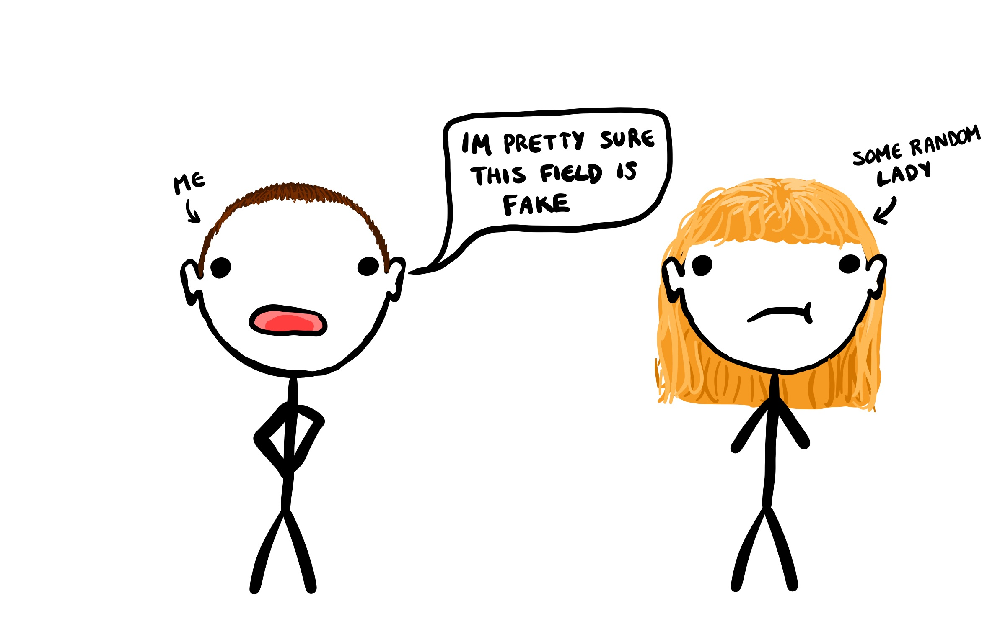{fig-align="center"}


## If you are me...
But you are a year into your externally funded PhD with a set topic

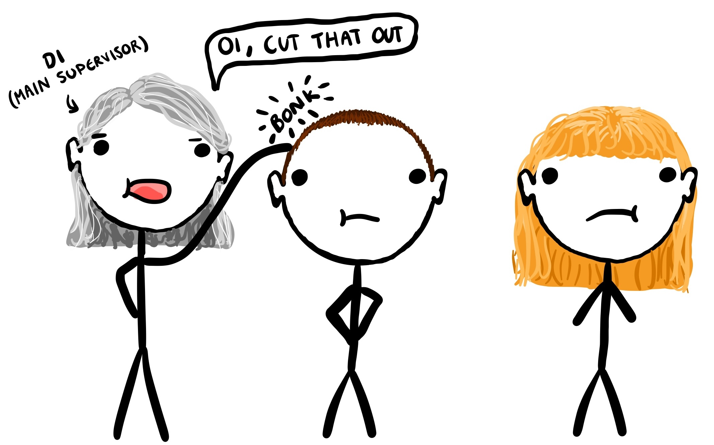{fig-align="center"}

## So you take another approach
::: {.incremental}
- Instead of defining what uncertainty **IS**...
- Maybe we can look at where uncertainty **ISN'T?**
- To do that, we need to take a look back into the past... 
  - past... 
  - [past...]{style="font-size: 0.8em"} 
  - [past...]{style="font-size: 0.4em"} 
::: 


## Posivitism [@Otsuka2023] {.smaller}
::::: columns
::: {.column width="50%"}
- In nineteenth-century England, positivism was all the rage
  - Positivists loved descriptive statistics *becase* they don't have uncertainty
:::

::: {.column width="50%"}

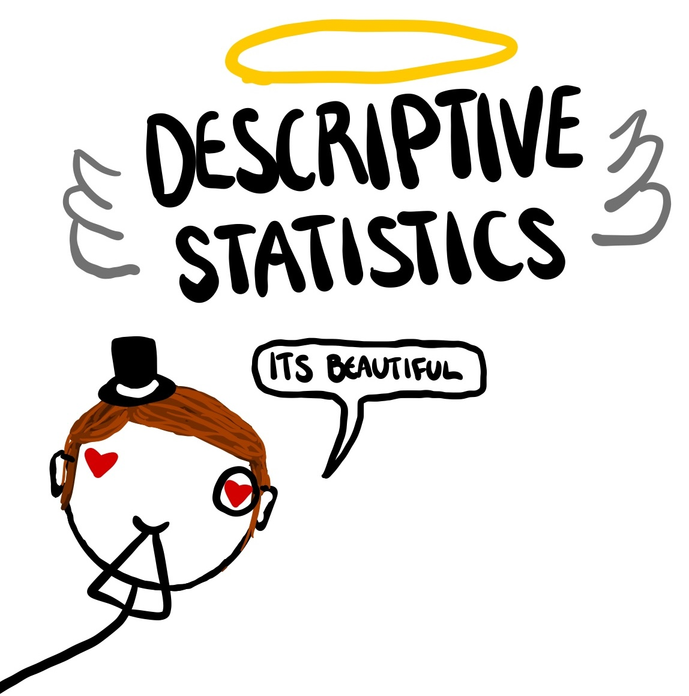{fig-align="center"}

:::
:::::


## Posivitism [@Otsuka2023] {.smaller}
::::: columns
::: {.column width="50%"}

:::: {.incremental}
- Inference requires us to reference the "unobservable"
  - Discussions about future values, population parameters, new observations
- Uniformity of nature: assume that the observations we have are similar to the ones we do not have
  - The potential to violate this assumption is what creates uncertainty
- Uncertainty is the price we pay for looking beyond our observations

:::: 

:::

::: {.column width="50%"}

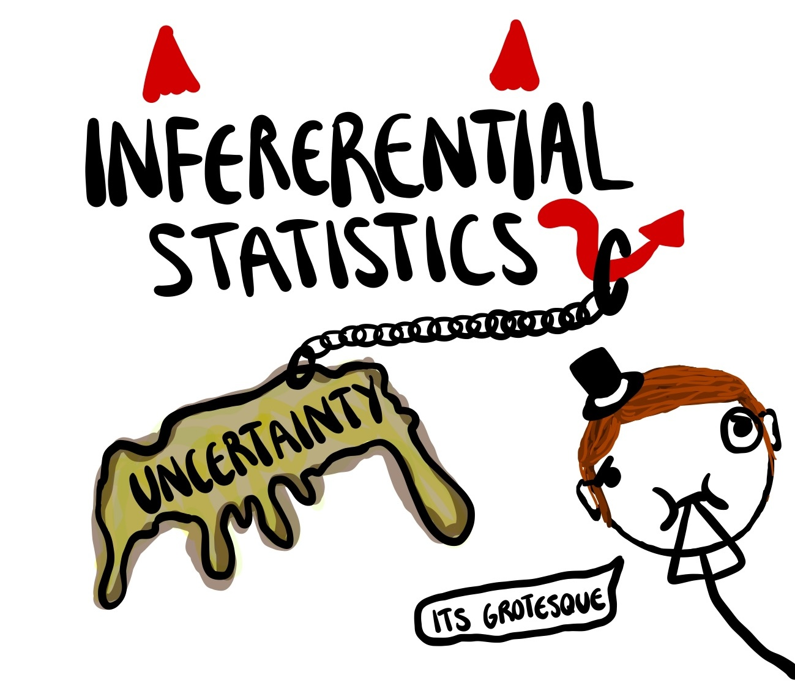{fig-align="center"}

:::
:::::

## What is uncertainty? {.smaller}
:::: {.incremental}
- Every example of uncertainty is simply a violation (or potential violation) to the *uniformity of nature*
  - We check for the violations using statistical tests
  - We quantify the violations using statistical inference
  - e.g. missing data.
    - It is not, in and of itself, "uncertainty", but it can *create* uncertainty through a reduction in information, or bias
- If we have zero violations we have no uncertainty (as is the case with descriptive statistics).
    
:::: 

## Quantifying uncertainty {.smaller}
:::: {.incremental}
- Uncertainty must be quantified to be visualised
- Quantified uncertainty will either appear as:
  a. Bias = false information 
    - Our population parameter is not like existing data (e.g. data not missing completely at random)
  b. Variance = insufficient information 
    - We cant say if our population parameter is like existing data (e.g. data missing completely at random loses data) 
- Quantified uncertainty can be represented as an adjustment to the density of your estimate

:::: 

## The role of statistics in uncertainty
:::: {.incremental}

- Statisticians are like data economists
  - Economists = Maximise utility given a set amount of resources
  - Statisticians = Minimise uncertainty given a set amount of data
- If we didn't want to use statistics, we could just throw up our hands and say everything is equally likely 
  - We all probably know someone like this
  - The "well everything gives you cancer" approach
  - Not advised (I am a statistician though, so I'm biased)
    
:::: 


## This framework organises our "uncertainty" words {.smaller}
:::: {.incremental}

We can look at all those terms we had earlier, and understand how they fit in with this description of uncertainty
- Precision? **The set level of information that we have (looking beyond it would create variance).** 
- Error, risk, or accuracy? **The consequences of uncertainty.**
- Missing values, expertise, assumptions? **Potential violations to the uniformity of nature** 
- Probability, variance, bounds, or confidence intervals? **A numerical summary of our quantified uncertainty**

:::: 

## Where is the uncertainty coming from in visualisation?
:::: {.incremental}

- There are two things we can be uncertain about in a data visualisation
  1. The data itself (i.e. we are visualising estimates) 
  2. The conclusions we draw from the plot (i.e. visual inference)

:::: 


## Where is the uncertainty coming from in visualisation? {.smaller}
:::: {.incremental}
- Visualisation are used for Exploratory Data Analysis (EDA)
  - EDA is a deductive method
  - Uncertainty in conclusions is a fundamental feature of deduction, this uncertainty (i.e. #2) cannot be incorporated into the visualisation
  - It would violate causality
- Data is the only possible source of uncertainty in an uncertainty visualisation.

:::: 


## What does this mean?
::: {.incremental}
Uncertainty visualisation is the visualisation of random matricies

- Earlier in our analysis we performed *inference* and created *estimates*
- Estimates are best repesented as *probability distributions*
- A table of probability distributions is a *random matrix*
- Uncertainty visualisation is the visualisation of this data

::: 

## No, probability distributions are not limiting {.smaller}
:::: {.incremental}
- Some researchers (fools) believe these abstract notions of uncertainty "cannot be described by a probability distribution"
  - Credibility or confidence? Bayesians constantly model degrees of belif
  - Uncertain about uncertainty? Hiercarchical approaches
  - False assumptions? Diagnostic tools caught dead in a ditch
- Annecdotally, I am *YET* to come accross a *SINGLE* example of uncertainty that cannot be modeled by a density function 

:::: 


## Make this data using distributional {.smaller}

```{r}
clean_walk|> 
  as_tibble() |>
  select(steps_dist, team, name) |>
  head(4) 
```

::: {.incremental}
- Include pedometer uncertainty with `distributional`
  - Thank you Mitch, Matt, Alex, and Rob
  - This is not a talk on `distributional`
- Our walktober examples are truncated normal distributions
  - The "prior inference" comes from measurement error (i.e. what is my *true* step count, not the *recorded* step count)
  
:::

# Part 2: What is the goal of uncertainty visualisation?


## What is the goal of uncertainty visualisation?

::::: columns
::: {.column width="40%"}
- We want to visualise uncertainty in a way that is statistically sensible
- Statistical properties are what differentiate us from the animals

:::

::: {.column width="60%"}
{fig-align="center"}
:::
:::::

## What is visualisation?
A continuous functions that maps distance in our data to a visual representation

{fig-align="center"}

## What is the goal of visualisation?
::::: columns
::: {.column width="50%"}

Lets start with a smaller question.

:::: {.incremental}
- When is the essence of our goals for a visualisation? What is it trying to do?
- The `plotscaper` paper made this point really well
:::: 

:::

::: {.column width="50%"}

{fig-align="center"}

:::
:::::

## A graphic is a map between data visualisation and visual representation

```{r}
#| include: false
#| eval: false
library(tidyverse)
df <- tibble(Species = c("Dog", "Cat", "Dog", "Bird", "Cow", "Cat", "Dog"),
             Weight = c(9.7, 5.2, 62.3, 0.8, 562.8, 3.7, 32.4))
ggplot(df) +
  geom_point(aes(x = Species, y = Weight, colour = Species)) +
  scale_y_log10() +
  theme(aspect.ratio = 1)
```

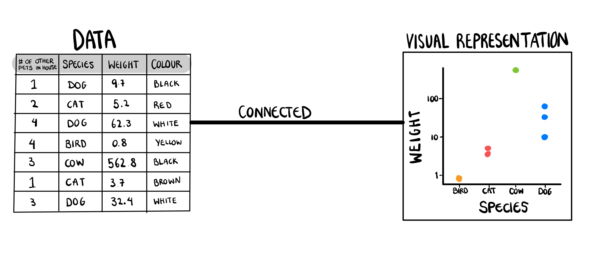{fig-align="center"}


## Data to Representation 
This is what differentiates a statistical graphic from a drawing

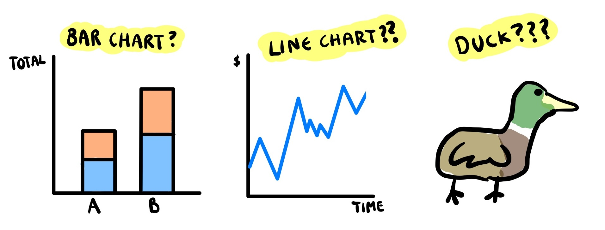{fig-align="center"}


## Extending on this idea {.smaller}
:::: {.incremental}
- We expand on this idea by expanding on this concept to define metrics and convergence for visualisations
  - Distance in the data space should equate to distance in the visual space
  - e.g. bad colour palet selection can warp the space
- Distance in visual space = visual distinguishability 
  - e.g. lineup protocol @Buja2009
  
::::

## What is the lineup protocol?
::::: columns
::: {.column width="60%"}
:::: {.incremental}
- To explain what the lineup protocol is, I am going to use an example from @Chowdhury
- Researchers have a dataset of wasp gene expression
  - 4 groups - Foundress (F), Gyne (G), Queen (Q) and Worker (W)
  - 447 variables, randomly selected 40
  - 50 observations Number of observations
  - Performed a linear discriminant analysis (LDA) decomposition, and visualised the results
- Is this group separation statistically significant?

:::: 

:::

::: {.column width="40%"}

```{r}
# Generate true data from lineup protocol
library(MASS)
library(nullabor)
library(tidyverse)
library(ggthemes)

data(wasps)

wasp.lda <- lda(Group~., data=wasps[,-1])
wasp.ld <- predict(wasp.lda, dimen=2)$x
true <- data.frame(wasp.ld, Group=wasps$Group)

ggplot(true, aes(x=LD1, y=LD2, colour=Group)) + 
  geom_point() + 
  theme(aspect.ratio=1) +
  scale_color_gdocs()
```

:::
:::::


## What is the lineup protocol?
::::: columns
::: {.column width="50%"}
:::: {.incremental}
- A lineup protocol is a kind of visual hypothesis test introduced by @Buja2009

  - You have a visual function, $V$, that you use to generate a plot
  - You generate 19 plots from some null distribution, 
  - You generate 1 plot from your true data
  - If you can identify the true plot, you reject the null hypothesis
  
:::: 

:::

::: {.column width="50%"}

```{r}
# Generate lineup protocol plot
wasp.sim <- data.frame(LD1=NULL, LD2=NULL, Group=NULL, .n=NULL)
for (i in 1:19) {
  x <- wasps
  x$Group <- sample(x$Group)
  x.lda <- lda(Group~., data=x[,-1])
  x.ld <- predict(x.lda, dimen=2)$x
  sim <- data.frame(x.ld, Group=x$Group, .n=i)
  wasp.sim <- rbind(wasp.sim, sim)
}

pos <- sample(1:20, 1)
d <- lineup(true=true, samples=wasp.sim, pos=pos)

ggplot(d, aes(x=LD1, y=LD2, colour=Group)) + 
  facet_wrap(~.sample, ncol=5) +
  geom_point() + theme(aspect.ratio=1) +
  scale_color_gdocs()
```

:::
:::::


## Hypothesis test = Malhalobis distance{.smaller}

::::: columns
::: {.column width="40%"}

- Lineups (and visualisation more broadly) implicitly use visual distinction (or discernability) as distance. 
- The lineup employs a Malhalobis distance version of this metric
  - This makes sense as it is a visual version of a statistical test

:::

::: {.column width="60%"}

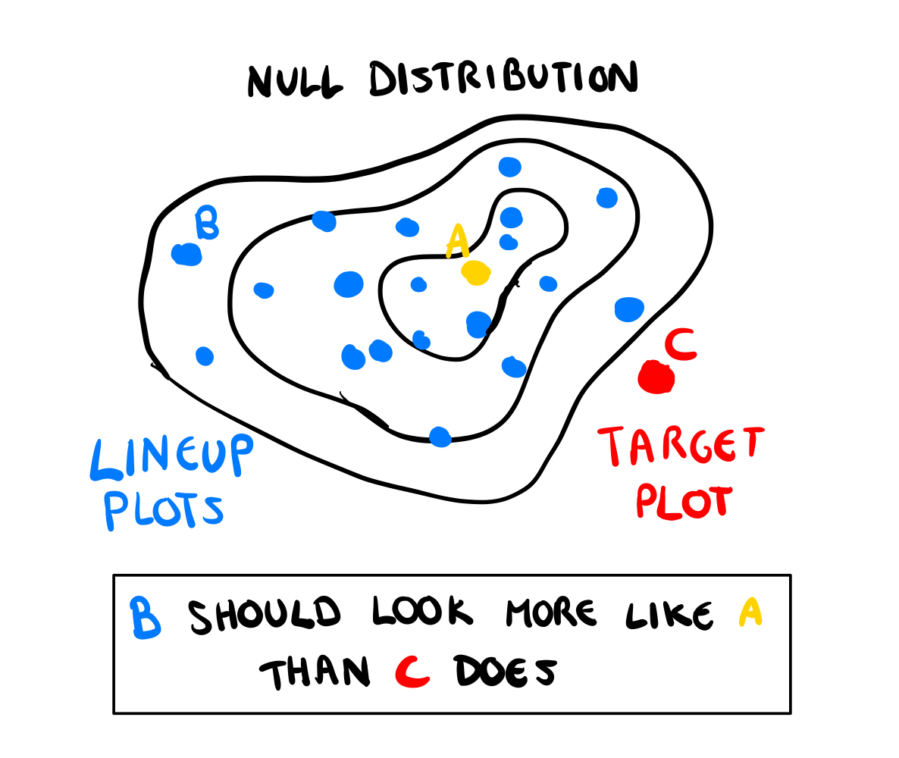{fig-align="center"}

:::
:::::

## Defining visual convergence
- This allows us to define convergence
- That is, when two plots are visually indistinguishable from one another, they have visually converged.
- Why do we want to define convergence? It gives us enough information to answer our original question...

## What is uncertainty visualisation?
If a visualisation is a a continuous functions...

{fig-align="center"}

## What is uncertainty visualisation?
...And an uncertainty visualisation is a visualisation with a *random matrix input*...

{fig-align="center"}


## What is uncertainty visualisation?
...then maintaining the link requires us to adhere to Continuous Mapping theorem

{fig-align="center"}

## What is uncertainty visualisation?
So an uncertainty visualisations are visualisations of random matricies, that have the desired convergent properties

```{r}
#| eval: false
#| include: false

library(ggdibbler)
library(patchwork)
library(colorspace)

p1 <- ggplot(faithfuld, aes(waiting, eruptions)) + 
  geom_raster(aes(fill = density)) +
  scale_fill_continuous_sequential(palette = "Terrain", rev = FALSE) +
  theme(legend.position = "bottom")

p2 <- ggplot(uncertain_faithfuld, aes(waiting, eruptions)) + 
  geom_raster_sample(aes(fill = density0)) +
  scale_fill_continuous_sequential(palette = "Terrain", rev = FALSE) +
  theme(legend.position = "bottom")

p3 <- ggplot(uncertain_faithfuld, aes(waiting, eruptions)) + 
  geom_raster_sample(aes(fill = density)) +
  scale_fill_continuous_sequential(palette = "Terrain", rev = FALSE) +
  theme(legend.position = "bottom")

p4 <- ggplot(uncertain_faithfuld, aes(waiting, eruptions)) + 
  geom_raster_sample(aes(fill = density2)) +
  scale_fill_continuous_sequential(palette = "Terrain", rev = FALSE) +
  theme(legend.position = "bottom")

pv <- ggplot() +
  geom_segment(aes(x = 0, xend = 5, y = 1 ), arrow = arrow()) +
  geom_text(aes(label = expression(sigma), x = -0.2, y = 1 ), size = 10) +
  geom_text(aes(label = "0", x = 5.2, y = 1 ), size = 10) +
  geom_text(aes(label = "as the variance approaches zero", x = 2.5, y = 1.1 ), size = 6) +
  ylim(0.5,1.5) +
  theme_void()


pv / (p4 | p3 | p2 | p1 ) 

```

## Call this "signal modulation"
- This property means that statistical validity translates to perceptual ease
    - The higher the variance on an estimate, the harder that estimate is to extract from the plot
- The purpose of a visualisation is to give a quick gist (NO mental calculations)

{fig-align="center"}

## Convergence of uncertainty visualisation
- Difficulty in value extraction is often avoided, but it is a requirement of a data visualisation that operates as intended.

*Include LDA uncertainty visualisation example to talk about visual differentiation*

# Part 3: How to (safely) make uncertainty visualisations in `ggdibbler`

## Whoops, I broke the connection
- It turns out breaking the connection between data and representation is really easy in uncertainty visualisation
- It happens all the time

*Include example of A with blur and with sampling*


## Make this into a `ggplot2` extension
I want a package that does this for every `geom` & `stat`

{fig-align="center"}


## Minds eye code
The function is the same. The input that different
```{r}
#| echo: true
#| eval: false
# determinsitic ggplot
ggplot(deterministic_data) +
  geom_tile(aes(x=x, y=y, fill=z))

# random variable ggplot
ggplot(random_data) +
  geom_tile(aes(x=x, y=y, fill=random_z))
```

{fig-align="center"}


## Its a simple problem...

{fig-align="center"}


## That is actually even simpler {.smaller}
  
::::: columns
::: {.column width="50%"}
::: {.incremental}
- Represent as a set of samples from the random matrix
- Only distribution representation that can be subbed into any `ggplot2` function
  - Mean/median brings us back to the original problem
  - PDF leads to the geom_rug problem
  - Quantiles need an ordering (problem in figure)
  
::: 

:::

::: {.column width="50%"}

```{r}
#| fig-align: center
#| fig-height: 6
#| fig-width: 6

# Random intercept
tsize=20
# Generate multivariate data
set.seed(112)
dist <- dist_multivariate_normal(mu = list(c(0,0)), 
                                 #sigma = list(matrix(c(1,0,0,1), ncol=2)))
                                 sigma = list(matrix(c(1,-0.8,-0.8,1), ncol=2)))
dimnames(dist) <- c("x", "y")

a <- quantile(dist, p = seq(0, 1, length.out = 100),
              type = "marginal") 
qdf <- tibble(x = unlist(a)[1:100],
              y = unlist(a)[101:200]) |>
  rownames_to_column() |>
  mutate(rowname = as.numeric(rowname)) 

b <- generate(dist, times = 100)
sdf <- tibble(x = unlist(b)[1:100],
              y = unlist(b)[101:200]) |>
  rownames_to_column() |>
  mutate(rowname = as.numeric(rowname),
         distance = sqrt(x^2 + y^2),
         rawdist = x + y)


q1 <- qdf |>
  ggplot() + 
  geom_abline(aes(intercept = x, slope = 1, colour = x), 
              alpha=0.7, linewidth=1.5) +
  scale_colour_continuous_sequential(palette = "Batlow") +
  scale_x_continuous_distribution(limits = c(-2,2)) +
  scale_y_continuous_distribution(limits = c(-2,2)) +
  ggtitle("a. quantile: intercept") 

q2 <- sdf |>
  ggplot() + 
  geom_abline(aes(intercept = x, slope = 1, colour = x), 
              alpha=0.5, linewidth=1.5) +
  scale_colour_continuous_sequential(palette = "Batlow") +
  scale_x_continuous_distribution(limits = c(-2,2)) +
  scale_y_continuous_distribution(limits = c(-2,2)) +
  ggtitle("b. sample: intercept") 

q3 <- qdf |>
  ggplot() + 
  geom_abline(aes(intercept = x, slope = y, colour = rowname), 
              alpha=0.7, linewidth=1.5) +
  scale_colour_continuous_sequential(palette = "Batlow") +
  scale_x_continuous_distribution(limits = c(-2,2)) +
  scale_y_continuous_distribution(limits = c(-2,2)) +
  ggtitle("c. quantile: intercept, slope") 

q4 <- sdf |>
  ggplot() + 
  geom_abline(aes(intercept = x, slope = y, colour = rawdist), 
              alpha=0.5, linewidth=1.5) +
  scale_colour_continuous_sequential(palette = "Batlow") +
  scale_x_continuous_distribution(limits = c(-2,2)) +
  scale_y_continuous_distribution(limits = c(-2,2)) +
  ggtitle("d. sample: intercept, slope") 


q1 + q2 + q3 + q4 

```

:::
:::::


## ... and we make even simpler again
- Start off with a choropleth map, `geom_sf`

```{r}
# get data
load("data/my_map_data.rda")

# seed for sampling
set.seed(1997)

# data dimension for sampling
n <- dim(my_map_data)[1]

# Make palettes
longpal <- rev(sequential_hcl(13, palette = "YlOrRd"))
basecols <- longpal[3:10]
breaks <- 21:29 
breakslong <- 18:32 
names(basecols) <- seq(8)
names(longpal) <- -1:11
var_seq <- seq(0,12, by=3)

my_map_data <- my_map_data |>
  mutate(temp = 29 - 2*abs(scale(cent_lat) - sin(2*(scale(cent_long)))[,1]), # trend
         highvar = runif(n, min=8, max=var_seq[5]), # high variance
         lowvar = runif(n, min=2, max=4), # low variance
         count_id = row_number()) |>
  pivot_longer(cols=highvar:lowvar, names_to = "variance_class", values_to = "variance") |>
  # add bivariate classes to data
  mutate(bitemp = cut(temp, breaks=breaks, labels=seq(8)),
         bivar = cut(variance, breaks=var_seq, labels=seq(4)),
         biclass = paste(bitemp, bivar, sep="-")) |>
  mutate(highlight = ifelse(count_id <= 5, TRUE, FALSE)) |>
  mutate(temp = as.numeric(temp))

###################### CHOROPLETH MAP ###################### 
my_map_data |>
  filter(variance_class=="lowvar") |>
  ggplot() +
  geom_sf(aes(fill = temp, 
              geometry = geometry), colour=NA) + 
  scale_fill_gradientn(colours = basecols) +
  #theme_void() +
  labs(fill = "temperature") +
  theme_map() +
  theme(legend.position = "inside", 
        legend.position.inside = c(0.1, -0.2),
        legend.direction = "horizontal",
        legend.background = element_rect(fill=NA),
        plot.title = element_text(size = 14)) 
```


## If you have a simple problem...
The ggplot2 book has lots off good advice

{fig-align="center"}

## Not so simple errors

{fig-align="center"}


## Asking for help 
{fig-align="center"}

## Asking for help 
{fig-align="center"}

## Asking for help 
{fig-align="center"}

## Mania in the Github activity
{fig-align="center"}


## Spatial Plots  {.smaller}

```{r spatialdata}
#| echo: false
# Make average summary of data
toy_temp_mean <- toy_temp |> 
  dplyr::group_by(county_name) |>
  summarise(temp_mean = mean(recorded_temp))
```

::::: columns
::: {.column width="50%"}

```{r}
#| echo: true
#| fig-width: 4
ggplot(toy_temp_mean) +
  geom_sf(aes(geometry=county_geometry, fill=temp_mean), linewidth=0) +
  scale_fill_distiller(palette = "OrRd") +
  theme_map() +
  theme(legend.position = "bottom") +
  ggtitle("ggplot2")

```

:::

::: {.column width="50%"}

```{r}
#| echo: true
#| fig-width: 4

ggplot(toy_temp_dist) + 
  geom_sf_sample(aes(geometry = county_geometry, fill=temp_dist), linewidth=0, times=50) + 
  scale_fill_distiller(palette = "OrRd") +
  theme_map() +
  theme(legend.position = "bottom") +
  ggtitle("ggdibbler")
```

:::
:::::

## Uncertain EVERYTHING
The extension is TRIVIAL!

{fig-align="center"}


## Uncertain data sets!
Every data set used in the `ggplot2` documentation has a `distributional` version in `ggdibbler` where **EVERY** variable is a random variable.

- `diamonds` = `uncertain_diamonds`
- `mpg` = `uncertain_mpg`
- `mtcars` = `uncertain_mtcars`
- `faithful` = `uncertain_faithful`
- `economics`= `uncertain_economics`

## Any geom!

::::: columns
::: {.column width="50%"}

```{r}
#| echo: true
#| fig-width: 4
ggplot(faithfuld, aes(waiting, eruptions, z = density)) + 
  ggtitle("ggplot2") +
  geom_contour() +
  theme(aspect.ratio = 1)

```

:::

::: {.column width="50%"}

```{r}
#| echo: true
#| fig-width: 4

ggplot(uncertain_faithfuld, aes(waiting, eruptions, z = density))+
  ggtitle("ggdibbler") +
  geom_contour_sample(alpha=0.2)+
  theme(aspect.ratio = 1)

```

:::
:::::

## Any geom! {.smaller}

::::: columns
::: {.column width="50%"}

```{r}
#| echo: true
#| fig-width: 4
ggplot(faithfuld, aes(waiting, eruptions)) + 
  geom_raster(aes(fill = density)) +
  scale_fill_viridis_c() +
  theme(legend.position = "none") +
  ggtitle("ggplot2")

```

:::

::: {.column width="50%"}

```{r}
#| echo: true
#| fig-width: 4

ggplot(uncertain_faithfuld, aes(waiting, eruptions)) + 
  geom_raster_sample(aes(fill = density2)) +
  scale_fill_viridis_c() +
  ggtitle("ggdibbler")+
  theme(legend.position = "none")

```

:::
:::::

## Any aesthetic! {.smaller}

```{r textdata}
#| echo: false
set.seed(10)
textdata <- expand_grid(x = c(1,2,3,4,5), y= c(1,2,3,4,5)) |>
  mutate(
    text_const = sample(c(TRUE, FALSE), 25, replace=TRUE),
    text_dist = dist_bernoulli(0.3 + 0.4*text_const),
    ) 
```

::::: columns
::: {.column width="50%"}

```{r}
#| echo: true
#| fig-width: 4
ggplot(textdata, aes(x=x, y=y)) +
  geom_text(aes(label = text_const), size=4) +
  theme_few() +
  ggtitle("ggplot2") +
  theme(aspect.ratio = 1, legend.position = "none") 

```

:::

::: {.column width="50%"}

```{r}
#| echo: true
#| fig-width: 4

ggplot(textdata, aes(x=x, y=y, lab = text_dist)) +
  geom_text_sample(aes(label = after_stat(lab)), size=4, alpha=1/30, times=30) +
  ggtitle("ggdibbler") +
  theme_few() +
  theme(aspect.ratio = 1, legend.position = "none") 

```

:::
:::::


## Uhh hold on, positions are an isuse {.smaller}

```{r dodgebarchart}
#| fig-height: 4
#| fig-width: 12
set.seed(10)
catdog <- tibble(
    DogOwner = sample(c(TRUE, FALSE), 25, replace=TRUE),
    CatOwner = sample(c(TRUE, FALSE), 25, replace=TRUE))

random_catdog <- catdog |>
  mutate(
    DogOwner = dist_bernoulli(0.1 + 0.8*DogOwner),
  )
    

p1 <- ggplot(catdog, aes(DogOwner)) + 
  geom_bar_sample(aes(fill = CatOwner), 
                  position = "stack")+
  theme_few() +
  theme(legend.position="none", aspect.ratio = 1)+
  ggtitle("ggplot: stack")


p2 <- ggplot(random_catdog, aes(DogOwner)) + 
  geom_bar_sample(aes(fill = CatOwner), times=30,
                  position = "stack_dodge") +
  theme_few() +
  theme(legend.position="none", aspect.ratio = 1)+
  ggtitle("ggdibbler: stack_dodge")

p3 <- ggplot(random_catdog, aes(DogOwner)) + 
  geom_bar_sample(aes(fill = CatOwner),  times=30,
                  position = "stack") +
  theme_few() +
  theme(legend.position="none", aspect.ratio = 1)+
  ggtitle("stack")

p3 <- ggplot(random_catdog, aes(DogOwner)) + 
  geom_bar_sample(aes(fill = CatOwner),  times=30,
                  position = "stack") +
  theme_few() +
  theme(legend.position="none", aspect.ratio = 1)+
  ggtitle("ggdibbler: stack")

p1 | p3

```

{fig-align="center"}

## Nested positions!
```{r}
p1 | p2
```

## Any Position! {.smaller}

::::: columns
::: {.column width="50%"}

```{r}
#| echo: true
#| fig-width: 4
ggplot(mpg, aes(class)) + 
  geom_bar_sample(aes(fill = drv), 
                  position = "stack")+
  theme(legend.position="none")+
  ggtitle("ggplot2")

```

:::

::: {.column width="50%"}

```{r}
#| echo: true
#| fig-width: 4

ggplot(uncertain_mpg, aes(class)) + 
  geom_bar_sample(aes(fill = drv),times = 30, alpha=1/30,
                  position = "stack_identity")+
  theme(legend.position="none")+
  ggtitle("ggdibbler")

```

:::
:::::


## All the documentation!

::::: columns
::: {.column width="50%"}
{fig-align="center"}
:::

::: {.column width="50%"}

{fig-align="center"}

:::
:::::


## Combine all this together to get...

{fig-align="center"}

## Flexible uncertainty visualisation! {.smaller}

{fig-align="center"}


## Back to walktober example

```{r}
# Plot0B
p3 <- ggplot(my_suburbs) +
  geom_sf_sample(data = suburb_walk, linewidth=0, times=100,
                 aes(geometry= geometry, fill = steps_dist)) +
  geom_sf(aes(geometry= geometry), fill=NA) +
  theme_map()  +
  ggtitle("Average steps per day by Melbourne Suburb") + 
  labs(fill = "Average steps per day") +
  scale_fill_continuous_sequential(palette = "Magenta", rev = TRUE)

# plot 3B
p4 <- ggplot(clean_walk, aes(x=team, y = steps_dist, fill = team_colour)) +
  geom_col_sample(times=50) +
  scale_fill_identity() +
  ggtitle("Total steps per team, per person") +
  theme_few()

p3 + p4
```


# Part 4: Verifying that the plots work


## Am I bad at my job?{.smaller}
- I spent the middle two years of my PhD just kind of been going around and saying the pixel map works best for signal modulation 
- My primary evidence being "bro look at it, we all have eyes"
- Some people disagree with me?
- Apparently I can't just say stuff without any evidence


## Should you start a perceptual experiment from scratch three months before your PhD submission deadline and also forget to tell your main advisor about it until you are like a month in? 
- Sure, why not (If you have Rachel and Alison's help)

## Well thankfully there is probably some existing evaluation approach you can use to test your hypothesis...
- Nah
- Wait what?

## Implicit vs Explicit testing
- There are two ways to evaluate a plot [@Vanderplas2020]

  - Explicit: "What is the spatial correlation in this plot?"
  - Implicit: "Which is the odd one out"


## Prefer to use implicit
There are two issues with using explicit testing
1. Implicit tests are more aligned with EDA
2. The Ratatouille rule

## The Ratatouille rule{.smaller}

::::: columns
::: {.column width="65%"}

- "Not everyone can become a great artist, but a great artist can come from anywhere." - Anton Ego (Ratatouille (2007))
- "Not *everyone* need to be able to understand your plot, but a good plot can be understood by *anyone*. - Me (right here, right now)
  - Colour blind friendly palette VS Spatial autocorrelation

:::

::: {.column width="35%"}

{fig-align="center"}

:::
:::::


## So, the lineup protocol?
- Remember the two sources of uncertainty in a graphic?
  1. The data itself (i.e. we are visualising estimates) 
  2. The conclusions we draw from the plot (i.e. visual inference)
- Visual inference tests the second. We only have the first.


## Aside: pour one out for Alison and Rachel
{fig-align="center"}


## Message from Susan
::: {.chat}
:::: {.speaker-2}
Hey
::::
:::

## Context: Who is Susan?
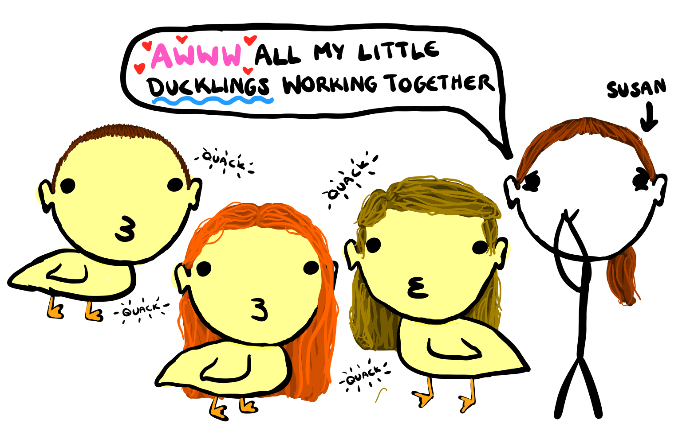{fig-align="center"}


## Message from Susan
::: {.chat}
:::: {.speaker-2}
Hey
::::

:::: {.fragment .speaker-2}
Are you doing OK? I just spoke to Rachel and Alison at the Graphics Group meeting, and they are worried about you after your meeting today.
::::

:::: {.fragment .speaker-1}
RIP I thought that meeting went well. Whoops.
::::

:::: {.fragment .speaker-2}
Yup I thought so. I told them you are just like that.
::::

:::


## We need an explicit evaluation method that...
- Can measure a latent variable (uncertainty)
- Could be understood by a child 
- Specifically tests if a pattern is visible 

## ... Wait 
  
::::: columns
::: {.column width="60%"}

- Thats just an Ishihara colourblind test
- Usually the latent variable is colour vision deficiency
- In this experiment we will make the latent variable uncertainty.
- OK this will work.


:::

::: {.column width="40%"}

{fig-align="center"}

:::
:::::


## Will still use the power curve analysis{.smaller}

::::: columns
::: {.column width="40%"}

- Lineups can be compared to power curves
- We can do the same here 
:::

::: {.column width="60%"}

{fig-align="center"}

:::
:::::


## The stimuli
- Making Ishihara plates of the choropleth maps is super easy
- Nick Tierney has a package called `ishihara` 

{fig-align="center"}

## The stimuli
Which we use to make Ishihara uncertainty maps


## Data 
Grid of distance and variance of estimates

::::: columns
::: {.column width="50%"}

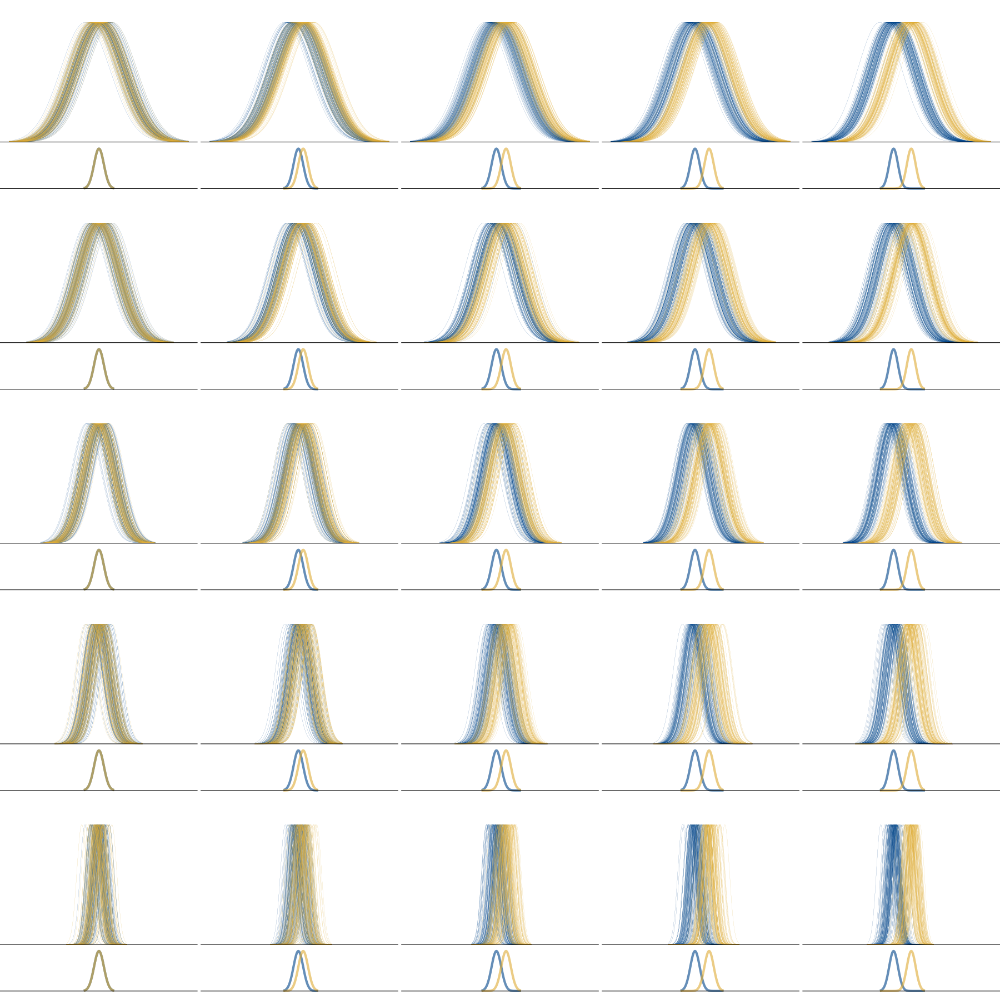{fig-align="center"}

:::

::: {.column width="50%"}

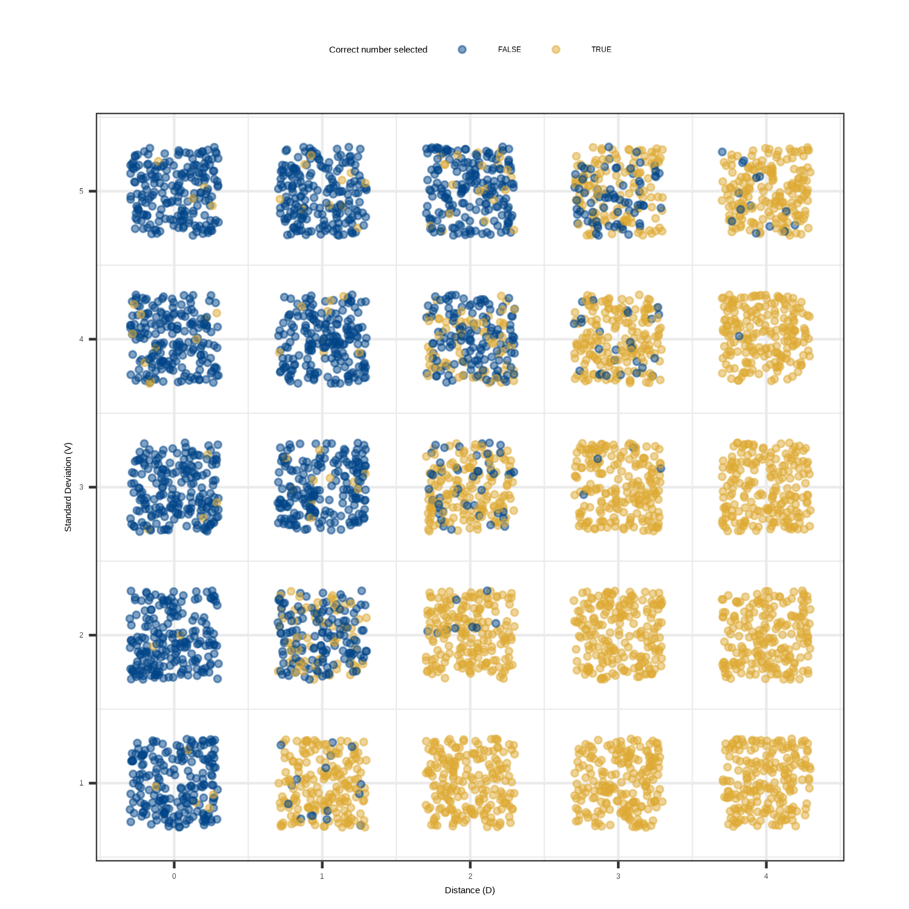{fig-align="center"}
:::
:::::


## Our hypothesis?
- i.e. stuff I have been saying with no evidence
  - 1. Choropleth maps and Bivariate value/variance maps are identical 
  - 2. VSUP will do some signal suppression, but not in a way that is mathematically consistent with hypothesis test results
  - 3. Pixel maps and Transparency maps should perform the same


## Significance levels
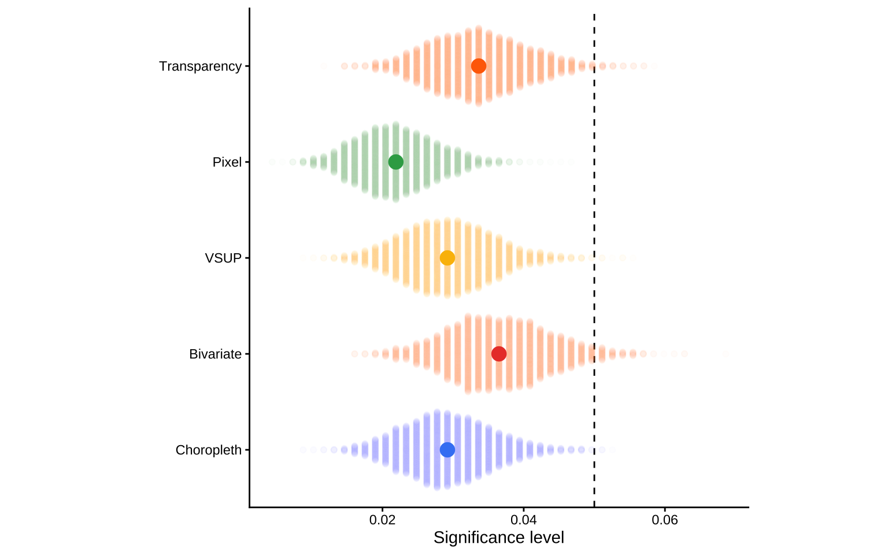{fig-align="center"}

## Choropleth - data
::::: columns
::: {.column width="50%"}

{fig-align="center"}

:::

::: {.column width="50%"}

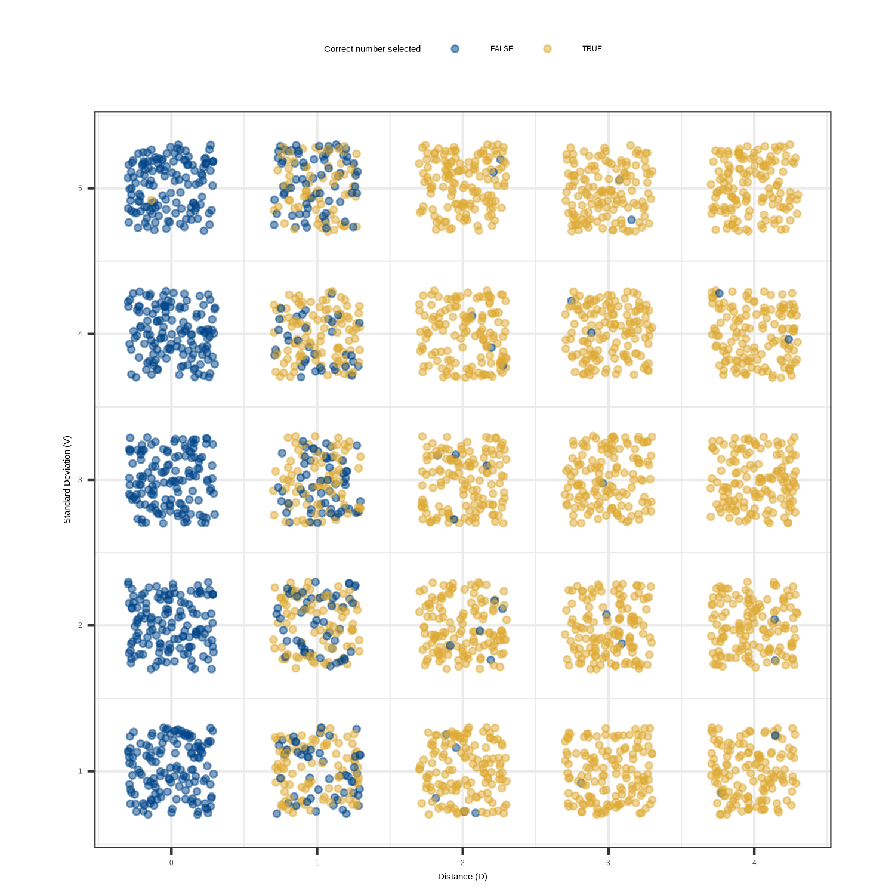{fig-align="center"}

:::
:::::


## Choropleth - power curves

```{r}
#| out-width: 100%
# load simulated models
load("data/glmer_models.rda")
load("data/theoretical_models.rda")
# load("data/average_fit.rda")

name_distance <- function(string) {
  paste0("Distance: \n", string)
}

LINES <- c("T-test" = "longdash", "Moran's I" = "dotdash")

map_type = "Choropleth"
pcol = gpal[1]

glmer_models |>
  filter(!D==0,
         plot_type %in% map_type) |>
  mutate(line_id = interaction(plot_type, id)) |>
  ggplot(aes(x=V,  group = line_id)) +
  geom_line(aes(y = power_random), colour = pcol,
            linewidth=0.3, alpha=0.3) +
  geom_line(data = theoretical_models |>
              filter(!D==0, plot_type %in% map_type) |>
              mutate(line_id = interaction(test, plot_type, correct_number)),
            aes(y=power_random, linetype = test),
            linewidth=0.3, colour = "black") +
  theme(legend.position="top", 
        legend.direction ="horizontal",
        text=element_text(size=10), 
        strip.text.x=element_text(size=8),
        strip.text.y=element_text(size=8),
        legend.text = element_text(size=8)) +
  guides(colour = "none") + 
  facet_wrap(~D, nrow = 1,
             labeller = labeller(D = name_distance)) +
  labs(x = "Standard Deviation", y = "Power",
       linetype = "Classical Test") +
  scale_linetype_manual(values = LINES) 

```


## Bivariate - data
::::: columns
::: {.column width="50%"}

{fig-align="center"}

:::

::: {.column width="50%"}

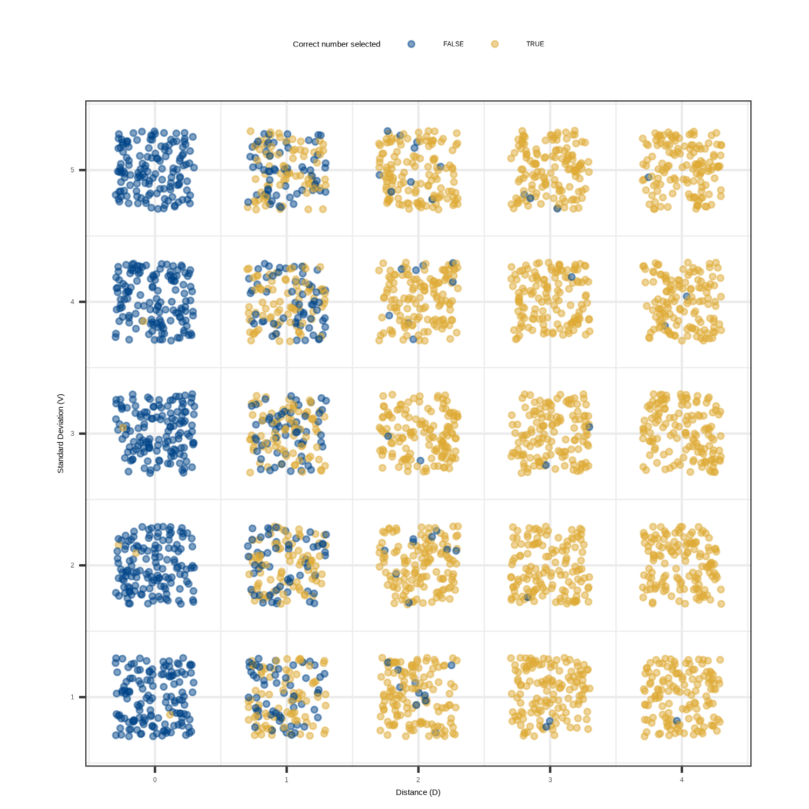{fig-align="center"}

:::
:::::

## Bivariate - power curves

```{r}
#| out-width: 100%
map_type = "Bivariate"
pcol = gpal[2]

glmer_models |>
  filter(!D==0,
         plot_type %in% map_type) |>
  mutate(line_id = interaction(plot_type, id)) |>
  ggplot(aes(x=V,  group = line_id)) +
  geom_line(aes(y = power_random), colour = pcol,
            linewidth=0.3, alpha=0.3) +
  geom_line(data = theoretical_models |>
              filter(!D==0, plot_type %in% map_type) |>
              mutate(line_id = interaction(test, plot_type, correct_number)),
            aes(y=power_random, linetype = test),
            linewidth=0.3, colour = "black") +
  theme(legend.position="top", 
        legend.direction ="horizontal",
        text=element_text(size=10), 
        strip.text.x=element_text(size=8),
        strip.text.y=element_text(size=8),
        legend.text = element_text(size=8)) +
  guides(colour = "none") + 
  facet_wrap(~D, nrow = 1,
             labeller = labeller(D = name_distance)) +
  labs(x = "Standard Deviation", y = "Power",
       linetype = "Classical Test") +
  scale_linetype_manual(values = LINES) 

```


## VSUP - data

::::: columns
::: {.column width="50%"}

{fig-align="center"}

:::

::: {.column width="50%"}

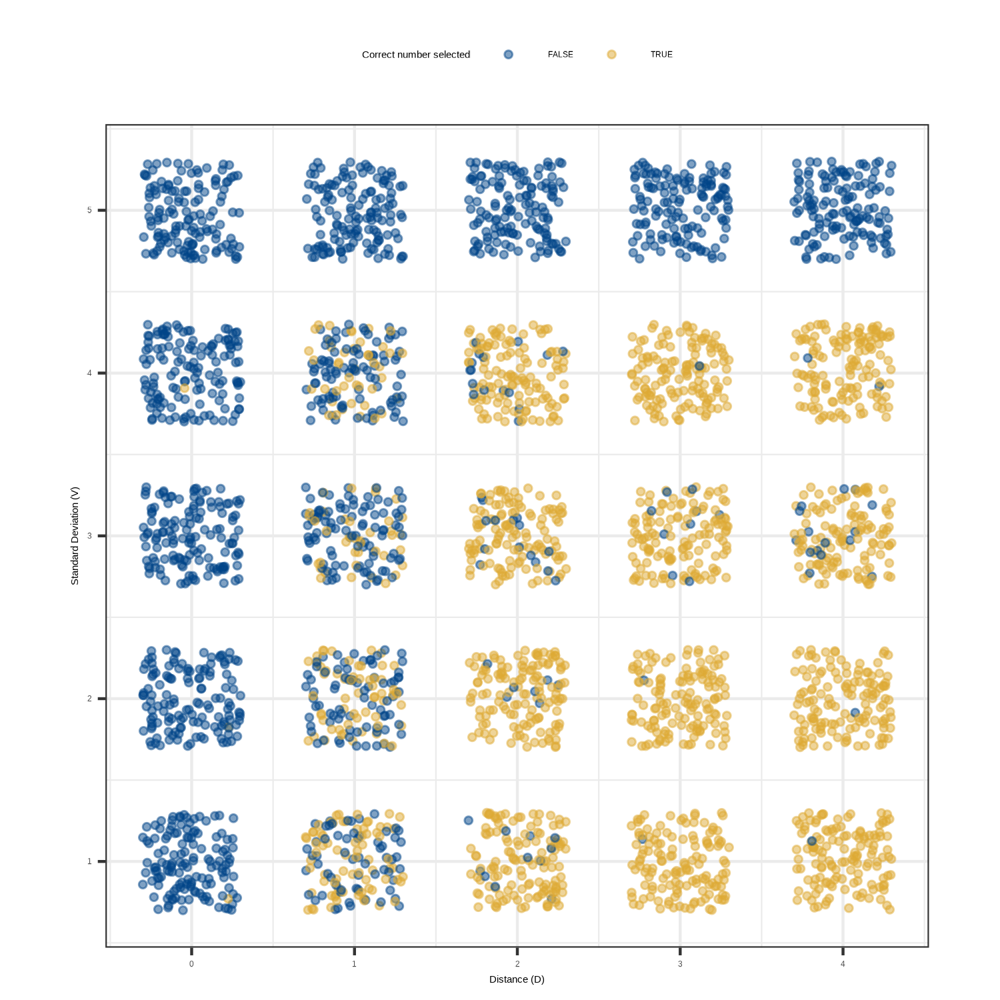{fig-align="center"}

:::
:::::


## VSUP - power curves

```{r}
#| out-width: 100%
map_type = "VSUP"
pcol = gpal[3]

glmer_models |>
  filter(!D==0,
         plot_type %in% map_type) |>
  mutate(line_id = interaction(plot_type, id)) |>
  ggplot(aes(x=V,  group = line_id)) +
  geom_line(aes(y = power_random), colour = pcol,
            linewidth=0.3, alpha=0.3) +
  geom_line(data = theoretical_models |>
              filter(!D==0, plot_type %in% map_type) |>
              mutate(line_id = interaction(test, plot_type, correct_number)),
            aes(y=power_random, linetype = test),
            linewidth=0.3, colour = "black") +
  theme(legend.position="top", 
        legend.direction ="horizontal",
        text=element_text(size=10), 
        strip.text.x=element_text(size=8),
        strip.text.y=element_text(size=8),
        legend.text = element_text(size=8)) +
  guides(colour = "none") + 
  facet_wrap(~D, nrow = 1,
             labeller = labeller(D = name_distance)) +
  labs(x = "Standard Deviation", y = "Power",
       linetype = "Classical Test") +
  scale_linetype_manual(values = LINES) 

```

## Pixel - data

::::: columns
::: {.column width="50%"}

{fig-align="center"}

:::

::: {.column width="50%"}

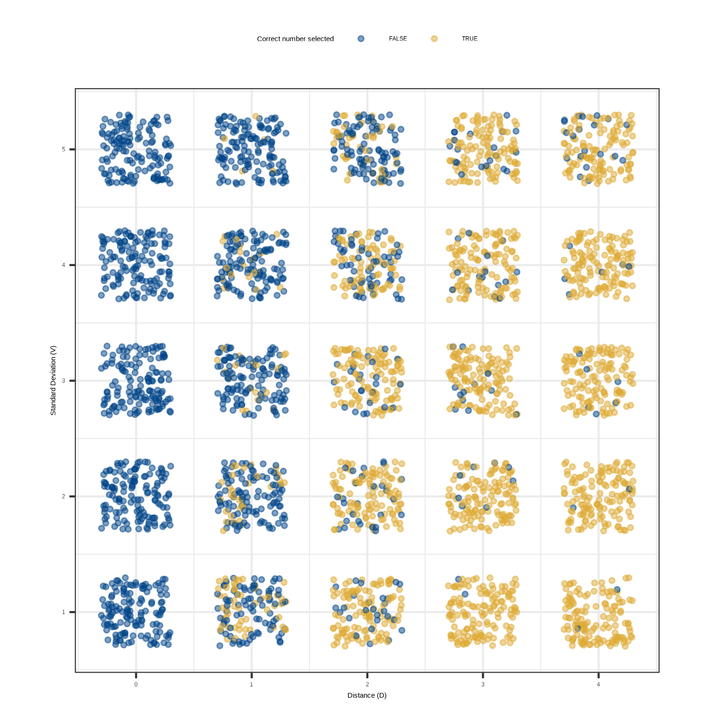{fig-align="center"}

:::
:::::

## Pixel - power curves

```{r}
#| out-width: 100%
map_type = "Pixel"
pcol = gpal[4]

glmer_models |>
  filter(!D==0,
         plot_type %in% map_type) |>
  mutate(line_id = interaction(plot_type, id)) |>
  ggplot(aes(x=V,  group = line_id)) +
  geom_line(aes(y = power_random), colour = pcol,
            linewidth=0.3, alpha=0.3) +
  geom_line(data = theoretical_models |>
              filter(!D==0, plot_type %in% map_type) |>
              mutate(line_id = interaction(test, plot_type, correct_number)),
            aes(y=power_random, linetype = test),
            linewidth=0.3, colour = "black") +
  theme(legend.position="top", 
        legend.direction ="horizontal",
        text=element_text(size=10), 
        strip.text.x=element_text(size=8),
        strip.text.y=element_text(size=8),
        legend.text = element_text(size=8)) +
  guides(colour = "none") + 
  facet_wrap(~D, nrow = 1,
             labeller = labeller(D = name_distance)) +
  labs(x = "Standard Deviation", y = "Power",
       linetype = "Classical Test") +
  scale_linetype_manual(values = LINES) 

```

## Transparency - data


::::: columns
::: {.column width="50%"}

{fig-align="center"}

:::

::: {.column width="50%"}

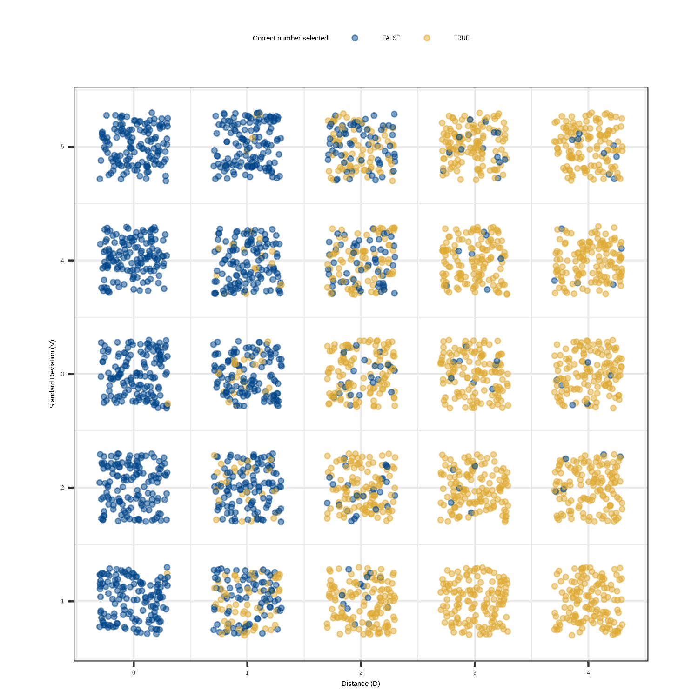{fig-align="center"}

:::
:::::

## Transparency - power curves
```{r}
#| out-width: 100%
map_type = "Transparency"
pcol = gpal[4]

glmer_models |>
  filter(!D==0,
         plot_type %in% map_type) |>
  mutate(line_id = interaction(plot_type, id)) |>
  ggplot(aes(x=V,  group = line_id)) +
  geom_line(aes(y = power_random), colour = pcol,
            linewidth=0.3, alpha=0.3) +
  geom_line(data = theoretical_models |>
              filter(!D==0, plot_type %in% map_type) |>
              mutate(line_id = interaction(test, plot_type, correct_number)),
            aes(y=power_random, linetype = test),
            linewidth=0.3, colour = "black") +
  theme(legend.position="top", 
        legend.direction ="horizontal",
        text=element_text(size=10), 
        strip.text.x=element_text(size=8),
        strip.text.y=element_text(size=8),
        legend.text = element_text(size=8)) +
  guides(colour = "none") + 
  facet_wrap(~D, nrow = 1,
             labeller = labeller(D = name_distance)) +
  labs(x = "Standard Deviation", y = "Power",
       linetype = "Classical Test") +
  scale_linetype_manual(values = LINES) 

```


## To sum up?
- I was right, never verify your claims, they will just prove what you already thought based on vibes


# Conclusion


## Acknowledgements
-   My supervisors: Di Cook, Susan Vanderplas, and Sarah Goodwin
-   Good ideas: Mitch O'Hara-Wild, Cynthia Huang, Emily Robbinson
-   AEMO Zema Energy Scholarship
-   Australian RTP Stipend
-   Numbat Hackathon (for the walktober data)
