# Walktober

```{r setup}
#| include: false
#| message: false
#| warning: false

library(ggdibbler)
library(tidyverse)
library(colorspace)
library(sf)
library(ggthemes)
library(distributional)
library(patchwork)
library(kableExtra)
library(ggthemes)
library(ggdist)
# read in other data

theme_set( theme_gdocs() + 
             theme(aspect.ratio = 1, 
                   axis.text.x = element_text(angle = 35, 
                                              vjust = 1.05, 
                                              hjust=1),
                   palette.colour.continuous = gdocs_pal(),
                   palette.colour.discrete = gdocs_pal(),
             )
)
gpal <- gdocs_pal()(5)
```

```{r walkremote}
#| eval: false
suburbs <- strayr::read_absmap("suburb2021")
saveRDS(suburbs, file = "data/suburbs.rds")
```

```{r walkdata}
#filtered_walk <- walkathon[which((walkathon$name %in% extra_walk$name)),]
filtered_walk <- walktober

# Read in extra walk and add in suburbs
extra_walk <- read.csv("data/extrawalktober.csv") |>
  mutate(suburb = ifelse(suburb == "Claython north", "Clayton", suburb),
         suburb = ifelse(suburb == "Clayton ", "Clayton", suburb),
         suburb = ifelse(suburb == "Mordi ", "Oakleigh", suburb),
         suburb = ifelse(suburb == "Oakleigh ", "Oakleigh", suburb),
         suburb = ifelse(suburb == "Langwarrin", "Mordialloc", suburb),
         suburb = ifelse(suburb == "Croydon", "Mordialloc", suburb))
#required_subs <- unique(c(extra_walk$suburb))
suburbs <- readRDS("data/suburbs.rds")

my_suburbs <- suburbs |> 
  filter(state_name_2021 == "Victoria") |>
  mutate(suburb_name_2021 = str_remove(suburb_name_2021, " \\(Vic.\\)")) |>
  filter(between(cent_long, 144.8, 145.2),
         between(cent_lat, -38, -37.8)) |>
  #filter(suburb_name_2021 %in% required_subs) |>
  #select(c(suburb_name_2021, geometry)) |>
  rename("suburb" = "suburb_name_2021")

extra_walk <- extra_walk |>
  left_join(my_suburbs, by = "suburb")
# add team colours
extra_walk$team_colour <- c(sequential_hcl(4, palette = "Peach"),
  sequential_hcl(5, palette = "Blues")[1:4],
  sequential_hcl(6, palette = "Reds 3")[2:5],
  sequential_hcl(5, palette = "Greens")[1:4],
  sequential_hcl(4, palette = "Purp"),
  sequential_hcl(8, palette = "Heat")[3:6])

# clean data to just local suburbs
clean_walk <- filtered_walk |>
  left_join(extra_walk, by="name") |>
  mutate(steps_dist = dist_truncated(steps + 0.1*steps*dist_normal(bias_mu, bias_se), 0),
         date = as.Date(date, "%d/%m/%y")) |>
  group_by(name) |>
  mutate(cum_steps = cumsum(steps)) |>
  ungroup() |>
  filter(date <= as.Date("23/10/25", "%d/%m/%y")) |>
  na.omit()

suburb_walk <- clean_walk |>
  as.tibble() |>
  group_by(suburb) |>
  summarise(mean_steps = mean(steps + 0.1*bias_mu),
            se_steps = mean((steps*0.1)^2*bias_se),
            steps_dist = dist_normal(mean_steps, se_steps)) |> 
  left_join(my_suburbs, by = "suburb") |>
  select(c(suburb, steps_dist, mean_steps, geometry))


```


## What is walktober? {.smaller}

Our department had a walkathon in october where we all competed to see how many steps we could walk each day {fig-align="center"}

## Data quality angel

::::: columns
::: {.column width="60%"}
{fig-align="center"}
:::

::: {.column width="40%"}
Before the competition started, I searched up the most accurate and cost effective pedometer
:::
:::::

## Pedometer = bad {.smaller}

-   It turns out, pedometers are wildly inaccurate {fig-align="center"}


## Data quality demons {.smaller}

::::: columns
:::: {.column width="60%"}
{fig-align="center"}
::::

:::: {.column width="40%"}
::: {.incremental}
-   It turns out I was the ONLY person concerned about data quality
-   We conducted a survey after walktober, to see if we could quantify the pedometer error
-   Turns out the measurement error was the least of my worries
:::
::::
:::::

## Survey response

{fig-align="center"}

## The visualisation challenge {.smaller}
I had to just use the raw data without incorporating my pedometer research

```{r}
#| fig-align: center

# Plot0A
p1 <- ggplot(my_suburbs) +
  geom_sf(data = suburb_walk, aes(geometry= geometry, fill = mean_steps)) +
  geom_sf(aes(geometry= geometry), fill=NA) +
  theme_map() +
  ggtitle("Average steps per day by Melbourne Suburb") + 
  labs(fill = "Average steps per day") +
  scale_fill_continuous_sequential(palette = "Magenta", rev = TRUE)

# plot 3A
p2 <- ggplot(clean_walk, aes(x=team, y = steps, fill = team_colour)) +
  geom_col() +
  scale_fill_identity() +
  ggtitle("Total steps per team, per person") +
  theme_few()

p1 + p2
```

# Overview
## Overview
This is going to be the focus of todays talk. We are going to go over:

- Part 1: What is uncertainty?
- Part 2: What is an uncertainty visualisation?
- Part 3: What makes an effective uncertainty visualisation? 
- Part 4: Making uncertainty visualisations in `ggdibbler`

# Part 1: What is uncertainty?

## Not even an uncommon scenario
::: {.incremental}
Often our data is....

-   Unavailable
    -   e.g. anonymised data, measurement error, etc.
-   Non-deterministic
    -   e.g. bounded data, estimated values, etc.
-   or Theoretical
    -   e.g. estimates based on theory, latent variables, etc

::: 

## Data type already exists

```{r}
clean_walk|> 
  as_tibble() |>
  select(steps_dist, team, name) |>
  head(4) 
```

::: {.incremental}
- Include pedometer uncertainty with `distributional`
  - Thank you Mitch, Matt, Alex, and Rob
  - Vectorised random variable
  - Our walktober examples are truncated normal distributions
- This is not a talk on `distributional` 

:::

# Part 2: What is uncertainty visualisation?
- What is visualisation?
  - A continuous map from data to representation?
- A pipe is not a bar chart point (and duck image)
- What are we trying to maintain?
  - Distance. Distance in the data space should equate to distance in the visual space
  - e.g. value extraction studies. 
  - We consider it a problem when visualisations diverge from their data space & call it a bias' (like the sine illustion)
- Distance in the visual space translates to visual distinguishability. 
  - e.g. lineup protocol is a malhalobis distance
- Then what is uncertainty visualisation? 
  - Can think of as a confidence interval
  - Jump to lineup protocol

## Density visualisations
When we have distributional inputs, we typically default to a density function

```{r}
#| fig-align: center

set.seed(1)
density_data <- data.frame(xmean = rnorm(15, 163, 7),
                           xse = rexp(15,0.5)) |>
  mutate(xdist = distributional::dist_normal(xmean, xse))
tsize = 12

d2 <- ggplot(data = density_data) +
  stat_slab(aes(xdist = xdist), colour = "black", fill=NA,
            linewidth = 0.5) +
  xlab("Height") + ylab("density") +
  ggtitle("A density plot of 15 distributions") +
  theme(plot.title = element_text(size = tsize))

d2 
```

## Random inputs, not density plots
I want an uncertain version of MY walktober visualisations!

```{r}
#| fig-align: center

p1 + p2
```


## Don't want to just "show uncertainty"

::::: columns
::: {.column width="40%"}
- I want to do it in a way that is statistically sensible
- Statistical properties are what differentiate us from the animals

:::

::: {.column width="60%"}
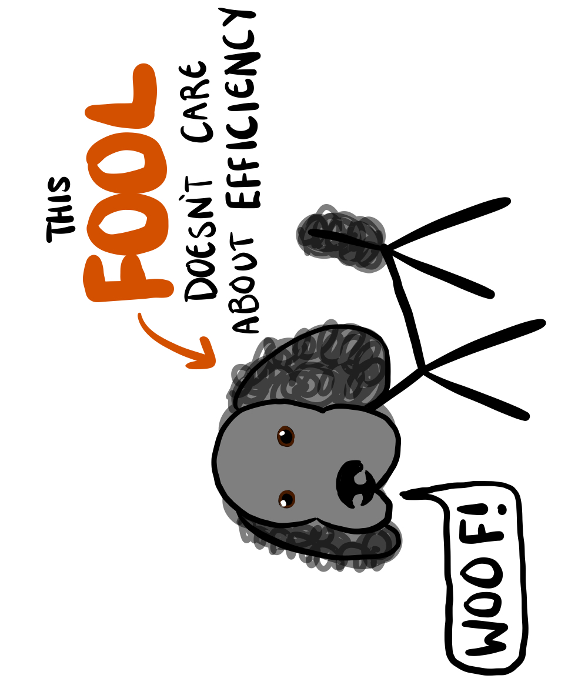{fig-align="center"}
:::
:::::


## What statistical properties?
Visualisations are functions

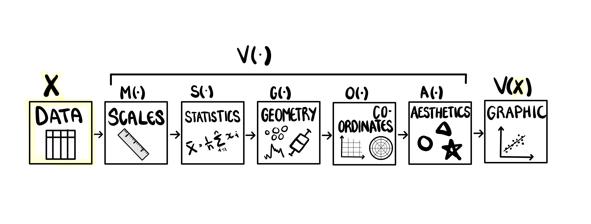{fig-align="center"}


## What statistical properties?
... that are being applied to a random variable

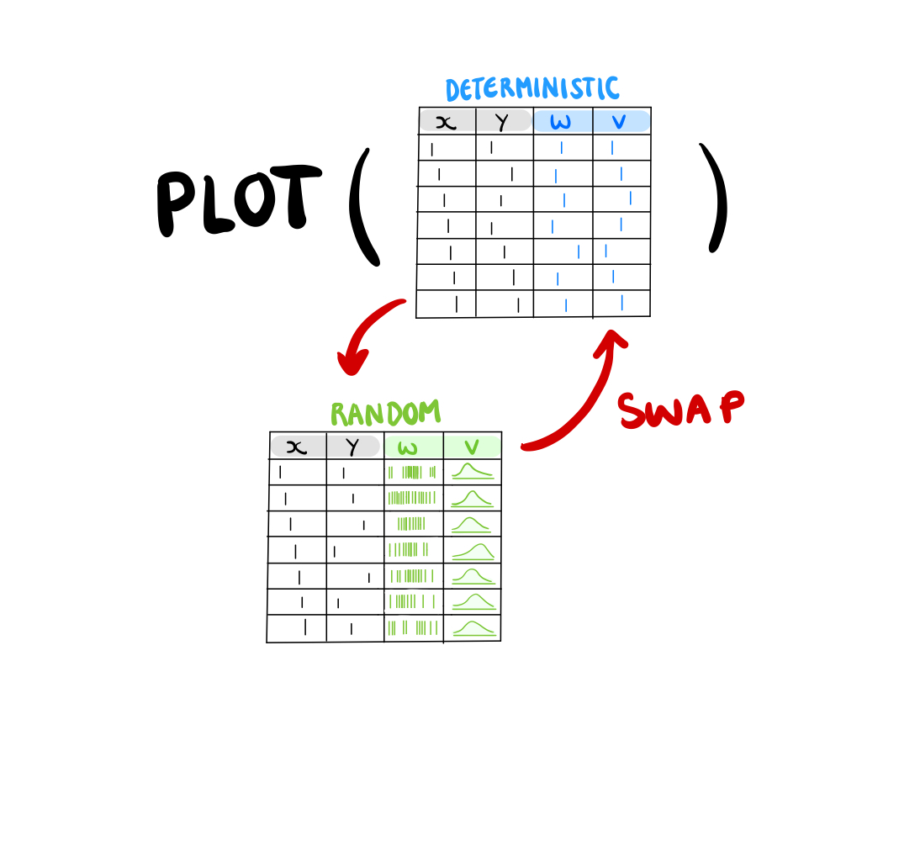{fig-align="center"}


## What statistical properties?
So they should follow continuous mapping theorem
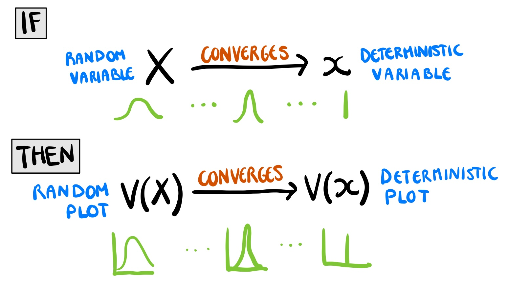{fig-align="center"}

## A density plot under this system

```{r}
#| label: fig-dist-converge
#| fig-align: center

set.seed(1)
density_data <- data.frame(xmean = rnorm(15, 163, 7),
                           xse1 = rexp(15,0.5)) |>
  mutate(xse2 = 0.3*xse1, 
         xse3 = 0.05*xse1)
tsize = 12
p1 <- ggplot(data = density_data) + 
  geom_density_sample(aes(x=dist_normal(xmean, xse1)), times=100, 
                      linewidth=0.1) +
  scale_linewidth(range = c(0.1, 0.1)) +
  xlab("Height") +
  ggtitle(" ") + 
  theme_classic() +
  theme(plot.title = element_text(size = tsize))

p2 <- ggplot(data = density_data) + 
  geom_density_sample(aes(x=dist_normal(xmean, xse2)), times=100, 
                      linewidth=0.1) +
  scale_linewidth(range = c(0.1, 0.1)) +
  xlab("Height") +
  ggtitle("") + 
  theme_classic() +
  theme(plot.title = element_text(size = tsize))

p3 <- ggplot(data = density_data) + 
  geom_density_sample(aes(x=dist_normal(xmean, xse3)), times=100, 
                      linewidth=0.1) +
  scale_linewidth(range = c(0.1, 0.1)) +
  xlab("Height") +
  ggtitle("") + 
  theme_classic() +
  theme(plot.title = element_text(size = tsize))

p4 <- ggplot(data = density_data) + 
  geom_density_sample(aes(x=dist_normal(xmean, 0))) +
  scale_linewidth(range = c(0.1, 0.1)) +
  xlab("Height") +
  ggtitle("geom_density!") + 
  theme_classic() +
  theme(plot.title = element_text(size = tsize))


q1 <- ggplot(data = density_data) +
  stat_slab(aes(xdist = dist_normal(xmean, xse1)), 
            colour = "black", fill=NA,
            linewidth = 0.5) +
  xlab("Height") + ylab("density") +
  ggtitle("") +  
  theme_classic() +
  theme(plot.title = element_text(size = tsize))

q2 <- ggplot(data = density_data) +
  stat_slab(aes(xdist = dist_normal(xmean, xse2)), 
            colour = "black", fill=NA,
            linewidth = 0.5) +
  xlab("Height") + ylab("density") +
  ggtitle("") + 
  theme_classic() +
  theme(plot.title = element_text(size = tsize))

q3 <- ggplot(data = density_data) +
  stat_slab(aes(xdist = dist_normal(xmean, xse3)), 
            colour = "black", fill=NA,
            linewidth = 0.5) +
  xlab("Height") + ylab("density") +
  ggtitle("") + 
  theme_classic() +
  theme(plot.title = element_text(size = tsize))

q4 <- ggplot(data = density_data) +
  stat_slab(aes(xdist = dist_normal(xmean, 0)), 
            colour = "black", fill=NA,
            linewidth = 0.5) +
  xlab("Height") + ylab("density") +
  ggtitle("geom_rug!") + 
  theme_classic() +
  theme(plot.title = element_text(size = tsize))

pv <- ggplot() +
  geom_segment(aes(x = 0, xend = 5, y = 1 ), arrow = arrow()) +
  geom_text(aes(label = expression(sigma), x = -0.2, y = 1 ), size = 10) +
  geom_text(aes(label = "0", x = 5.2, y = 1 ), size = 10) +
  geom_text(aes(label = "as the variance approaches zero", x = 2.5, y = 1.1 ), size = 5) +
  ylim(0.5,1.5) +
  theme_void()


pv / (p1 | p2 | p3 | p4 ) / (q1 | q2 | q3 | q4)

```


# Part 3: What makes an effective uncertainty visualisation? 

## Consequence of distance in uncertainty visualisation
-   Statistical validity should translates to perceptual ease
    -   The higher the variance on an estimate, the harder that estimate is to extract from the plot

{fig-align="center"}

## Don't hide me signals, I needed those!
- Some people don't like the idea of the plot hiding signals
  - It doesn't hide signals (I mean it does but it is beside the point)
  - It is simply giving a more accurate rendering of your data, if that hides the signals, I don't think they were there to begin with.
- If you think this, I hope you have all your spam filters turned off

# Part 4: Making uncertainty visualisations in `ggdibbler`

## Make this into a `ggplot2` extension
I want a package that does this for every `geom` & `stat`

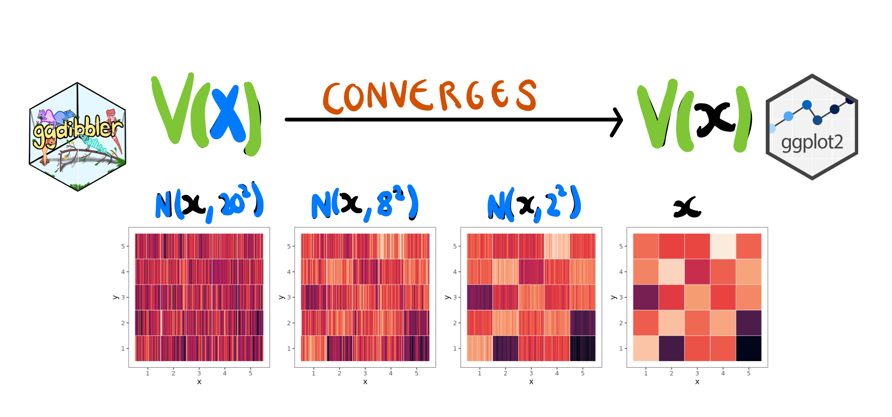{fig-align="center"}


## Minds eye code
The function is the same. The input that different
```{r}
#| echo: true
#| eval: false
# determinsitic ggplot
ggplot(deterministic_data) +
  geom_tile(aes(x=x, y=y, fill=z))

# random variable ggplot
ggplot(random_data) +
  geom_tile(aes(x=x, y=y, fill=random_z))
```

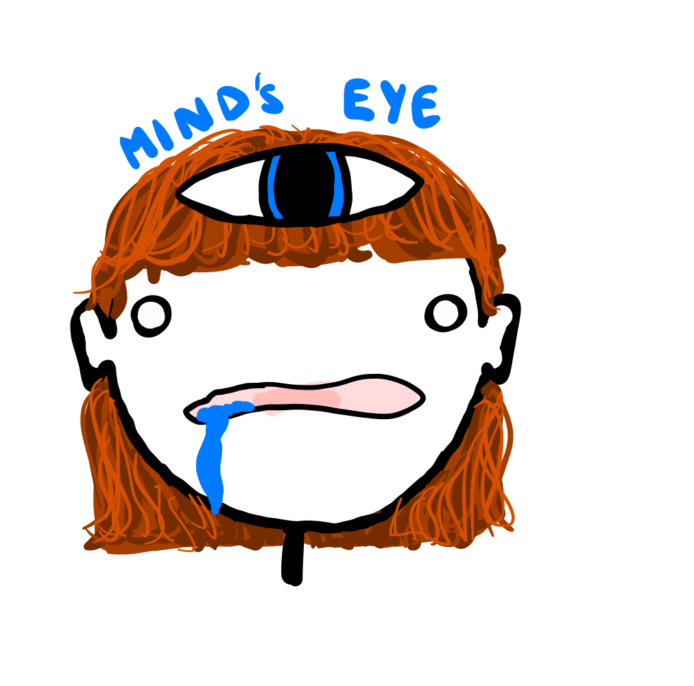{fig-align="center"}


## Its a simple problem...

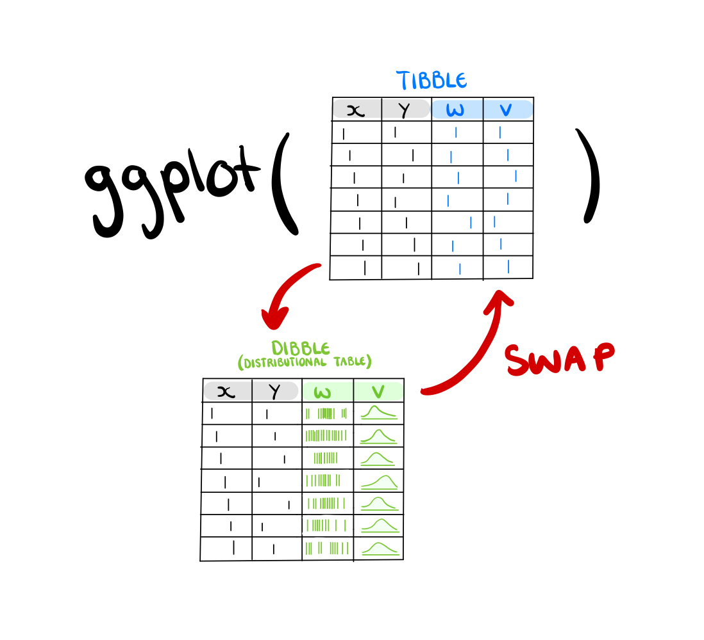{fig-align="center"}


## ... that we make even simpler {.smaller}
  
::::: columns
::: {.column width="50%"}
::: {.incremental}
- Represent as a set of samples from the random matrix
- Only distribution representation that can be subbed into any `ggplot2` function
  - Mean/median brings us back to the original problem
  - PDF leads to the geom_rug problem
  - Quantiles need an ordering (problem in figure)
  
::: 

:::

::: {.column width="50%"}

```{r}
#| fig-align: center
#| fig-height: 6
#| fig-width: 6

# Random intercept

# Generate multivariate data
set.seed(112)
dist <- dist_multivariate_normal(mu = list(c(0,0)), 
                                 #sigma = list(matrix(c(1,0,0,1), ncol=2)))
                                 sigma = list(matrix(c(1,-0.8,-0.8,1), ncol=2)))
dimnames(dist) <- c("x", "y")

a <- quantile(dist, p = seq(0, 1, length.out = 100),
              type = "marginal") 
qdf <- tibble(x = unlist(a)[1:100],
              y = unlist(a)[101:200]) |>
  rownames_to_column() |>
  mutate(rowname = as.numeric(rowname)) 

b <- generate(dist, times = 100)
sdf <- tibble(x = unlist(b)[1:100],
              y = unlist(b)[101:200]) |>
  rownames_to_column() |>
  mutate(rowname = as.numeric(rowname),
         distance = sqrt(x^2 + y^2),
         rawdist = x + y)


q1 <- qdf |>
  ggplot() + 
  geom_abline(aes(intercept = x, slope = 1, colour = x), 
              alpha=0.7, linewidth=1.5) +
  scale_colour_continuous_sequential(palette = "Batlow") +
  scale_x_continuous_distribution(limits = c(-2,2)) +
  scale_y_continuous_distribution(limits = c(-2,2)) +
  ggtitle("a. quantile: intercept") +
  theme(legend.position="none", plot.title = element_text(size = tsize))

q2 <- sdf |>
  ggplot() + 
  geom_abline(aes(intercept = x, slope = 1, colour = x), 
              alpha=0.5, linewidth=1.5) +
  scale_colour_continuous_sequential(palette = "Batlow") +
  scale_x_continuous_distribution(limits = c(-2,2)) +
  scale_y_continuous_distribution(limits = c(-2,2)) +
  ggtitle("b. sample: intercept") +
  theme(legend.position="none", plot.title = element_text(size = tsize))

q3 <- qdf |>
  ggplot() + 
  geom_abline(aes(intercept = x, slope = y, colour = rowname), 
              alpha=0.7, linewidth=1.5) +
  scale_colour_continuous_sequential(palette = "Batlow") +
  scale_x_continuous_distribution(limits = c(-2,2)) +
  scale_y_continuous_distribution(limits = c(-2,2)) +
  ggtitle("c. quantile: intercept, slope") +
  theme(legend.position="none", plot.title = element_text(size = tsize))

q4 <- sdf |>
  ggplot() + 
  geom_abline(aes(intercept = x, slope = y, colour = rawdist), 
              alpha=0.5, linewidth=1.5) +
  scale_colour_continuous_sequential(palette = "Batlow") +
  scale_x_continuous_distribution(limits = c(-2,2)) +
  scale_y_continuous_distribution(limits = c(-2,2)) +
  ggtitle("d. sample: intercept, slope") +
  theme(legend.position="none", plot.title = element_text(size = tsize))


q1 + q2 + q3 + q4 

```

:::
:::::


## ... and even simpler again
- Start off with a choropleth map, `geom_sf`

```{r}
# get data
load("data/my_map_data.rda")

# seed for sampling
set.seed(1997)

# data dimension for sampling
n <- dim(my_map_data)[1]

# Make palettes
longpal <- rev(sequential_hcl(13, palette = "YlOrRd"))
basecols <- longpal[3:10]
breaks <- 21:29 
breakslong <- 18:32 
names(basecols) <- seq(8)
names(longpal) <- -1:11
var_seq <- seq(0,12, by=3)

my_map_data <- my_map_data |>
  mutate(temp = 29 - 2*abs(scale(cent_lat) - sin(2*(scale(cent_long)))[,1]), # trend
         highvar = runif(n, min=8, max=var_seq[5]), # high variance
         lowvar = runif(n, min=2, max=4), # low variance
         count_id = row_number()) |>
  pivot_longer(cols=highvar:lowvar, names_to = "variance_class", values_to = "variance") |>
  # add bivariate classes to data
  mutate(bitemp = cut(temp, breaks=breaks, labels=seq(8)),
         bivar = cut(variance, breaks=var_seq, labels=seq(4)),
         biclass = paste(bitemp, bivar, sep="-")) |>
  mutate(highlight = ifelse(count_id <= 5, TRUE, FALSE)) |>
  mutate(temp = as.numeric(temp))

###################### CHOROPLETH MAP ###################### 
my_map_data |>
  filter(variance_class=="lowvar") |>
  ggplot() +
  geom_sf(aes(fill = temp, 
              geometry = geometry), colour=NA) + 
  scale_fill_gradientn(colours = basecols) +
  #theme_void() +
  labs(fill = "temperature") +
  theme_map() +
  theme(legend.position = "inside", 
        legend.position.inside = c(0.1, -0.2),
        legend.direction = "horizontal",
        legend.background = element_rect(fill=NA),
        plot.title = element_text(size = 14)) 
```


## If you have a simple problem...
The ggplot2 book has lots off good advice

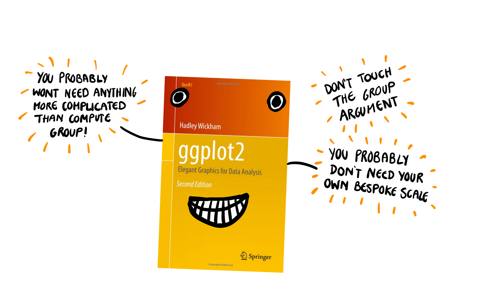{fig-align="center"}

## Not so simple errors

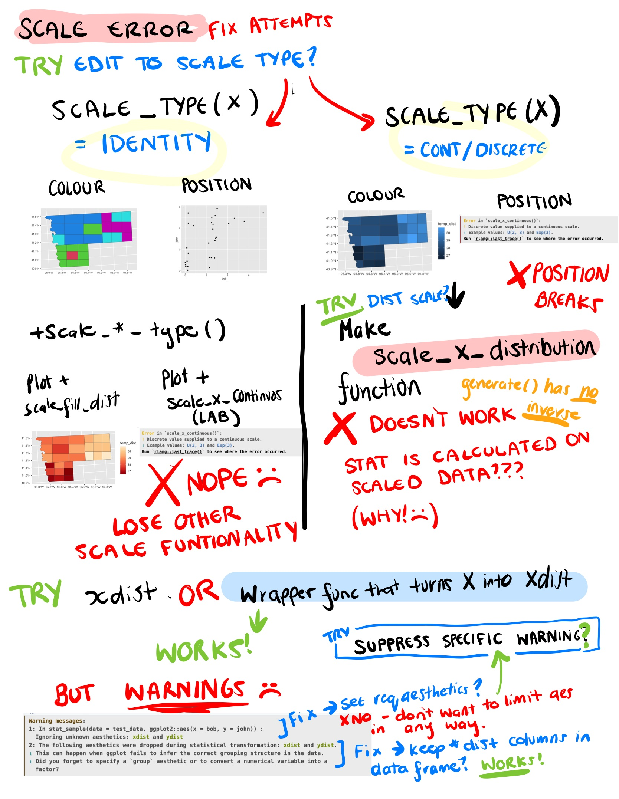{fig-align="center"}


## Asking for help 
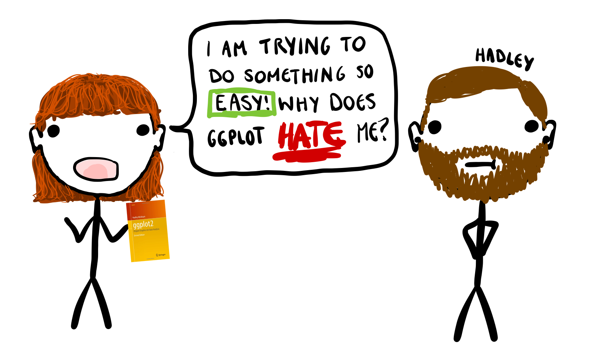{fig-align="center"}

## Asking for help 
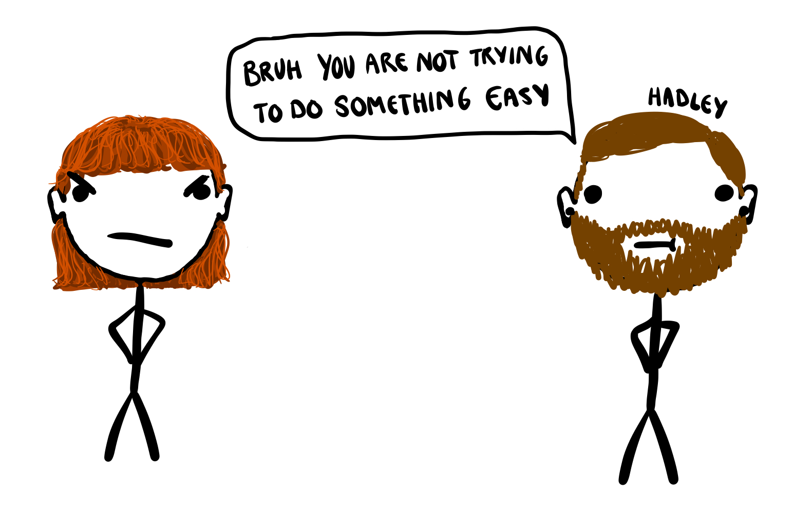{fig-align="center"}

## Asking for help 
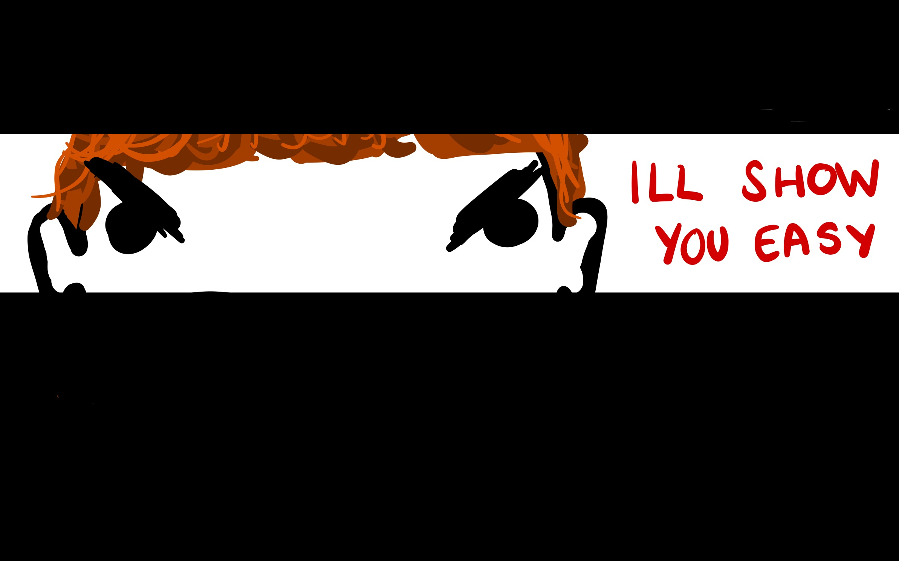{fig-align="center"}

## Mania in the Github activity
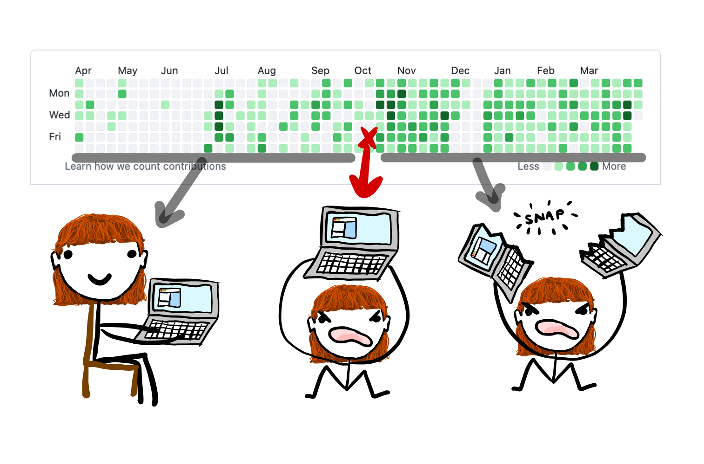{fig-align="center"}


## Spatial Plots  {.smaller}

```{r spatialdata}
#| echo: false
# Make average summary of data
toy_temp_mean <- toy_temp |> 
  dplyr::group_by(county_name) |>
  summarise(temp_mean = mean(recorded_temp))
```

::::: columns
::: {.column width="50%"}

```{r}
#| echo: true
#| fig-width: 4
ggplot(toy_temp_mean) +
  geom_sf(aes(geometry=county_geometry, fill=temp_mean), linewidth=0) +
  scale_fill_distiller(palette = "OrRd") +
  theme_map() +
  theme(legend.position = "bottom") +
  ggtitle("ggplot2")

```

:::

::: {.column width="50%"}

```{r}
#| echo: true
#| fig-width: 4

ggplot(toy_temp_dist) + 
  geom_sf_sample(aes(geometry = county_geometry, fill=temp_dist), linewidth=0, times=50) + 
  scale_fill_distiller(palette = "OrRd") +
  theme_map() +
  theme(legend.position = "bottom") +
  ggtitle("ggdibbler")
```

:::
:::::

## Uncertain EVERYTHING
The extension is TRIVIAL!

{fig-align="center"}


## Uncertain data sets!
Every data set used in the `ggplot2` documentation has a `distributional` version in `ggdibbler` where **EVERY** variable is a random variable.

- `diamonds` = `uncertain_diamonds`
- `mpg` = `uncertain_mpg`
- `mtcars` = `uncertain_mtcars`
- `faithful` = `uncertain_faithful`
- `economics`= `uncertain_economics`

## Any geom!

::::: columns
::: {.column width="50%"}

```{r}
#| echo: true
#| fig-width: 4
ggplot(faithfuld, aes(waiting, eruptions, z = density)) + 
  ggtitle("ggplot2") +
  geom_contour() +
  theme(aspect.ratio = 1)

```

:::

::: {.column width="50%"}

```{r}
#| echo: true
#| fig-width: 4

ggplot(uncertain_faithfuld, aes(waiting, eruptions, z = density))+
  ggtitle("ggdibbler") +
  geom_contour_sample(alpha=0.2)+
  theme(aspect.ratio = 1)

```

:::
:::::

## Any geom! {.smaller}

::::: columns
::: {.column width="50%"}

```{r}
#| echo: true
#| fig-width: 4
ggplot(faithfuld, aes(waiting, eruptions)) + 
  geom_raster(aes(fill = density)) +
  scale_fill_viridis_c() +
  theme(legend.position = "none") +
  ggtitle("ggplot2")

```

:::

::: {.column width="50%"}

```{r}
#| echo: true
#| fig-width: 4

ggplot(uncertain_faithfuld, aes(waiting, eruptions)) + 
  geom_raster_sample(aes(fill = density2)) +
  scale_fill_viridis_c() +
  ggtitle("ggdibbler")+
  theme(legend.position = "none")

```

:::
:::::

## Any aesthetic! {.smaller}

```{r textdata}
#| echo: false
set.seed(10)
textdata <- expand_grid(x = c(1,2,3,4,5), y= c(1,2,3,4,5)) |>
  mutate(
    text_const = sample(c(TRUE, FALSE), 25, replace=TRUE),
    text_dist = dist_bernoulli(0.3 + 0.4*text_const),
    ) 
```

::::: columns
::: {.column width="50%"}

```{r}
#| echo: true
#| fig-width: 4
ggplot(textdata, aes(x=x, y=y)) +
  geom_text(aes(label = text_const), size=4) +
  theme_few() +
  ggtitle("ggplot2") +
  theme(aspect.ratio = 1, legend.position = "none") 

```

:::

::: {.column width="50%"}

```{r}
#| echo: true
#| fig-width: 4

ggplot(textdata, aes(x=x, y=y, lab = text_dist)) +
  geom_text_sample(aes(label = after_stat(lab)), size=4, alpha=1/30, times=30) +
  ggtitle("ggdibbler") +
  theme_few() +
  theme(aspect.ratio = 1, legend.position = "none") 

```

:::
:::::


## Uhh hold on, positions are an isuse {.smaller}

```{r dodgebarchart}
#| fig-height: 4
#| fig-width: 12
set.seed(10)
catdog <- tibble(
    DogOwner = sample(c(TRUE, FALSE), 25, replace=TRUE),
    CatOwner = sample(c(TRUE, FALSE), 25, replace=TRUE))

random_catdog <- catdog |>
  mutate(
    DogOwner = dist_bernoulli(0.1 + 0.8*DogOwner),
  )
    

p1 <- ggplot(catdog, aes(DogOwner)) + 
  geom_bar_sample(aes(fill = CatOwner), 
                  position = "stack")+
  theme_few() +
  theme(legend.position="none", aspect.ratio = 1)+
  ggtitle("ggplot: stack")


p2 <- ggplot(random_catdog, aes(DogOwner)) + 
  geom_bar_sample(aes(fill = CatOwner), times=30,
                  position = "stack_dodge") +
  theme_few() +
  theme(legend.position="none", aspect.ratio = 1)+
  ggtitle("ggdibbler: stack_dodge")

p3 <- ggplot(random_catdog, aes(DogOwner)) + 
  geom_bar_sample(aes(fill = CatOwner),  times=30,
                  position = "stack") +
  theme_few() +
  theme(legend.position="none", aspect.ratio = 1)+
  ggtitle("stack")

p3 <- ggplot(random_catdog, aes(DogOwner)) + 
  geom_bar_sample(aes(fill = CatOwner),  times=30,
                  position = "stack") +
  theme_few() +
  theme(legend.position="none", aspect.ratio = 1)+
  ggtitle("ggdibbler: stack")

p1 | p3

```

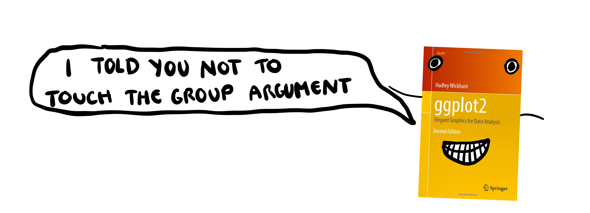{fig-align="center"}

## Nested positions!
```{r}
p1 | p2
```

## Any Position! {.smaller}

::::: columns
::: {.column width="50%"}

```{r}
#| echo: true
#| fig-width: 4
ggplot(mpg, aes(class)) + 
  geom_bar_sample(aes(fill = drv), 
                  position = "stack")+
  theme(legend.position="none")+
  ggtitle("ggplot2")

```

:::

::: {.column width="50%"}

```{r}
#| echo: true
#| fig-width: 4

ggplot(uncertain_mpg, aes(class)) + 
  geom_bar_sample(aes(fill = drv),times = 30, alpha=1/30,
                  position = "stack_identity")+
  theme(legend.position="none")+
  ggtitle("ggdibbler")

```

:::
:::::


## All the documentation!

::::: columns
::: {.column width="50%"}
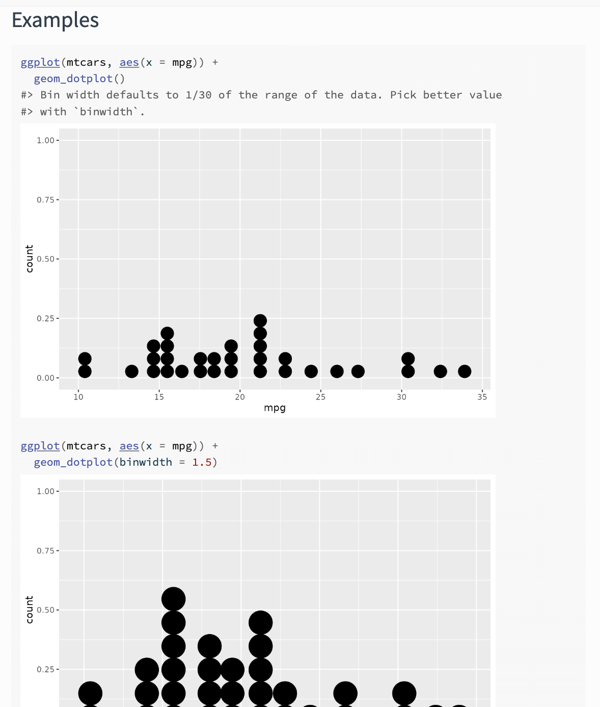{fig-align="center"}
:::

::: {.column width="50%"}

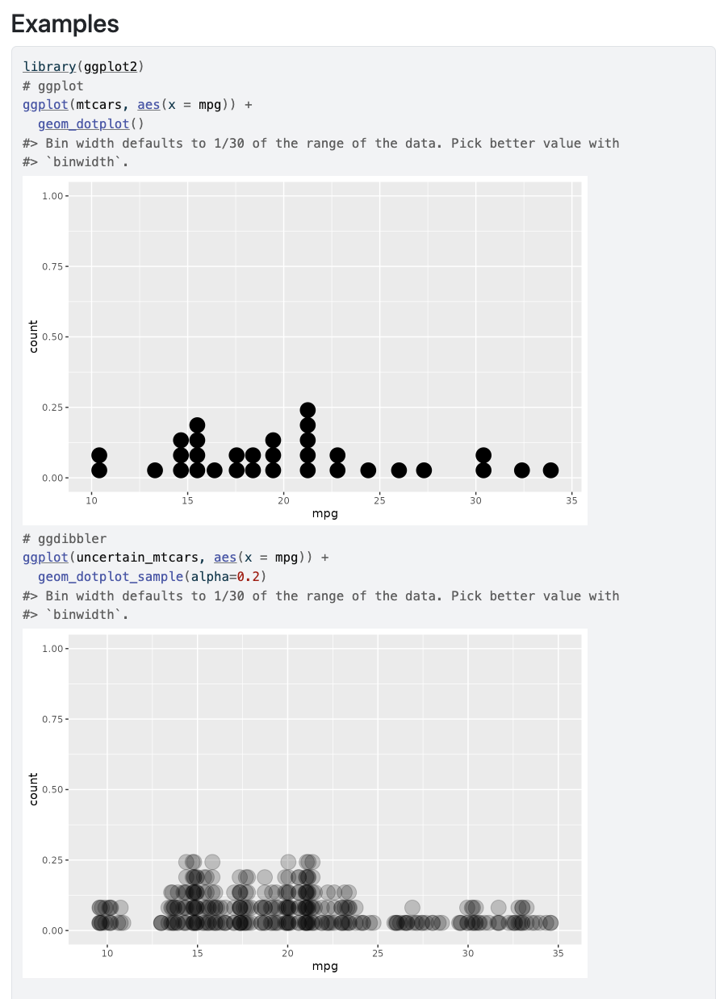{fig-align="center"}

:::
:::::


## Combine all this together to get...

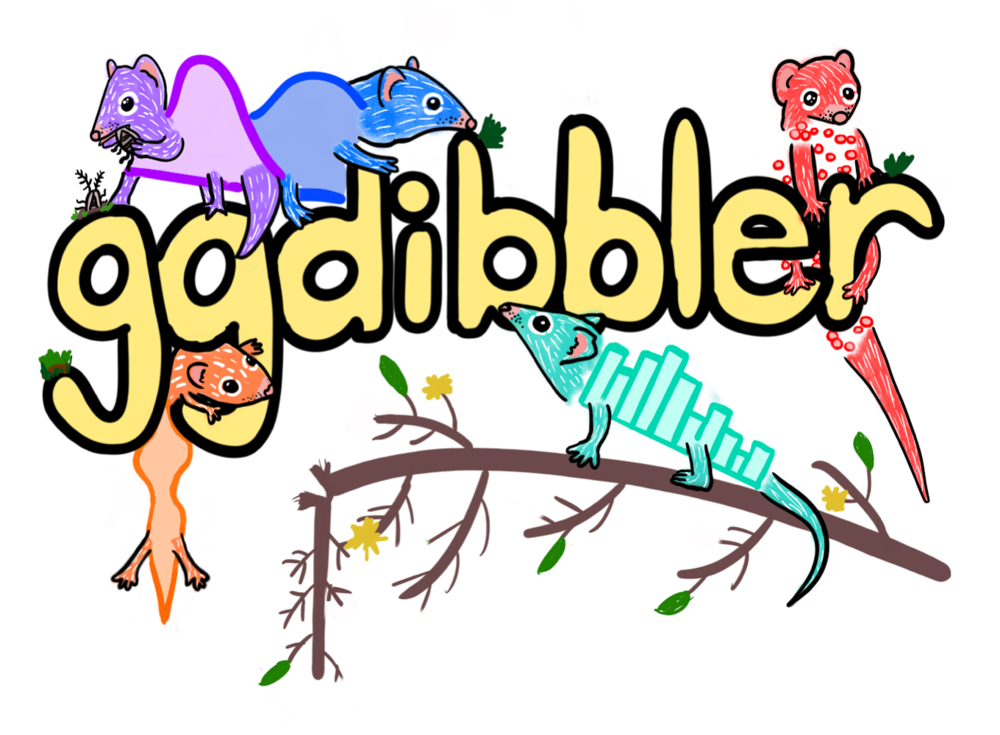{fig-align="center"}

## Flexible uncertainty visualisation! {.smaller}

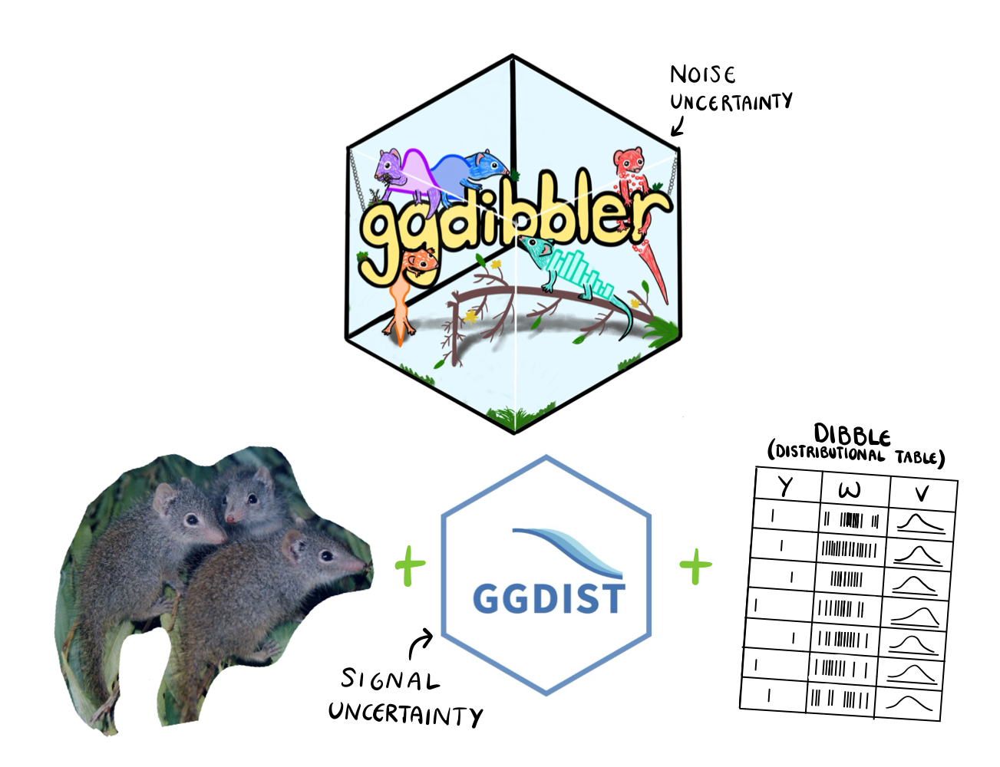{fig-align="center"}


## Back to walktober example

```{r}
# Plot0B
p3 <- ggplot(my_suburbs) +
  geom_sf_sample(data = suburb_walk, linewidth=0, times=100,
                 aes(geometry= geometry, fill = steps_dist)) +
  geom_sf(aes(geometry= geometry), fill=NA) +
  theme_map()  +
  ggtitle("Average steps per day by Melbourne Suburb") + 
  labs(fill = "Average steps per day") +
  scale_fill_continuous_sequential(palette = "Magenta", rev = TRUE)

# plot 3B
p4 <- ggplot(clean_walk, aes(x=team, y = steps_dist, fill = team_colour)) +
  geom_col_sample(times=50) +
  scale_fill_identity() +
  ggtitle("Total steps per team, per person") +
  theme_few()

p3 + p4
```


## Components of the grammar

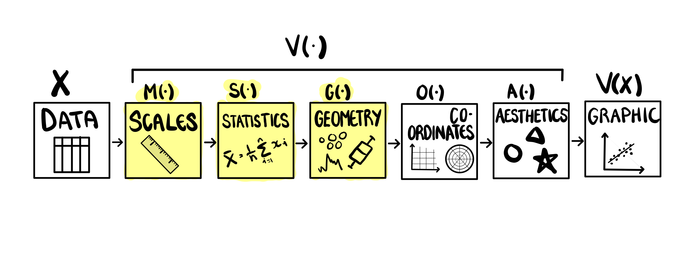{fig-align="center"}

## Scale

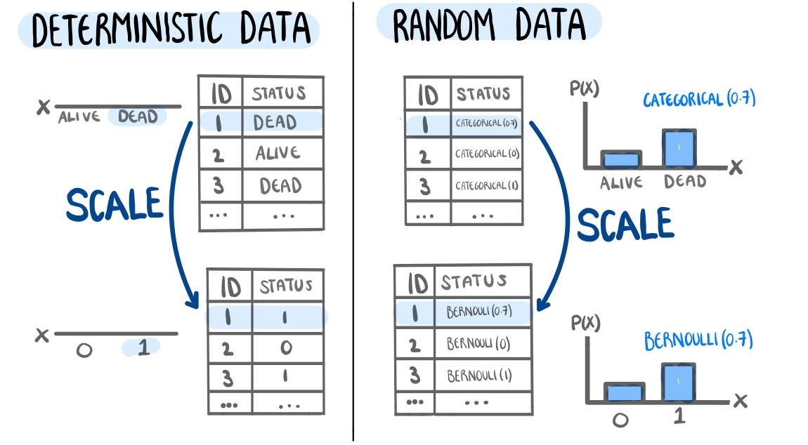{fig-align="center" width=50%}

## Statistic
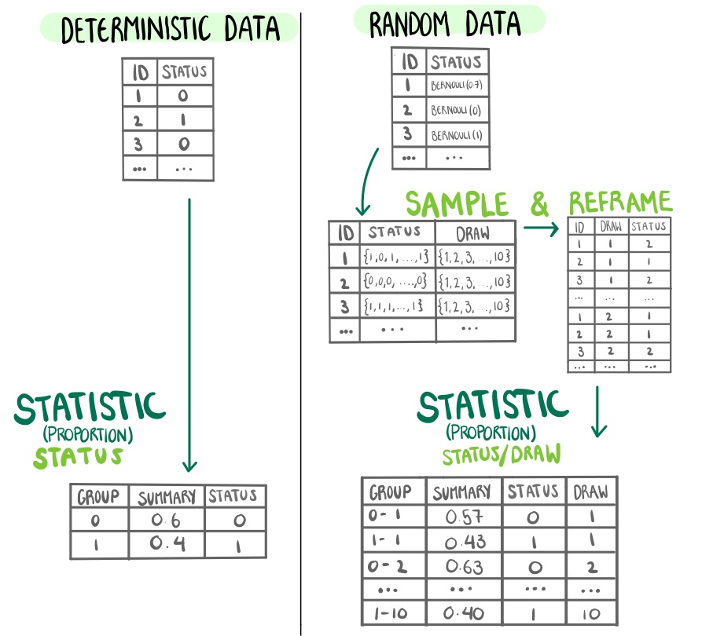{fig-align="center" width=50%}

## Why change the groups?

```{r}
#| label: fig-grouping-need
#| message: false

set.seed(4453)

l1 <- uncertain_mpg |>
  sample_expand(times=100) |>
  ggplot(aes(displ, hwy)) +
  geom_point(alpha=0.01) +
  geom_smooth() +
  ggtitle("a. without modifying group") +
  theme(plot.title = element_text(size = tsize))

l2 <- ggplot(uncertain_mpg, aes(displ, hwy)) +
  geom_point_sample(alpha=0.01, seed = 22, times=100) +
  geom_smooth_sample(linewidth=0.1, alpha=0.01, seed = 22, times=100) +
  ggtitle("b. group includes draw") +
  theme(plot.title = element_text(size = tsize))

l1 + l2 + plot_layout(ncol=2)
```


## Position Adjustments

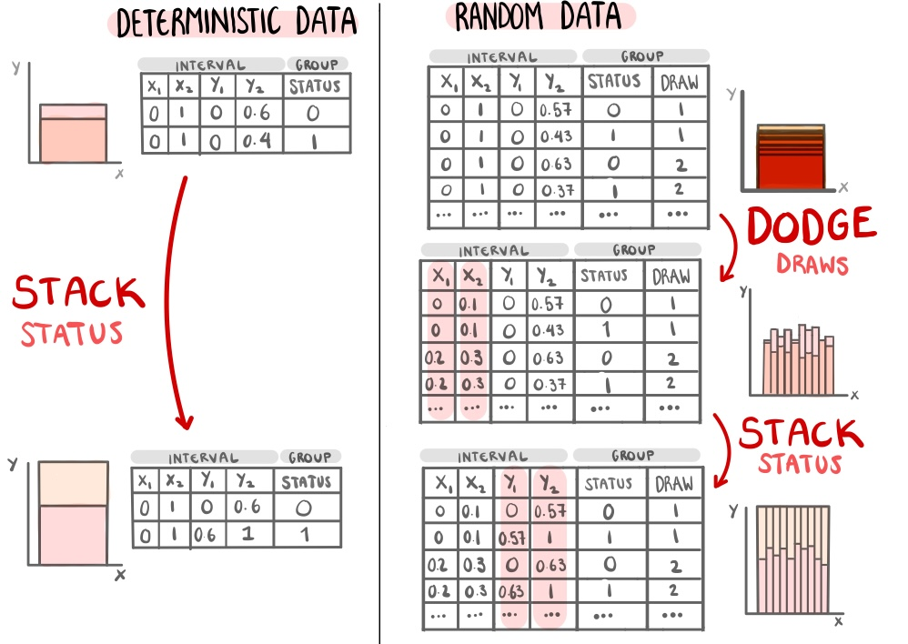{fig-align="center"}


# Conclusion

## Conclusion
- If you think data visualisations are statistics, these are not my opinions

## Acknowledgements
-   My supervisors: Di Cook, Susan Vanderplas, and Sarah Goodwin
-   Good ideas: Mitch O'Hara-Wild and Cynthia Huang
-   AEMO Zema Energy Scholarship
-   Australian RTP Stipend
-   Numbat Hackathon (for the walktober data)
