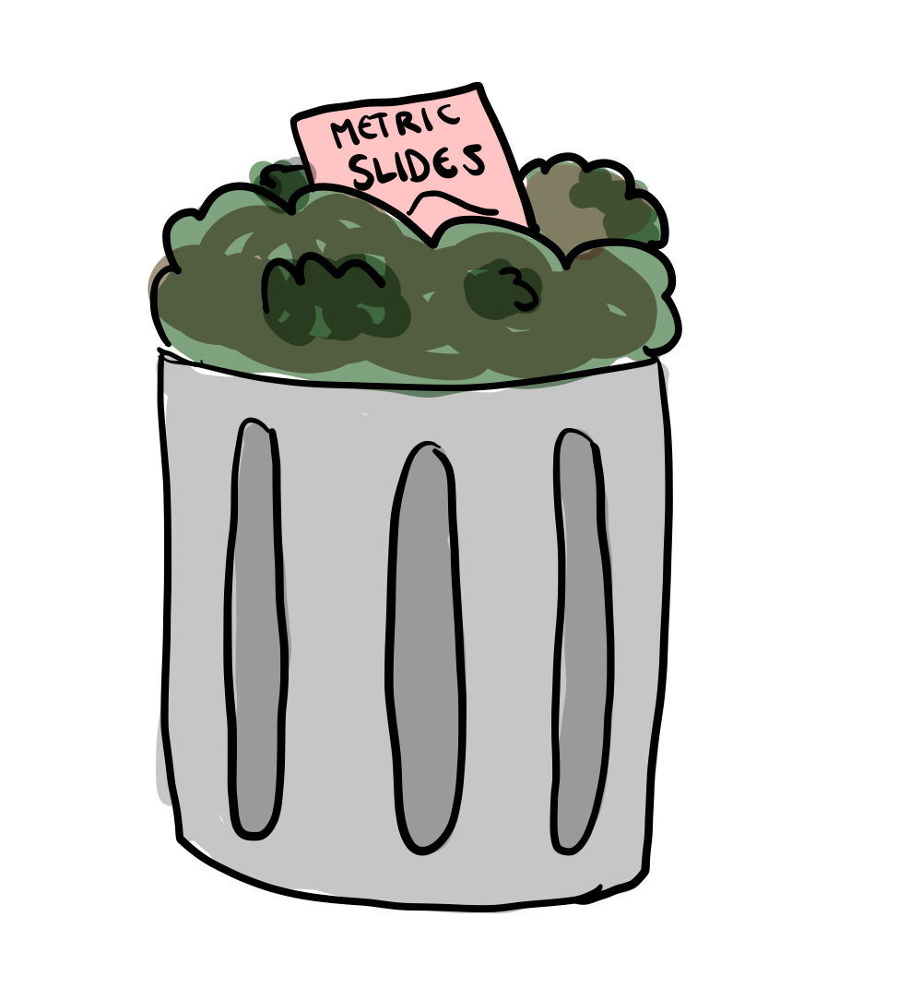

```{r setup}
#| include: false
#| message: false
#| warning: false

library(MASS)
library(tidyverse)
library(ggdibbler)
library(colorspace)
library(sf)
library(ggthemes)
library(distributional)
library(patchwork)
library(kableExtra)
library(ggthemes)
library(ggdist)
library(ggwordcloud)
library(nullabor)
library(shadowtext)
library(flextable)
library(ozmaps)
library(emmeans)
library(broom)
library(lme4)
library(car)
library(janitor)
library(naniar)

# set theme?
# theme_set( theme_gdocs() + 
#              theme(aspect.ratio = 1, 
#                    axis.text.x = element_text(angle = 35, 
#                                               vjust = 1.05, 
#                                               hjust=1),
#                    palette.colour.continuous = gdocs_pal(),
#                    palette.colour.discrete = gdocs_pal(),
#              )
# 3)
gpal <- gdocs_pal()(5)
```


# Walktober

```{r walkremote}
#| eval: false
suburbs <- strayr::read_absmap("suburb2021")
saveRDS(suburbs, file = "data/suburbs.rds")
```

```{r walkdata}
#filtered_walk <- walkathon[which((walkathon$name %in% extra_walk$name)),]
filtered_walk <- walktober

# Read in extra walk and add in suburbs
extra_walk <- read.csv("data/extrawalktober.csv") |>
  mutate(suburb = ifelse(suburb == "Claython north", "Clayton", suburb),
         suburb = ifelse(suburb == "Clayton ", "Clayton", suburb),
         suburb = ifelse(suburb == "Mordi ", "Oakleigh", suburb),
         suburb = ifelse(suburb == "Oakleigh ", "Oakleigh", suburb),
         suburb = ifelse(suburb == "Langwarrin", "Mordialloc", suburb),
         suburb = ifelse(suburb == "Croydon", "Mordialloc", suburb))
#required_subs <- unique(c(extra_walk$suburb))
suburbs <- readRDS("data/suburbs.rds")

my_suburbs <- suburbs |> 
  filter(state_name_2021 == "Victoria") |>
  mutate(suburb_name_2021 = str_remove(suburb_name_2021, " \\(Vic.\\)")) |>
  filter(between(cent_long, 144.8, 145.2),
         between(cent_lat, -38, -37.8)) |>
  #filter(suburb_name_2021 %in% required_subs) |>
  #select(c(suburb_name_2021, geometry)) |>
  rename("suburb" = "suburb_name_2021")

extra_walk <- extra_walk |>
  left_join(my_suburbs, by = "suburb")
# add team colours
extra_walk$team_colour <- c(sequential_hcl(4, palette = "Peach"),
  sequential_hcl(5, palette = "Blues")[1:4],
  sequential_hcl(6, palette = "Reds 3")[2:5],
  sequential_hcl(5, palette = "Greens")[1:4],
  sequential_hcl(4, palette = "Purp"),
  sequential_hcl(8, palette = "Heat")[3:6])

# clean data to just local suburbs
clean_walk <- filtered_walk |>
  left_join(extra_walk, by="name") |>
  mutate(steps_dist = dist_truncated(steps + 0.1*steps*dist_normal(bias_mu, bias_se), 0),
         date = as.Date(date, "%d/%m/%y")) |>
  group_by(name) |>
  mutate(cum_steps = cumsum(steps)) |>
  ungroup() |>
  filter(date <= as.Date("23/10/25", "%d/%m/%y")) |>
  na.omit()
# remove emojis
clean_walk$team <- gsub("\\p{So}", "", clean_walk$team, perl = TRUE)
suburb_walk <- clean_walk |>
  as.tibble() |>
  group_by(suburb) |>
  summarise(mean_steps = mean(steps + 0.1*bias_mu),
            se_steps = mean((steps*0.1)^2*bias_se),
            steps_dist = dist_normal(mean_steps, se_steps)) |> 
  left_join(my_suburbs, by = "suburb") |>
  select(c(suburb, steps_dist, mean_steps, geometry))


```


## What is walktober? {.smaller}

My department (Monash EBS) had a walkathon in October where we all competed to see how many steps we could walk each day

{fig-align="center"}

## Data quality angel

::::: columns
::: {.column width="60%"}
{fig-align="center"}
:::

::: {.column width="40%"}
Before the competition started, I searched up the most accurate and cost effective pedometer
:::
:::::

## Pedometer = bad {.smaller}

-   It turns out, pedometers are wildly inaccurate 
{fig-align="center"}


## Data quality demons {.smaller}

::::: columns
:::: {.column width="60%"}
{fig-align="center"}
::::

:::: {.column width="40%"}
::: {.incremental}
-   We conducted a survey after walktober, to see if we could quantify the pedometer error
-   It turns out I was the ONLY person concerned about data quality
-   Turns out the measurement error was the least of my worries
:::
::::
:::::

## Survey response

{fig-align="center"}

## The visualisation challenge {.smaller}
Our department decides to do a visualisation challenge of the walktober data

```{r}
#| fig-height: 4
#| fig-align: center

# Plot0A
p1 <- ggplot(my_suburbs) +
  geom_sf(data = suburb_walk, aes(geometry= geometry, fill = mean_steps)) +
  geom_sf(aes(geometry= geometry), fill=NA) +
  theme_map() +
  ggtitle("Average steps per day by Melbourne Suburb") + 
  labs(fill = "Average steps per day") +
  scale_fill_continuous_sequential(palette = "Magenta", rev = TRUE)

# plot 3A
p2 <- ggplot(clean_walk, aes(x=team, y = steps, fill = team_colour)) +
  geom_col() +
  scale_fill_identity() +
  ggtitle("Total steps per team, per person") +
  theme_few() +
  coord_flip()

p1 + p2 + 
  plot_annotation() & 
  theme(plot.background = element_blank())
```

## ...Should I include that uncertainty? {.smaller}

::: {.incremental}
- This seems like it is going to be a lot of work
  - But I did all that reading about pedometers!!! 
- Also, other people will get mad at me:
  - Failing to include it is akin to fraud! [@Hullman2020a; @Manski2020]
  - Conveys the legitimacy (or illegitimacy) of conclusions [@Kale2018; @Griethe2006]
  - Communicate confidence [@Correll2018; @Boukhelifa2017]
  - Communicate validity [@Hullman2020a; @Griethe2006]
  - It should guide, qualify or soften judgements [@Leland2005]
- **Increase transparency**
  
::: 

## Signal Modulation
- **Signal modulation**: statistical validity translates to perceptual ease
  - The higher the variance on an estimate, the harder that estimate is to extract from the plot

{fig-align="center"}


## A visual hypothesis test
Our visualisation should have behaviour similar to

  - a hypothesis test [@Correll2018; @MacEachren1992] or 
  - a Bayesian posterior probability [@Kim2019]

{fig-align="center"}


## OK, Fine! {.smaller}
Those properties sound pretty good., so we will make an uncertain version of these plots.

```{r}
#| fig-height:  4
#| fig-align: center

p1 + p2 + 
  plot_annotation() & 
  theme(plot.background = element_blank())
```

  
## Overview {.smaller}
::::: columns
::: {.column width="60%"}

Making uncertain versions of these plots is the focus of this talk

- Part 1: What is uncertainty? 
- Part 2: What is a visualisation? 
- Part 3: How to (safely) make uncertainty visualisations in `ggdibbler`

Other episodes of this series include (cut for time)

- Part 4: Metrics and convergence for visual statistics
- Part 5: Testing how well these plots perform signal modulation
  
:::

::: {.column width="40%"}

{fig-align="center"}

:::
:::::


# Part 1: What is uncertainty?

## The word association Olympics {.smaller}

:::: {.incremental}

- No definition, just a word salad 
- Can nobody tell me what uncertainty *IS*?
- How can you visualise something you can't even define? 

::::

```{r}
#| fig-height: 2
#| fig-width: 3
#| fig-align: center
#| column: screen-inset

# Set seed for appearance of plot
set.seed(3)

# make data
terms <- c("Epistemic", 
           "Precision", 
           "Accuracy", 
           "Missing values", 
           "Error", 
           "Bounds",
           "Variance",
           "Density",
           "Probability",
           "Risk",
           "Expertise",
           "Assumptions"
           )       

word_size <- round(abs(unlist(generate(dist_normal(30,10), length(terms)))))
word_angle <- 45 * sample(-2:2, length(terms), replace = TRUE, prob = c(1, 1, 4, 1, 1))
word_colour <- factor(sample.int(length(terms), length(terms), replace = FALSE))

# make into df
df_words <- tibble(
  words = terms,
  size = word_size,
  angle = word_angle,
  colour = word_colour
  ) |>
    arrange(desc(size)) 
    

ggplot(df_words, 
       aes(label = words, size = size,
           color = colour,
           angle = angle)) +
  geom_text_wordcloud(area_corr = TRUE) +
  scale_radius(range = c(0, 20), limits = c(0, NA)) +
  theme_minimal()
```


## If you are me...
You decide the entire field is fake and not worth working on 


{fig-align="center"}


## But...
Your PhD is externally funded with a set topic

{fig-align="center"}

## So you take another approach
::: {.incremental}
- Instead of defining what uncertainty **IS**...
- Maybe we can look at where uncertainty **ISN'T?**
- To do that, we need to take a look back into the past... 

::: 


## Statistics philosophy? {.smaller}
::::: columns
::: {.column width="50%"}

{fig-align="center"}
  
:::

::: {.column width="50%"}

::: {.incremental}
- In nineteenth-century England, positivism was all the rage
  - Posivitists do not believe in referencing the "unknown", as it is *bad science* [@Otsuka2023]
  - Therefore they only do descriptive statistics
  - Descriptive statistics summarise, they report things as they are without looking beyond the data
  
::: 

:::
:::::


## Statistics philosophy? {.smaller}
::::: columns
::: {.column width="50%"}

:::: {.incremental}
- What's the alternative?  **Inference**
  - discussions about future values
  - population parameters
  - new observations
- Requires a key assumption: *The uniformity of nature* [@Otsuka2023]
  - Assume the observations we have are similar to the ones we do not have
  - Violating this assumption creates uncertainty

:::: 

:::

::: {.column width="50%"}

{fig-align="center"}

:::
:::::

## Yes. And?
:::: {.incremental}
- This gives us a pretty workable understanding of inference
- Uncertainty is a product of inference
  - Without inference we have no uncertainty 
    - (*We need something to be uncertain about*)
  - We cannot have inference without uncertainty 
    - (*If we look beyond our data, we can never know for sure*)
- Quantifying uncertainty requires estimating the effect of the violations on our inference

:::: 

## Example: missing values
:::: {.incremental}
- That is kind of abstract (sorry)
- To give a concrete example, lets look at *missing values*
  - They are not really, in and of themselves "uncertain" 
  - They can *create* uncertainty when we perform inference 
- Missing values before inference are "unquantified uncertainty" 
  - I like to think of it as "potential uncertainty" like "potential energy"

:::: 

## Example: missing values {.smaller}
::::: columns
::: {.column width="50%"}

:::: {.incremental}
- We van visualise missing values with `naniar`[@Tierney2023]
- What is the point of the missing values?
  - There is nothing uncertain here
  - The data is *missing not at random (MNAR)*, so what?
- Unquantified uncertainty = assumption checks
  - Assumptions require a model

:::: 

:::

::: {.column width="50%"}

```{r}
#| fig-width: 4
#| fig-align: center


set.seed(4)
n = 100
myseq <- seq(from = -1, to = 1, length.out = n)
noise_m = 0
noise_sd = 0.1
# generate data
miss_data <- tibble(id = myseq,
                    x = myseq + rnorm(n, mean = noise_m, sd = noise_sd)) |>
  mutate(y = -myseq^2 + 0.8*myseq  + rnorm(n, mean = noise_m, sd = (1+x)*noise_sd)) |>
  # add missings
  mutate(missed = unlist(generate(dist_binomial(1, 1/(1 + exp(-id))),1))) |>
  mutate(z = ifelse(missed == 1, NA, y))


# using  geom_miss_point()
p1 <- ggplot(miss_data,
       aes(x = x, y = z)) +
 geom_miss_point() +
  theme_minimal() +
  scale_color_manual(
    values = c("grey", "firebrick2"),
    labels = c("Missing", "Present")
  ) +
  theme(aspect.ratio = 1,
        legend.position = "bottom") + 
  labs(title = "Do your conclusions change?",
       subtitle = "naniar geom_miss_point()") 

p1

```

:::
:::::

## Example: missing values {.smaller}
::::: columns
::: {.column width="50%"}
 
:::: {.incremental}
- Implicitly in visualisation, you might be drawing this smoothed line in your head
  - Visualising missing values won't magically change the estimate or confidence intervals
- For uncertainty to act as "noise" and perform **signal modulation**, it needs to be **quantified**
    
::::
    
:::

::: {.column width="50%"}

```{r}
#| fig-width: 4
#| fig-align: center

p1 + geom_smooth(colour = "orchid", fill = "orchid1", alpha=0.2)

```

:::
:::::

## Source of uncertainty {.smaller}
::: {.incremental}
- Only two points where inference can occur
  1. The data itself (i.e. we are visualising estimates) 
  2. The conclusions we draw from the plot (i.e. visual inference)
- Visualisation is used for exploratory data analysis (EDA)
- **Uncertainty can only come from the data**

::: 

{fig-align="center"}

## To summarise {.smaller}

::: {.incremental}
- At some point in our analysis we perform *inference* and created *estimates*
- We *quantify* the uncertainty in these estimates by representing them as *probability distributions*
  - "Anything worth doing is worth doing poorly" - G. K. Chesterton
- A table of probability distributions is a *random matrix*

::: 

{fig-align="center"}

## You see this kind of data constantly {.smaller}
::: {.incremental}
Often our data is...

- Unavailable 
  - anonymised data, measurement error, etc.
- Non-deterministic 
  - bounded data, estimated values, etc.
- Theoretical 
  - latent variables, calculations from theory, etc.
- Abstract 
  - based on expert opinion or credibility
  
:::


## Make this data using distributional {.smaller}

::: {.incremental}
- In practice we can make random matricies with `distributional`
- Our walktober examples are truncated normal distributions
  - The "prior inference" comes from measurement error 
    - What is my *true* step count, not the *recorded* step count
```{r}
clean_walk|> 
  as_tibble() |>
  select(steps_dist, team, name) |>
  head(4) 
```
  
:::


# Part 2: What is a visualisation?

## Uhh I know what a visualisation is...
It's a picture

{fig-align="center"}

## It's not that simple

::::: columns
::: {.column width="50%"}
:::: {.incremental}
- What is the essence a visualisation? What is it trying to do?
- Now, allow me to butcher an argument presented by @Bartonicek2025
:::: 

:::

::: {.column width="50%"}

{fig-align="center"}

:::
:::::

## A graphic is a map between data and visual representation

```{r}
#| include: false
#| eval: false
library(tidyverse)
df <- tibble(Species = c("Dog", "Cat", "Dog", "Bird", "Cow", "Cat", "Dog"),
             Weight = c(9.7, 5.2, 62.3, 0.8, 562.8, 3.7, 32.4))
ggplot(df) +
  geom_point(aes(x = Species, y = Weight, colour = Species)) +
  scale_y_log10() +
  theme(aspect.ratio = 1)
```

{fig-align="center"}

## But what happens when you break that link?

{fig-align="center"}

## Analogy to "The Treachery of Images"
These are not data visualisations, there is no data

- These are drawings

{fig-align="center"}


## Take it one step further {.smaller}

:::: {.incremental}
Visualisations are continuous functions

- A small change in our data, should result in a small change to our visualisation
- A lot of perception research is implicitly based on this assumption 
    - e.g. checking if colour pallets warp the space, etc.
    
:::: 

{fig-align="center"}

## Wait a second....
{fig-align="center"}


## Wait a second....
If uncertainty visualisations have a *random matrix input*...

{fig-align="center"}


## Wait a second....
... and a visualisation is a continuous function...

{fig-align="center"}


## Wait a second....
...then shouldn't they follow continuous mapping theorem? [@mann_wald]?

{fig-align="center"}

## Properties of V(X) 
Visualisations should adhere to continuous mapping theorem


```{r}
#| fig-height: 5
#| fig-align: center
#
p1 <- ggplot(faithfuld, aes(waiting, eruptions)) + 
  geom_raster(aes(fill = density)) +
  scale_fill_continuous_sequential(palette = "Terrain", rev = FALSE) +
  theme(legend.position = "none",
        aspect.ratio = 1)

p2 <- ggplot(uncertain_faithfuld, aes(waiting, eruptions)) + 
  geom_raster_sample(aes(fill = density)) +
  scale_fill_continuous_sequential(palette = "Terrain", rev = FALSE) +
  theme(legend.position = "none",
        aspect.ratio = 1)

p3 <- ggplot(uncertain_faithfuld, aes(waiting, eruptions)) + 
  geom_raster_sample(aes(fill = density2)) +
  scale_fill_continuous_sequential(palette = "Terrain", rev = FALSE) +
  theme(legend.position = "none",
        aspect.ratio = 1) +
  labs(fill = "density")

pv <- ggplot() +
  geom_segment(aes(x = 0, xend = 5, y = 1 ), arrow = arrow()) +
  geom_text(aes(label = expression(sigma), x = -0.2, y = 1 ), size = 10) +
  geom_text(aes(label = "0", x = 5.2, y = 1 ), size = 10) +
  geom_text(aes(label = "as the variance approaches zero", x = 2.5, y = 1.1 ), size = 6) +
  ylim(0.5,1.5) +
  theme_void()


pv / (p3 | p2 | p1 ) 

```

## Is this ANOTHER metric? {.smaller .nostretch}

::::: columns
::: {.column width="40%"}
:::: {.incremental}
- Didn't we already have that signal noise thing?
- It's just our original goal in a suit
- Data resolution is intrinsicly linked to variance [@Meng2014]
  - If your resolution is too high, you will get uncertainty
- In visualisation, this interpretation is very literal 
  - e.g. points become area reducing the resolution
- Precision loss makes the "nosier" values harder to extract
  - i.e. signal modulation
  
:::: 

:::

::: {.column width="60%"}

```{r}
#| fig-height: 5
#| fig-width: 5
#| fig-align: center


# make factors consistent across plots
new_factor <- function(cly) {
  factor(cly, levels = c(4,6,8))
}
cars_data <- uncertain_mtcars |>
  mutate(cyl = dist_transformed(cyl, new_factor, as.numeric))

p_bias <- ggplot(data = uncertain_mtcars) +
  geom_point_sample(aes(x=mpg, y=wt, 
                        colour = dist_transformed(cyl, as.factor, as.numeric)),
                    times=1000, alpha=0.1, size = 0.1) +
  labs(colour = "cyl") +
  theme_minimal() + 
  ggtitle("Example: uncertain mtcars data")  + 
  labs(x = "Miles per gallon (mpg)", 
       y = "Weight (wt)") +
  guides(color = guide_legend(override.aes = list(alpha = 1, size = 1))) +
  theme(legend.position = "bottom",
        aspect.ratio = 1)
p_bias
```

:::
:::::

## Hold up...
:::: {.incremental}
- Doesn't convergence require a definition of distance? 
  - Yes
- It's too long for this talk, but we did do it
  
::::

# Part 3: How to (safely) make uncertainty visualisations in `ggdibbler`

## Whoopsie
Breaking the data-visual connection is shockingly easy

{fig-align="center"}


## It happens all the time...
- This is an example from *the grammar of graphics* [@Leland2005]
- What are we uncertain about, exactly?

{fig-align="center"}

## What an uncertain letter should look like

- If the letter isn't A it must be *something* else, right? What?
  - Another letter (or a space)
- Uncertainty as a "vibe" might as well be a drawing.


```{r}
#| fig-align: center

set.seed(10)
textdata <- expand_grid(x = c(1,2,3,4,5), y = 1) |>
  mutate(z0 = rep("A", 5)) |>
  group_by(x,y) |>
  mutate(z2 = dist_sample(list(c(rep(z0, 20),
                               sample(c("B", "C"), 4*(x-1),
                                      replace=TRUE)))
                          )
  )

ggplot(textdata, aes(x=x, y=y, lab=z2)) +
  geom_text_sample(aes(label = after_stat(lab)), colour = "steelblue",
                   size=20, alpha=1/30, times=30) +
  theme_void() +
  theme(aspect.ratio = 1, legend.position = "none") 
```

## This mistake is too easy to make
::: {.incremental}
- Good software should help us avoid this pitfall
- Ideally, we have a `ggplot2` extension that does this for every `geom` & `stat`
  - Use `ggplot2` code so people don't have to learn new syntax
  - If you don't use `ggplot2`, sorry
  
::: 


## Call this package `ggdibbler`
{fig-align="center"}


## Main idea of the package
Every `ggdibbler` plot should have a `ggplot2` counterpart, and vice versa

{fig-align="center"}

## Can't have any distribution representation {.smaller}
  
::::: columns
::: {.column width="50%"}
::: {.incremental}
- To get consistent statistical behaviour we cant us:
  - Mean/median brings us back to the original problem
  - PDF changes the visual function (the limit is different)
  - Quantiles need an ordering (problem in figure)
- We can only use samples
  - Need to set the sample size big enough that you get visual convergence
  
::: 

:::

::: {.column width="50%"}

```{r}
#| fig-align: center
#| fig-height: 6
#| fig-width: 6

# Random intercept
tsize=20
# Generate multivariate data
set.seed(112)
dist <- dist_multivariate_normal(mu = list(c(0,0)), 
                                 #sigma = list(matrix(c(1,0,0,1), ncol=2)))
                                 sigma = list(matrix(c(1,-0.8,-0.8,1), ncol=2)))
dimnames(dist) <- c("x", "y")

a <- quantile(dist, p = seq(0, 1, length.out = 100),
              type = "marginal") 
qdf <- tibble(x = unlist(a)[1:100],
              y = unlist(a)[101:200]) |>
  rownames_to_column() |>
  mutate(rowname = as.numeric(rowname)) 

b <- generate(dist, times = 100)
sdf <- tibble(x = unlist(b)[1:100],
              y = unlist(b)[101:200]) |>
  rownames_to_column() |>
  mutate(rowname = as.numeric(rowname),
         distance = sqrt(x^2 + y^2),
         rawdist = x + y)


q1 <- qdf |>
  ggplot() + 
  geom_abline(aes(intercept = x, slope = 1, colour = x), 
              alpha=0.7, linewidth=1.5) +
  scale_colour_continuous_sequential(palette = "Batlow") +
  scale_x_continuous_distribution(limits = c(-2,2)) +
  scale_y_continuous_distribution(limits = c(-2,2)) +
  ggtitle("a. quantile: intercept")  +
  theme(aspect.ratio = 1)

q2 <- sdf |>
  ggplot() + 
  geom_abline(aes(intercept = x, slope = 1, colour = x), 
              alpha=0.5, linewidth=1.5) +
  scale_colour_continuous_sequential(palette = "Batlow") +
  scale_x_continuous_distribution(limits = c(-2,2)) +
  scale_y_continuous_distribution(limits = c(-2,2)) +
  ggtitle("b. sample: intercept") +
  theme(aspect.ratio = 1)

q3 <- qdf |>
  ggplot() + 
  geom_abline(aes(intercept = x, slope = y, colour = rowname), 
              alpha=0.7, linewidth=1.5) +
  scale_colour_continuous_sequential(palette = "Batlow") +
  scale_x_continuous_distribution(limits = c(-2,2)) +
  scale_y_continuous_distribution(limits = c(-2,2)) +
  ggtitle("c. quantile: intercept, slope") +
  theme(aspect.ratio = 1)

q4 <- sdf |>
  ggplot() + 
  geom_abline(aes(intercept = x, slope = y, colour = rawdist), 
              alpha=0.5, linewidth=1.5) +
  scale_colour_continuous_sequential(palette = "Batlow") +
  scale_x_continuous_distribution(limits = c(-2,2)) +
  scale_y_continuous_distribution(limits = c(-2,2)) +
  ggtitle("d. sample: intercept, slope") +
  theme(aspect.ratio = 1)


q1 + q2 + q3 + q4 

```

:::
:::::


## The visualisation stays the same
We want to communicate that only the input changes

{fig-align="center"}

## Minds eye code
The function is the same. The input that different
```{r}
#| echo: true
#| eval: false
# determinsitic ggplot
ggplot(deterministic_data) +
  geom_tile(aes(x=x, y=y, fill=z))

# random variable ggplot
ggplot(random_data) +
  geom_tile(aes(x=x, y=y, fill=random_z))
```

{fig-align="center"}


## Hmm
Some `ggplot2` technicalities stop us from being able to do this

{fig-align="center"}


# But we got pretty close!

## Any geom! {.smaller}

```{r spatialdata}
#| echo: false
# Make average summary of data
toy_temp_mean <- toy_temp |> 
  dplyr::group_by(county_name) |>
  summarise(temp_mean = mean(recorded_temp))
```

::::: columns
::: {.column width="50%"}

```{r}
#| echo: true
#| fig-width: 4
ggplot(toy_temp_mean) +
  geom_sf(aes(geometry=county_geometry, fill=temp_mean), linewidth=0) +
  scale_fill_distiller(palette = "OrRd") +
  theme_map() +
  theme(legend.position = "bottom") +
  ggtitle("ggplot2")

```

:::

::: {.column width="50%"}

```{r}
#| echo: true
#| fig-width: 4

ggplot(toy_temp_dist) + 
  geom_sf_sample(aes(geometry = county_geometry, fill=temp_dist), linewidth=0, times=50) + 
  scale_fill_distiller(palette = "OrRd") +
  theme_map() +
  theme(legend.position = "bottom") +
  ggtitle("ggdibbler")
```

:::
:::::


## Any geom! {.smaller}

::::: columns
::: {.column width="50%"}

```{r}
#| echo: true
#| fig-width: 4
ggplot(faithfuld, aes(waiting, eruptions, z = density)) + 
  ggtitle("ggplot2") +
  geom_contour() +
  theme(aspect.ratio = 1)

```

:::

::: {.column width="50%"}

```{r}
#| echo: true
#| fig-width: 4

ggplot(uncertain_faithfuld, aes(waiting, eruptions, z = density))+
  ggtitle("ggdibbler") +
  geom_contour_sample(alpha=0.2)+
  theme(aspect.ratio = 1)

```

:::
:::::

## Any geom! {.smaller}

::::: columns
::: {.column width="50%"}

```{r}
#| echo: true
#| fig-width: 4
ggplot(faithfuld, aes(waiting, eruptions)) + 
  geom_raster(aes(fill = density)) +
  scale_fill_viridis_c() +
  theme(legend.position = "none") +
  ggtitle("ggplot2")

```

:::

::: {.column width="50%"}

```{r}
#| echo: true
#| fig-width: 4

ggplot(uncertain_faithfuld, aes(waiting, eruptions)) + 
  geom_raster_sample(aes(fill = density2)) +
  scale_fill_viridis_c() +
  ggtitle("ggdibbler")+
  theme(legend.position = "none")

```

:::
:::::

## Any aesthetic! {.smaller}

```{r textdata}
#| echo: false
set.seed(10)
textdata <- expand_grid(x = c(1,2,3,4,5), y= c(1,2,3,4,5)) |>
  mutate(
    text_const = sample(c(TRUE, FALSE), 25, replace=TRUE),
    text_dist = dist_bernoulli(0.3 + 0.4*text_const),
    ) 
```

::::: columns
::: {.column width="50%"}

```{r}
#| echo: true
#| fig-width: 4
ggplot(textdata, aes(x=x, y=y)) +
  geom_text(aes(label = text_const), size=4) +
  theme_few() +
  ggtitle("ggplot2") +
  theme(aspect.ratio = 1, legend.position = "none") 

```

:::

::: {.column width="50%"}

```{r}
#| echo: true
#| fig-width: 4

ggplot(textdata, aes(x=x, y=y, lab = text_dist)) +
  geom_text_sample(aes(label = after_stat(lab)), size=4, alpha=1/30, times=30) +
  ggtitle("ggdibbler") +
  theme_few() +
  theme(aspect.ratio = 1, legend.position = "none") 

```

:::
:::::


## Nested positions let you use...
```{r}
set.seed(10)
catdog <- tibble(
    DogOwner = sample(c(TRUE, FALSE), 25, replace=TRUE),
    CatOwner = sample(c(TRUE, FALSE), 25, replace=TRUE))

random_catdog <- catdog |>
  mutate(
    DogOwner = dist_bernoulli(0.1 + 0.8*DogOwner),
  )
    

p1 <- ggplot(catdog, aes(DogOwner)) + 
  geom_bar_sample(aes(fill = CatOwner), 
                  position = "stack")+
  theme_few() +
  theme(legend.position="none", aspect.ratio = 1)+
  ggtitle("ggplot: stack")


p2 <- ggplot(random_catdog, aes(DogOwner)) + 
  geom_bar_sample(aes(fill = CatOwner), times=30,
                  position = "stack_dodge") +
  theme_few() +
  theme(legend.position="none", aspect.ratio = 1)+
  ggtitle("ggdibbler: stack_dodge")

p1 | p2
```

## Any Position! {.smaller}

::::: columns
::: {.column width="50%"}

```{r}
#| echo: true
#| fig-width: 4
ggplot(mpg, aes(class)) + 
  geom_bar_sample(aes(fill = drv), 
                  position = "stack")+
  theme(legend.position="none")+
  ggtitle("ggplot2")

```

:::

::: {.column width="50%"}

```{r}
#| echo: true
#| fig-width: 4

ggplot(uncertain_mpg, aes(class)) + 
  geom_bar_sample(aes(fill = drv),times = 30, alpha=1/30,
                  position = "stack_identity")+
  theme(legend.position="none")+
  ggtitle("ggdibbler")

```

:::
:::::


## Replicate the `ggplot2` documentation

::::: columns
::: {.column width="50%"}
{fig-align="center"}
:::

::: {.column width="50%"}

{fig-align="center"}

:::
:::::


## Uncertainty visualisation neatly bundled up in...

{fig-align="center"}


## Finally, back to the walktober example
Horray, we can include the measurement uncertainty!

```{r}
# Plot0B
p3 <- ggplot(my_suburbs) +
  geom_sf_sample(data = suburb_walk, linewidth=0, times=100,
                 aes(geometry= geometry, fill = steps_dist)) +
  geom_sf(aes(geometry= geometry), fill=NA) +
  theme_map()  +
  ggtitle("Average steps per day by Melbourne Suburb") + 
  labs(fill = "Average steps per day") +
  scale_fill_continuous_sequential(palette = "Magenta", rev = TRUE)

# plot 3B
p4 <- ggplot(clean_walk, aes(x=team, y = steps_dist, fill = team_colour)) +
  geom_col_sample(times=50) +
  scale_fill_identity() +
  ggtitle("Total steps per team, per person") +
  theme_few() +
  coord_flip()

p3 + p4
```


## Conclusion
- Visualisations are statisitics with statistical properties
  - Make sure yours have good ones
- Uncertainty can be whatever you feel like
  - Doing a bad job is better than doing no job at all
- Please use my package, it is good for my resume

## Acknowledgements
-   My supervisors: Di Cook, Susan Vanderplas, and Sarah Goodwin
-   Good ideas: Mitch O'Hara-Wild, Cynthia Huang, Emily Robbinson
-   AEMO Zema Energy Scholarship
-   Australian RTP Stipend
-   Numbat Hackathon (for the walktober data)

## References
